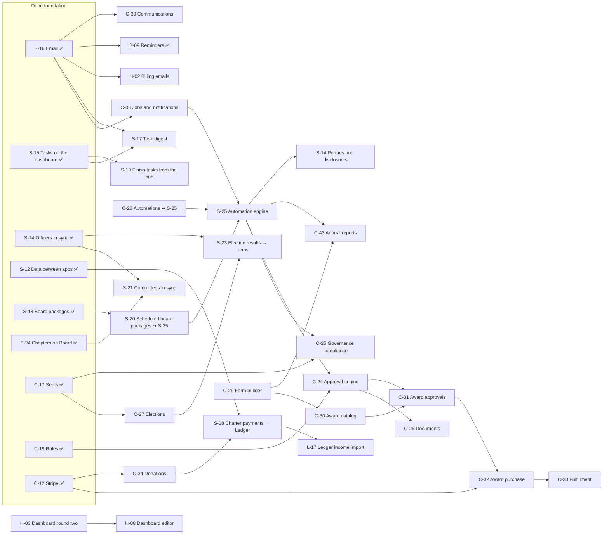

# OpenAppHub suite roadmap

One roadmap for the whole suite: every epic from every app, what's done, what's next, and what each one needs first. It replaces each app's `epic.md` and `roadmap.md` (kept for history in [`charter/`](charter/), [`board/`](board/), [`ledger/`](ledger/)).

Updated 2026-11-12. Architecture: [`architecture.md`](architecture.md). Tables: [`database-map.md`](database-map.md).

## How to read it

**Prefixes**

| Prefix | Scope                                     | Notes                                                                                   |
| ------ | ----------------------------------------- | --------------------------------------------------------------------------------------- |
| **S-** | Suite: work that spans apps or every repo | S-01 to S-26                                                                            |
| **H-** | OpenAppHub (the hub)                      | H-00 is the hub's finished foundation                                                   |
| **C-** | OpenCharterApp                            | Charter's old `E-NN` are now `C-NN` (same number); its future backlog `F-NN` is `C-FNN` |
| **B-** | OpenBoardApp                              | Unchanged numbers                                                                       |
| **L-** | OpenLedgerApp                             | Unchanged numbers                                                                       |

**Status:** ✅ done · 🟡 done with follow-ups · 🟠 partly built · ⬜ not started · ⏸ deferred · ➜ moved into another epic · ✖ retired.

**Order** (for what isn't done): **Now** (unblocks other work or closes a launch gap), **Next** (most visible value), **Later** (scoped, can wait), **Someday** (an idea worth keeping).

**Needs:** the epics that must be finished (or far enough along) first. "—" means nothing blocks it.

**Where things stand:** everything marked ✅ is on `staging`; `main` (production) gets it when the owner merges.

**Contents**

1. [What's next, in one view](#1-whats-next-in-one-view)
2. [Dependency map](#2-dependency-map)
3. [Suite (S-)](#3-suite-s-)
4. [OpenAppHub (H-)](#4-openapphub-h-)
5. [OpenCharterApp (C-)](#5-opencharterapp-c-)
6. [OpenBoardApp (B-)](#6-openboardapp-b-)
7. [OpenLedgerApp (L-)](#7-openledgerapp-l-)
8. [Owner actions](#8-owner-actions)
9. [Known issues](#9-known-issues)
10. [ID changes](#10-id-changes)

---

## 1. What's next, in one view

| Order   | Epic                                           | Why now                                                                                                | Needs                                       |
| ------- | ---------------------------------------------- | ------------------------------------------------------------------------------------------------------ | ------------------------------------------- |
| Now     | **H-01** Stripe test run                       | Billing can't go live without it                                                                       | Owner: legal entity and EIN for live prices |
| Now     | **H-05** Launch                                | Open sign-ups, Auth SMTP, plans page, license                                                          | H-01                                        |
| Now     | **S-22** Production smoke test                 | S-01 needs a person after every deploy today                                                           | —                                           |
| Now     | **L-10** People checks                         | A Ledger release gate                                                                                  | —                                           |
| Now     | **C-08 / S-25** Jobs and the automation engine | Part 1 done (catalog, settings, Board's reminders); next: move fixed schedules in, then event triggers | S-16 ✅                                     |
| Next    | **S-19** Finish a task from the hub            | Saves a trip into each app for simple tasks                                                            | S-15 ✅                                     |
| Next    | **S-18 / L-17** Charter payments into Ledger   | No retyping of dues; the demo already books them this way                                              | S-12 ✅                                     |
| Next    | **H-02** Billing and activity emails           | Preferences already saved                                                                              | S-16 ✅                                     |
| Next    | **C-25** Governance compliance                 | Vacancies and good standing into tasks; board reports                                                  | C-17 ✅, S-25                               |
| Next    | **C-27** Elections, then **S-23**              | Results start terms in Board                                                                           | C-17 ✅, S-14 ✅                            |
| Next    | **C-34** Donations                             | With S-18, gifts reach Ledger                                                                          | C-12 ✅                                     |
| Later   | **C-24 → C-29 → C-30…C-33** Awards             | Driven by the automation engine                                                                        | S-25, C-24, C-29                            |
| Someday | **H-08** Dashboard editor                      | People choose and arrange their dashboard                                                              | H-03                                        |

---

## 2. Dependency map

The relationships that decide the order. An arrow means "must come before".

> **Diagram description:** The finished foundation is S-16 (email), S-15 (tasks on the dashboard), S-14 (officers in sync), S-12 (data between apps), S-13 (board packages), S-24 (chapters on Board), and Charter's C-17 (seats), C-19 (rules) and C-12 (Stripe). Email leads to C-08 (jobs and notifications), which leads to the S-25 automation engine; email and the dashboard's tasks lead to S-17 (task digest); the dashboard's tasks lead to S-19 (finishing tasks from the hub); email also leads to H-02 (billing emails), B-09 (reminders, done) and C-39 (communications). Data between apps leads to S-18 (Charter payments into Ledger), then L-17 (Ledger's import). Board packages lead to S-20 (scheduled packages), which is folded into S-25. Officers in sync lead to S-21 (committees) and S-23 (election results into terms); C-17 (seats) leads to C-27 (elections), which also leads to S-23, and to C-25 (governance compliance), which also needs S-25. S-25 and C-19 (rules) lead to C-24 (the approval engine), which leads to C-26 (documents) and C-31 (award approvals). The form builder C-29 leads to C-30 (award catalog), C-31, C-32 (award purchase, also needing C-12) and C-33 (fulfillment), and to C-43 (annual reports, also needing S-25). C-12 leads to C-34 (donations), which feeds S-18. C-28 (Charter's automation expansion) is folded into S-25, and S-25 also leads to B-14 (policies and disclosures). H-03 (dashboard round two) leads to H-08 (dashboard editor). Chapters on Board lead to S-21.

---

## 3. Suite (S-)

### 3.1 Done

| ID   | Epic                                    | Status        | Notes                                                                                                                                                         |
| ---- | --------------------------------------- | ------------- | ------------------------------------------------------------------------------------------------------------------------------------------------------------- |
| S-01 | Production check                        | 🟡            | Each deploy needs a person to open every app on openapphub.org as a real organization; S-22 automates it                                                      |
| S-02 | Exposed schemas                         | ✅ 2026-11-11 | `charter`, `board`, `ledger` exposed on staging and production (owner)                                                                                        |
| S-03 | Integration views for the hub           | ✅            | `api_*` views in every app; `INTEGRATION.md` per app                                                                                                          |
| S-04 | Help links                              | ✅            | Per-page help maps to docs.openapphub.org                                                                                                                     |
| S-05 | Read-only when billing lapses           | ✅            | `isReadOnly`; write controls off; reading and export stay on                                                                                                  |
| S-06 | Export everything                       | ✅            | Every app exports all of its data, also while read-only                                                                                                       |
| S-07 | Old build tooling                       | ✅            | The old editor's leftovers removed (Ledger's AI PDF import off: L-01)                                                                                         |
| S-08 | Worker secrets                          | 🟡            | Service role key on every Worker that needs it; Resend and Stripe on the hub; **Charter's `GATEWAY_ENCRYPTION_KEY` for dues payments still to check** (owner) |
| S-09 | End-to-end tests                        | ✅            | Playwright on staging with the demo accounts, every pull request and daily                                                                                    |
| S-10 | Retire the old projects                 | ✅ 2026-11-12 | Owner                                                                                                                                                         |
| S-11 | One look across the suite               | ✅            | Shared AppShell, tokens and one logo family                                                                                                                   |
| S-12 | Data between apps (groundwork)          | ✅            | Views to read, invoker RPCs to change, trigger-only sync as the documented exception                                                                          |
| S-13 | Reports into a board package            | ✅            | Charter and Ledger reports → a Board meeting's packet (`add_report_to_meeting`)                                                                               |
| S-14 | Board members in sync (Charter ⇄ Board) | ✅            | Charter owns officers; both directions through each app's rules                                                                                               |
| S-15 | Tasks on the hub dashboard              | ✅            | Board action items, Charter tasks, Ledger recurring entries; the dashboard reads every app                                                                    |
| S-16 | Email                                   | ✅            | Core outbox; Resend (hosted, from the hub, every 5 minutes); SMTP (self-hosted, per app); unsubscribe; email choices                                          |
| S-24 | Chapters on OpenBoardApp                | ✅            | Off / approval / open; the chapter's own organization under the national's, covered by its plan; officers synced                                              |
| S-26 | One place for the suite's docs          | ✅ 2026-11-12 | Every internal doc in OpenAppHub `docs/`; suite architecture, database map, this roadmap                                                                      |

### 3.2 To do

| ID   | Epic                                             | What it means                                                                                                                                                                                                                                                                                                                                                                                                                                                                                                                                                                                                                                                                                                                                                                                                                                                                                                                                                                                                                                                                                                                                                                                                                                                                                                                                                                                                                                                                                                                                                                                         | Order                  | Needs                                    |
| ---- | ------------------------------------------------ | ----------------------------------------------------------------------------------------------------------------------------------------------------------------------------------------------------------------------------------------------------------------------------------------------------------------------------------------------------------------------------------------------------------------------------------------------------------------------------------------------------------------------------------------------------------------------------------------------------------------------------------------------------------------------------------------------------------------------------------------------------------------------------------------------------------------------------------------------------------------------------------------------------------------------------------------------------------------------------------------------------------------------------------------------------------------------------------------------------------------------------------------------------------------------------------------------------------------------------------------------------------------------------------------------------------------------------------------------------------------------------------------------------------------------------------------------------------------------------------------------------------------------------------------------------------------------------------------------------- | ---------------------- | ---------------------------------------- |
| S-17 | **Task digest, with each person's own settings** | One email with a person's open tasks and upcoming meetings from every app, grouped by organization. ✅ **Done (shared 1.10.0, core `0007_core_digest.sql`).** Each person chooses, in the Task summary section of their email settings (the hub's account page; each app's Email page): how often (off, daily, weekly), the day (weekly), the time and their time zone, which organizations (when they belong to several), and whether it includes open tasks, upcoming board meetings or both. Sent at about the chosen time (the `core.digest` email job runs every 15 minutes, once per local day); skipped when there's nothing open. What each person sees follows each app's rules: Board action items assigned to them; Charter tasks for owners, admins and people who manage the unit; Ledger recurring transactions due for owners, admins and treasurers; Board meetings in the next 7 days (daily: 2). Later: the schedule moves into the automation engine (S-25)                                                                                                                                                                                                                                                                                                                                                                                                                                                                                                                                                                                                                        | ✅ Done                | S-15 ✅, S-16 ✅                         |
| S-18 | Charter payments into Ledger                     | Charter offers `charter.api_payments` (dues, fees, donations, refunds); Ledger imports them with a category map per organization, booked as daily summaries into Stripe balance (net of fees) or Undeposited funds, with Friday payouts and Monday deposits, no duplicates, a link back to each payment. The demo already books this way                                                                                                                                                                                                                                                                                                                                                                                                                                                                                                                                                                                                                                                                                                                                                                                                                                                                                                                                                                                                                                                                                                                                                                                                                                                              | Next                   | S-12 ✅, L-17 (the Ledger side)          |
| S-19 | **Finish a task from the hub**                   | A "Done" button on the hub dashboard for tasks that **can** be completed with a click, through the owning app's `security invoker` RPC (SHARED-SPEC §3.6): a Board action item; skipping or posting a Ledger recurring entry. **Tasks that have to be physically done stay links** to where the work happens, because finishing them means doing the work: approving an award, approving a join request, reconciling a month's bank statement, filling a vacant seat, submitting an annual report. Each `api_tasks` row gets a `completable` flag (added at the end of the view) and the hub shows "Done" only where it's true                                                                                                                                                                                                                                                                                                                                                                                                                                                                                                                                                                                                                                                                                                                                                                                                                                                                                                                                                                        | Next                   | S-15 ✅                                  |
| S-20 | Scheduled board packages                         | ➜ **Moved into S-25.** A meeting asking for reports (Ledger's financial reports, Charter's membership report) a set number of days before is one automation among many that people should be able to change                                                                                                                                                                                                                                                                                                                                                                                                                                                                                                                                                                                                                                                                                                                                                                                                                                                                                                                                                                                                                                                                                                                                                                                                                                                                                                                                                                                           | —                      | ➜ S-25                                   |
| S-21 | Committees in sync                               | Extends S-14 from officers to committees and their members (Charter's board templates ⇄ Board's committees)                                                                                                                                                                                                                                                                                                                                                                                                                                                                                                                                                                                                                                                                                                                                                                                                                                                                                                                                                                                                                                                                                                                                                                                                                                                                                                                                                                                                                                                                                           | Later                  | S-14 ✅, S-24 ✅                         |
| S-22 | Production smoke test                            | A read-only Playwright run against production after each deploy, signed in as a dedicated check account, opening every app as a real organization                                                                                                                                                                                                                                                                                                                                                                                                                                                                                                                                                                                                                                                                                                                                                                                                                                                                                                                                                                                                                                                                                                                                                                                                                                                                                                                                                                                                                                                     | Now                    | — (owner: a check account on production) |
| S-23 | Election results into Board terms                | When Charter certifies an election (C-27), the winners' terms start in Board through the S-14 sync                                                                                                                                                                                                                                                                                                                                                                                                                                                                                                                                                                                                                                                                                                                                                                                                                                                                                                                                                                                                                                                                                                                                                                                                                                                                                                                                                                                                                                                                                                    | Later                  | C-27, S-14 ✅                            |
| S-25 | **Automation engine**                            | One engine for **every schedule and automation people may want to change**, instead of fixed jobs: **triggers** (a date or schedule, an event in any app: a payment, an appointment, a meeting scheduled, a task overdue), **conditions** (the rules engine, C-19), **actions** (send an email, create a task, start an approval, add reports to a meeting's packet, change a status). Organizations see and edit their automations (with sensible defaults switched on), and a history of what each one did. Built on the email outbox and `public.email_jobs` (S-16), generalized to an `automations` table, a job runner and per-app action RPCs. **Drives OpenCharterApp's award system** (routing, reminders, escalation to national, purchase and fulfillment steps: C-30…C-33), renewal reminders and lapse notices (C-13), governance alerts (C-25), annual reports (C-43), scheduled board packages (the former S-20), Board's reminders (B-09), policy reviews (B-14) and the task digest's schedule (S-17). Absorbs C-28. 🟡 **Part 1 done (shared 1.11.0, core `0008_core_automations.sql`, Board `0009`):** the catalog of kinds each app registers, each organization's choices over sensible defaults, the Automations panel (hub organization settings, Board's Email page), validation, and a history of what each did; **Board's meeting and action-item reminders are the first automations** (days before now configurable). Design and later parts (moving fixed schedules in, event triggers, conditions, more actions, awards): [`automation-engine.md`](automation-engine.md) | Now (parts 2–3) / Next | S-16 ✅, C-08, C-19 ✅                   |

---

## 4. OpenAppHub (H-)

### 4.1 Done

| ID   | Epic           | Status | Notes                                                                                                                                                                                                                                                                                                                                                                                                                                                                                                                                                                                  |
| ---- | -------------- | ------ | -------------------------------------------------------------------------------------------------------------------------------------------------------------------------------------------------------------------------------------------------------------------------------------------------------------------------------------------------------------------------------------------------------------------------------------------------------------------------------------------------------------------------------------------------------------------------------------- |
| H-00 | Hub foundation | ✅     | Scaffold and Worker config, security headers, CI, staging, migration runner; core SQL (`db/core` 0001–0006) and DB tests; sign-in (password, Google), sign-up, email confirmation, password reset; the design system; organizations, members, invitations with email, ownership, account and organization settings, account deletion, audit log; billing (Stripe Checkout, Customer Portal, webhooks, lookup-key prices, editor limits); the dashboard from every app (S-03, S-15); suite email (S-16); child organizations for chapters (S-24); staging demo tools and the suite demo |

### 4.2 To do

| ID   | Epic                        | What it means                                                                                                                                                                                                               | Order   | Needs                                            |
| ---- | --------------------------- | --------------------------------------------------------------------------------------------------------------------------------------------------------------------------------------------------------------------------- | ------- | ------------------------------------------------ |
| H-01 | Stripe test run             | Trial → checkout → renewal → failed payment → cancel → read-only → export, on staging (sandbox key set), then live prices in production                                                                                     | Now     | Owner: live prices need the legal entity and EIN |
| H-02 | Billing and activity emails | Trial ending, payment failed, plan changed; someone joined, left or changed roles (preferences already saved)                                                                                                               | Next    | S-16 ✅                                          |
| H-03 | Dashboard, round two        | Choose which panels show, a "This week" view across meetings and due dates, a default organization per person                                                                                                               | Next    | S-15 ✅                                          |
| H-04 | People across the apps      | One page: each person, their role in each app (core role and every app overlay), invitations                                                                                                                                | Next    | —                                                |
| H-05 | Launch                      | Open sign-ups (`VITE_SIGNUPS_OPEN` and the Supabase setting), custom SMTP for Supabase Auth, the published plans page, the license file in every repository                                                                 | Now     | H-01; owner decisions                            |
| H-06 | Generated database types    | `gen-types.yml`, so each app's `types.ts` is generated from the shared database (and Charter's `pending-schema.ts` empties)                                                                                                 | Later   | —                                                |
| H-07 | One terms step              | Hosted Ledger (and any app) skips its own terms screen when the hub already recorded acceptance                                                                                                                             | Later   | —                                                |
| H-08 | **Dashboard editor**        | **Far future.** People design their own dashboard: add, remove, resize and arrange panels; pick which apps, organizations and figures each panel shows; save layouts per organization; share a layout with the organization | Someday | H-03                                             |

---

## 5. OpenCharterApp (C-)

Charter's phases (from its original epic map): Phase 0 Foundation, 1 Membership MVP, 2 Chapters at scale, 3 Governance and documents, 4 Awards, 5 Donations and fundraising, 6 Events, 7 Corporate, 8 Communications and polish. Phases 3, 5 and 7 are independent of each other once Phase 2 is done; 4 and 5 can swap. Decisions behind each: [`charter/decisions.md`](charter/decisions.md).

### 5.1 Phases 0–2 (foundation, membership, chapters)

| ID   | Epic                                           | Status   | Needs       | Notes                                                                                                                                              |
| ---- | ---------------------------------------------- | -------- | ----------- | -------------------------------------------------------------------------------------------------------------------------------------------------- |
| C-01 | Project scaffolding and CI/CD                  | 🟡       | —           | CI, checks, end-to-end tests, performance budget, docs check; the coverage gate needs a dependency decision                                        |
| C-02 | ~~Deployment packaging~~                       | ✖        | —           | Moved to C-F11 (number retired)                                                                                                                    |
| C-03 | Identity and authentication                    | ✅       | —           | Hosted: through the hub                                                                                                                            |
| C-04 | Organization hierarchy and platform tier       | ✅       | —           | Units, settings, tax profile, branding with chapter override                                                                                       |
| C-05 | RBAC and permissions                           | ✅       | C-04        | Roles, permissions, downward inheritance                                                                                                           |
| C-06 | Audit log                                      | ✅       | —           |                                                                                                                                                    |
| C-07 | Host-based tenant resolution                   | ⏸        | C-04        | Per-org web addresses; RLS and isolation tests are done                                                                                            |
| C-08 | Jobs, email and notifications                  | 🟠       | S-16 ✅     | Email is done suite-wide (S-16); what's left (jobs for renewal reminders and lapse notices, signed-action links) becomes the first use of **S-25** |
| C-09 | Custom attribute system                        | ✅       | —           | Incl. ordered lists (rank)                                                                                                                         |
| C-10 | Setup engine + membership setup                | ✅       | C-09        | Rank and Branch offered only to 501(c)(19) organizations (2026-11-12)                                                                              |
| C-11 | Membership tiers and terms                     | ✅       | —           |                                                                                                                                                    |
| C-12 | Payment gateway and Stripe                     | 🟡       | —           | Live Stripe test-mode check open (owner)                                                                                                           |
| C-13 | Member signup and renewals                     | 🟡       | C-11, C-12  | Automatic lapse notices and reminders wait for **S-25**                                                                                            |
| C-14 | Member directory, lists, exports               | ✅       | C-13        | Checked at 20,000 members                                                                                                                          |
| C-15 | Basic automatic receipts                       | ✅       | C-12        | Tax-exempt wording setting; receipt PDF                                                                                                            |
| C-16 | Chapter creation wizard and chapter attributes | ✅       | C-04        | Web address made from the name, editable, checked as you type (2026-11-12)                                                                         |
| C-17 | Board role templates and appointments          | ✅       | C-05        | Synced with Board (S-14)                                                                                                                           |
| C-18 | Two-level dues and national controls           | ✅       | C-13, C-19  | Incl. national membership with a home chapter                                                                                                      |
| C-19 | Rules engine and attribute-based pricing       | ✅       | C-09        |                                                                                                                                                    |
| C-20 | Postpaid dues                                  | ⬜ Next  | C-13        | Balances, invoices, delinquency, parent orgs invoicing subordinates (national fee); chapters' local dues in the home-chapter model                 |
| C-21 | Per-org gateways and PayPal                    | 🟠 Later | C-12        | Stripe done; PayPal open                                                                                                                           |
| C-22 | Custom domains                                 | ⏸        | C-F11, C-07 | Needs the reverse proxy                                                                                                                            |
| C-23 | National roll-up reporting                     | ✅       | C-13        |                                                                                                                                                    |

### 5.2 Phase 3 (governance and documents)

| ID   | Epic                                            | Status   | Needs               | Notes                                                                                                                                                                     |
| ---- | ----------------------------------------------- | -------- | ------------------- | ------------------------------------------------------------------------------------------------------------------------------------------------------------------------- |
| C-24 | Approval workflow engine                        | ⬜ Next  | S-25, C-19 ✅       | Generic multi-step approvals, approver resolution, escalation, delegation, batch approval, signed links with a confirmation page; S-25 runs its reminders and escalations |
| C-25 | Governance compliance                           | 🟠 Next  | C-17 ✅, S-25       | Good standing and vacancy views exist; alerts into hub tasks (vacant seats already are); board reports go to Board (S-13)                                                 |
| C-26 | Document repository                             | ⬜ Later | C-24                | Or reuse Board's document library through an RPC                                                                                                                          |
| C-27 | Elections                                       | ⬜ Next  | C-17 ✅             | Then S-23                                                                                                                                                                 |
| C-28 | Automation engine expansion                     | ➜ S-25   | —                   | Folded into the suite automation engine                                                                                                                                   |
| C-43 | Annual chapter reports (optional, per national) | ⬜ Later | C-29, C-17 ✅, S-25 | The national builds the form; due dates and reminders through S-25                                                                                                        |

### 5.3 Phase 4 (awards), driven by the automation engine

| ID   | Epic                                | Status   | Needs         | Notes                                                                                                                                 |
| ---- | ----------------------------------- | -------- | ------------- | ------------------------------------------------------------------------------------------------------------------------------------- |
| C-29 | Form builder                        | ⬜ Later | C-09 ✅       | Reused by awards and annual reports                                                                                                   |
| C-30 | Award catalog and approval policies | ⬜ Later | C-29, S-25    | Families, prerequisites, criteria, tiered approval chains                                                                             |
| C-31 | Submission, routing, approvals      | ⬜ Later | C-30, C-24    | Routing by chapter/role/rank; escalation to national and reminders are S-25 automations; approving is a "physically done" task (S-19) |
| C-32 | Award purchase and payer            | ⬜ Later | C-31, C-12 ✅ | Purchase options modeled as products (future store)                                                                                   |
| C-33 | Award fulfillment tracking          | ⬜ Later | C-32          | Status changes and notices as S-25 automations                                                                                        |

### 5.4 Phases 5–8

| ID   | Epic                                                    | Status   | Needs         | Notes                                                                                                    |
| ---- | ------------------------------------------------------- | -------- | ------------- | -------------------------------------------------------------------------------------------------------- |
| C-34 | Donations                                               | ⬜ Next  | C-12 ✅       | Gifts reach Ledger through S-18                                                                          |
| C-35 | Fundraising                                             | ⬜ Later | C-34          | Campaigns, peer-to-peer, sponsorships                                                                    |
| C-36 | Receipt templates, manual receipts, year-end statements | ⬜ Later | C-15 ✅, C-34 |                                                                                                          |
| C-37 | Events and registration                                 | ⬜ Later | C-12 ✅       |                                                                                                          |
| C-38 | Corporate memberships                                   | ⬜ Later | C-13 ✅       |                                                                                                          |
| C-39 | Communications                                          | ⬜ Next  | S-16 ✅       | Segmented email to members; scheduled ones through S-25                                                  |
| C-40 | Public sites and widgets                                | ⬜ Later | —             |                                                                                                          |
| C-41 | Accounting export                                       | ⬜ Later | —             | Partly superseded by S-18 for suite customers                                                            |
| C-42 | Hosted-service billing and tenant management            | ➜ H-00   | —             | The hub does suite billing; usage metering per unit (`api_unit_count`) is ready if pricing ever needs it |

### 5.5 Future backlog (scoped, not scheduled)

| ID    | Item                                                                 | Needs         |
| ----- | -------------------------------------------------------------------- | ------------- |
| C-F01 | Generic store (merchandise, add-ons)                                 | C-32          |
| C-F02 | Vendor and inventory tracking                                        | C-33          |
| C-F03 | Delegate-based national elections                                    | C-27          |
| C-F04 | Regional tier features and regional award approvals                  | C-24          |
| C-F05 | Reply-by-email approvals                                             | C-24, S-16 ✅ |
| C-F06 | Virus scanning for uploads                                           | C-26          |
| C-F07 | PayPal national-fee mechanism                                        | C-20, C-21    |
| C-F08 | Tool-specific accounting export formats                              | C-41          |
| C-F09 | Internationalization and multi-currency                              | —             |
| C-F10 | Mobile app or PWA enhancements                                       | —             |
| C-F11 | Deployment packaging (Docker image + Compose, app + hosted Supabase) | —             |

---

## 6. OpenBoardApp (B-)

| ID   | Epic                                                   | Status | Order | Needs   | Notes                                                                                                                                                                                                                                                                                                                |
| ---- | ------------------------------------------------------ | ------ | ----- | ------- | -------------------------------------------------------------------------------------------------------------------------------------------------------------------------------------------------------------------------------------------------------------------------------------------------------------------- |
| B-01 | Foundation: sign-in, organizations, roles, invitations | ✅     | —     | —       | On the OpenAppHub core                                                                                                                                                                                                                                                                                               |
| B-02 | Governance: roster, officers, terms, committees        | ✅     | —     | —       | Terms synced with Charter (S-14)                                                                                                                                                                                                                                                                                     |
| B-03 | Meetings, agenda, attendance, notes, motions, minutes  | ✅     | —     | —       |                                                                                                                                                                                                                                                                                                                      |
| B-04 | Documents, board packet PDF, minutes PDF, letterhead   | ✅     | —     | —       | Reports from Charter and Ledger arrive here (S-13)                                                                                                                                                                                                                                                                   |
| B-05 | Action items                                           | ✅     | —     | —       | On the hub dashboard (S-15)                                                                                                                                                                                                                                                                                          |
| B-06 | Meeting templates                                      | ✅     | —     | —       |                                                                                                                                                                                                                                                                                                                      |
| B-07 | Live member voting and the meeting dashboard           | ✅     | —     | —       | Frozen electorate, recusal, live quorum                                                                                                                                                                                                                                                                              |
| B-08 | Audit log and exports                                  | ✅     | —     | —       | Full board record zip                                                                                                                                                                                                                                                                                                |
| B-09 | Reminders                                              | ✅     | —     | S-16 ✅ | 7 days and 1 day before a meeting; action items due and overdue. Becomes configurable with S-25                                                                                                                                                                                                                      |
| B-10 | Backup restore drill                                   | ⬜     | Next  | —       | A tested restore of an export                                                                                                                                                                                                                                                                                        |
| B-11 | Atomic multi-step changes                              | ✅     | Done  | —       | Board `0008_atomic_changes.sql`: a meeting and its agenda (`board.create_meeting_with_agenda`), handing a role over (`board.assign_term`), a document and its first version (`board.add_document`) are one database call each; a file whose record fails is removed again (documents, versions, packets, letterhead) |
| B-12 | Calendar feed                                          | ⬜     | Next  | —       | A private iCal link per person                                                                                                                                                                                                                                                                                       |
| B-13 | Consent agenda and sign-off                            | ⬜     | Next  | —       | A consent agenda voted once; the secretary's sign-off on approved minutes                                                                                                                                                                                                                                            |
| B-14 | Policies and annual forms                              | ⬜     | Later | S-25    | A policy library with review dates; yearly conflict-of-interest disclosures; both feed tasks                                                                                                                                                                                                                         |
| B-15 | Remove the sign-in page's demo button                  | ⬜     | Later | —       | The hub's staging demo buttons replace it                                                                                                                                                                                                                                                                            |

---

## 7. OpenLedgerApp (L-)

Released versions: v0.0.1 – v0.1.1 (2026-10-28): safety and controls, concurrency and periods, everyday use (templates and recurring drafts, search, fund and project budgets, board package, first-run checklist, tutorial, diagnostics). Details: OpenLedgerApp's `CHANGELOG.md`, history: [`ledger/roadmap.md`](ledger/roadmap.md).

| ID   | Epic                                            | Status        | Order   | Needs      | Notes                                                                                                                         |
| ---- | ----------------------------------------------- | ------------- | ------- | ---------- | ----------------------------------------------------------------------------------------------------------------------------- |
| L-01 | AI PDF import off                               | ✅ 2026-11-11 | —       | —          | Removed with the old tooling (S-07)                                                                                           |
| L-10 | People checks                                   | ⬜            | Now     | —          | A screen-reader pass by a person; the password reset email checked by hand                                                    |
| L-11 | Desktop parity                                  | ⬜            | Later   | L-14       | History, exports, backups and bank import on desktop                                                                          |
| L-12 | Hardening                                       | ⬜            | Later   | —          | Self-hosted installer, upgrade tests, cross-version restore, user testing with non-accountants, disclosure policy             |
| L-13 | v1.0 gates                                      | ⬜            | Later   | L-10, L-12 | Accounting correctness, security tests, real-statement import, backup recovery, install and upgrade, usability, support pages |
| L-14 | Budgets, exports and history behind the ports   | ⬜            | Later   | —          | For desktop                                                                                                                   |
| L-15 | Wording: terminology note, currency rules, undo | ⬜            | Later   | —          |                                                                                                                               |
| L-16 | Later, not scheduled                            | ⏸             | Someday | —          | Desktop sync, accrual basis, A/R and A/P, invoices and bills, bank feeds                                                      |
| L-17 | Charter income import                           | ⬜            | Next    | S-18       | The Ledger side of S-18: category map, matching, an import log                                                                |
| L-18 | Fund accounting                                 | ⬜            | Next    | —          | Funds are tags today; restricted and unrestricted balances, releases from restriction, a statement by fund                    |
| L-19 | Budget vs. actual summary                       | ⬜            | Next    | —          | `ledger.api_budget_summary` for the hub's money panel and the board package                                                   |
| L-20 | Receipt attachments                             | ⬜            | Later   | —          | Pulled forward from L-16                                                                                                      |
| L-21 | Demo: tutorial marked done                      | ⬜            | Later   | —          | The "Getting started" tutorial opens for the demo account on every visit                                                      |

---

## 8. Owner actions

| Action                                                                                 | Unblocks              |
| -------------------------------------------------------------------------------------- | --------------------- |
| Legal entity and EIN, then live prices (lookup keys) and the customer portal in Stripe | H-01, H-05            |
| Charter's `GATEWAY_ENCRYPTION_KEY` on production and previews                          | S-08, dues payments   |
| Run Migrate on staging after each merge: Charter, Ledger, Board (hub is automatic)     | Everything on staging |
| A production check account for the smoke test                                          | S-22                  |
| License files                                                                          | H-05                  |
| Custom SMTP in Supabase Auth (Resend offers SMTP)                                      | H-05                  |
| Decide the coverage gate dependency                                                    | C-01                  |

## 9. Known issues

- Charter's demo seed numbers and Board/Ledger demo details are rebuilt every 12 hours; screenshots taken between resets drift (by design: dates roll).
- Ledger's own "Before you continue" terms step shows for hosted users the hub already asked (H-07).
- Board's sign-in page still has its "Explore the demo board" button (B-15).

## 10. ID changes

| Old                                                         | New                                                  |
| ----------------------------------------------------------- | ---------------------------------------------------- |
| Charter `E-01` … `E-43`                                     | `C-01` … `C-43` (same numbers; `E-02` stays retired) |
| Charter `F-01` … `F-11`                                     | `C-F01` … `C-F11`                                    |
| Charter `E-28` Automation engine expansion                  | Folded into `S-25`                                   |
| Charter `E-42` Hosted-service billing                       | Done by the hub (`H-00`)                             |
| `S-20` Board package on a schedule                          | Folded into `S-25`                                   |
| Hub "dashboard editor" (new)                                | `H-08`                                               |
| Charter's and Board's and Ledger's own `S-01` … `S-15` rows | This roadmap's §3 (one copy)                         |
