# OpenAppHub suite architecture

The whole suite in one document: what runs where, how the four apps share one database and one sign-in, how data moves between them, and how billing, email, chapters, the demo and deploys work. It expands OpenCharterApp's architecture map (now [`charter/architecture.md`](charter/architecture.md)) to the suite, and links to each app's own architecture document for the inside of that app.

Current as of 2026-11-12 (staging: shared code 1.9.1, core `0001`–`0006`).

Related: [`database-map.md`](database-map.md) (every table and how they connect), [`ROADMAP.md`](ROADMAP.md) (what's next), [`SHARED-SPEC.md`](SHARED-SPEC.md) (the contract every repo follows), [`README.md`](README.md) (where every document is).

**Contents**

1. [The suite at a glance](#1-the-suite-at-a-glance)
2. [Repositories](#2-repositories)
3. [Runtime and hosting](#3-runtime-and-hosting)
4. [Two modes: hosted and self-hosted](#4-two-modes-hosted-and-self-hosted)
5. [Identity, sign-in and sessions](#5-identity-sign-in-and-sessions)
6. [Organizations, roles and the Charter tree](#6-organizations-roles-and-the-charter-tree)
7. [The database](#7-the-database)
8. [Shared code](#8-shared-code)
9. [Data between apps](#9-data-between-apps)
10. [The hub dashboard](#10-the-hub-dashboard)
11. [Billing](#11-billing)
12. [Payments inside the apps (Charter dues)](#12-payments-inside-the-apps-charter-dues)
13. [Email](#13-email)
14. [Chapters on OpenBoardApp](#14-chapters-on-openboardapp)
15. [Inside each app](#15-inside-each-app)
16. [Security](#16-security)
17. [Demo and seed data](#17-demo-and-seed-data)
18. [Branches, CI and deploys](#18-branches-ci-and-deploys)
19. [Testing](#19-testing)
20. [Future architecture](#20-future-architecture)
21. [Glossary](#21-glossary)

---

## 1. The suite at a glance

OpenAppHub is a suite of open-source apps for nonprofits and associations. The hub is the front door: one account, one organization, one bill. The apps do the work:

| App                      | Domain                   | What it's for                                                                                                                       |
| ------------------------ | ------------------------ | ----------------------------------------------------------------------------------------------------------------------------------- |
| **OpenAppHub** (the hub) | `openapphub.org`         | Sign-up and sign-in, organizations, people and invitations, ownership, billing, the dashboard, email for the suite                  |
| **OpenCharterApp**       | `charter.openapphub.org` | Members, dues and receipts, chapters and regions, board seats and officers, guided setup                                            |
| **OpenBoardApp**         | `board.openapphub.org`   | Board roster and terms, meetings, agendas, live votes, minutes, documents and packets, action items                                 |
| **OpenLedgerApp**        | `ledger.openapphub.org`  | Double-entry books, funds and projects, budgets, bank import and statement checks, reports, year-end close (also a desktop edition) |
| Docs site                | `docs.openapphub.org`    | User guides for every app (static, no database)                                                                                     |

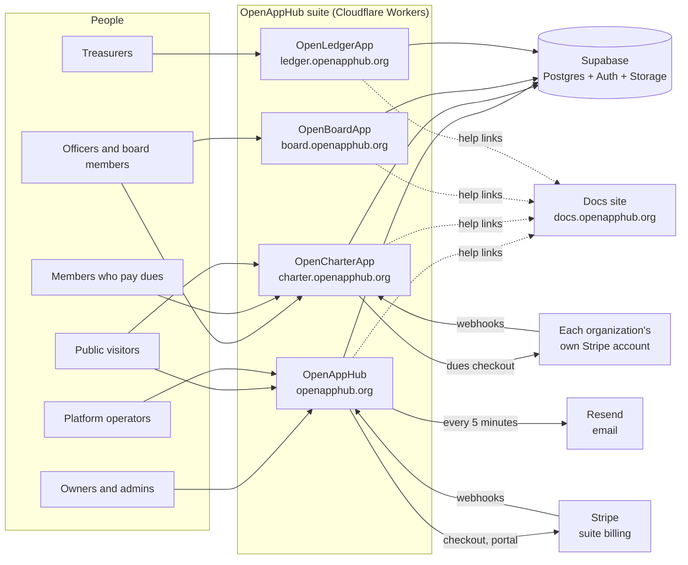

> **Diagram description:** People on the left (owners and admins, officers and board members, treasurers, members who pay dues, public visitors, platform operators) use the four apps in the middle, all Cloudflare Workers. Every app reads and writes one Supabase project (Postgres, Auth and Storage). The hub talks to Stripe for the suite's own billing and gets Stripe webhooks back; Charter talks to each organization's own Stripe account for dues and gets that account's webhooks. The hub sends the suite's email through Resend every five minutes. Every app links to the docs site for help.

**The three rules that shape everything:**

1. **One organization id.** `public.organizations.id` is the organization in every app. Every app table that holds an organization's data has `org_id` referencing it.
2. **Logic lives in the core; screens live where the mode says.** Organization creation, invitations, ownership and the member directory are core database functions (`db/core`). Hosted, the hub provides the screens; self-hosted, each app provides its own. Both call the same functions.
3. **Each app stays standalone.** Every app runs on its own database when self-hosted. It never depends on the hub's `hub` or `billing` schemas or on another app's schema; integrations are feature-detected and simply disappear when the other side isn't there.

---

## 2. Repositories

| Repository                | Package manager | Contents                                                                                                     |
| ------------------------- | --------------- | ------------------------------------------------------------------------------------------------------------ |
| `Nox-Mob/OpenAppHub`      | npm             | The hub app; the canonical `shared/` code and `db/core`; the suite's internal docs (this folder); demo reset |
| `Nox-Mob/OpenCharterApp`  | Bun             | Charter app, schema `charter`                                                                                |
| `Nox-Mob/OpenBoardApp`    | npm             | Board app, schema `board`                                                                                    |
| `Nox-Mob/OpenLedgerApp`   | npm             | Ledger app, schema `ledger`; Tauri desktop shell                                                             |
| `Nox-Mob/OpenAppHub-docs` | npm             | The user-guide site (Astro Starlight)                                                                        |

Every app repo has the same layout (SHARED-SPEC §2.1):

```
/src/...                 app source (TanStack Start routes, components, lib)
/server/email-cron.ts    Nitro plugin: the self-hosted email sender (apps only)
/db/core/                vendored core SQL (read-only; from OpenAppHub)
/db/migrations/          the app's own schema, NNNN_description.sql
/db/seed/                staging demo data (applied only with --seed)
/db/tests/               SQL tests for row security and rules
/scripts/migrate.mjs     vendored migration runner
/shared/                 vendored shared code (read-only; from OpenAppHub)
/docs/SHARED-SPEC.md     the suite contract (vendored); docs/README.md points here
/AGENTS.md               rules for contributors and AI assistants
/wrangler.jsonc          Worker config: production at the top level, env.staging
```

---

## 3. Runtime and hosting

### 3.1 Stack

| Layer         | Choice                                                                             | Notes                                                                                      |
| ------------- | ---------------------------------------------------------------------------------- | ------------------------------------------------------------------------------------------ |
| UI            | React 19, TanStack Router, TanStack Query, Tailwind v4, shadcn/ui-style components | Shared shell and design tokens in `shared/`                                                |
| Server        | TanStack Start (SSR), server functions and server routes                           | Runs inside the Worker; no Supabase Edge Functions                                         |
| Hosting       | Cloudflare Workers                                                                 | The hub uses `@cloudflare/vite-plugin`; apps build with Nitro's `cloudflare-module` preset |
| Database      | Supabase Postgres 15+ with row-level security                                      | One project for production, one for staging                                                |
| Auth          | Supabase Auth (email + password, Google)                                           | One account for the suite                                                                  |
| Files         | Supabase Storage, private buckets, signed URLs                                     | Buckets prefixed by app (`board-files`, `charter-branding`)                                |
| Suite billing | Stripe Checkout, Customer Portal, webhooks                                         | Hub only                                                                                   |
| Dues          | Each organization's own Stripe account                                             | Charter only                                                                               |
| Email         | Resend (hosted, from the hub); any SMTP server (self-hosted, from each app)        | `shared/email`                                                                             |
| Desktop       | Tauri + SQLite (Ledger Solo)                                                       | Local file, no account                                                                     |

### 3.2 Deployment topology

```mermaid
flowchart TB
    subgraph CF["Cloudflare"]
        direction TB
        subgraph PROD["Production Workers (deploy on main)"]
            WH[openapphub<br/>openapphub.org<br/>cron */5]
            WC[opencharterapp<br/>charter.openapphub.org]
            WB[openboardapp<br/>board.openapphub.org]
            WL[openledgerapp<br/>ledger.openapphub.org]
        end
        subgraph STG["Staging"]
            SH[openapphub-staging<br/>staging.openapphub.org<br/>cron */5]
            SC[Charter preview of branch staging<br/>staging.charter.staging.openapphub.org]
            SBD[Board preview of branch staging<br/>staging.board.staging.openapphub.org]
            SL[Ledger preview of branch staging<br/>staging.ledger.staging.openapphub.org]
            PV[Any other branch<br/>branch.app.staging.openapphub.org]
        end
    end
    subgraph SUPA["Supabase"]
        P[(openapphub-prod)]
        S[(openapphub-staging)]
    end
    subgraph GH["GitHub Actions"]
        CI[ci.yml / e2e.yml<br/>PRs and pushes to staging]
        MIG[migrate.yml<br/>owner runs: staging or production]
        STY["staging.yml (hub)<br/>push to staging: migrate + seed"]
        DR["demo-reset.yml (hub)<br/>05:17 and 17:17 UTC"]
    end
    PROD --> P
    STG --> S
    MIG --> P
    MIG --> S
    STY --> S
    DR --> S
    RES[Resend]
    WH --> RES
    SH --> RES
```

> **Diagram description:** Cloudflare hosts four production Workers, one per app, deployed when `main` changes; the hub's Worker also runs a cron every five minutes. Staging is the hub's separate `openapphub-staging` Worker plus each app's Worker preview of branch `staging`; any other branch gets its own preview address. Production Workers use the `openapphub-prod` Supabase project, staging uses `openapphub-staging`. GitHub Actions runs CI on pull requests and pushes to staging; the owner runs `migrate.yml` against staging or production; the hub's `staging.yml` migrates and seeds staging on every push to `staging`; `demo-reset.yml` resets the demo twice a day. Both hub Workers send email through Resend.

### 3.3 Domains

|         | Production               | Staging                                  |
| ------- | ------------------------ | ---------------------------------------- |
| Hub     | `openapphub.org`         | `staging.openapphub.org`                 |
| Charter | `charter.openapphub.org` | `staging.charter.staging.openapphub.org` |
| Board   | `board.openapphub.org`   | `staging.board.staging.openapphub.org`   |
| Ledger  | `ledger.openapphub.org`  | `staging.ledger.staging.openapphub.org`  |
| Docs    | `docs.openapphub.org`    | —                                        |

A preview of any other branch is `<branch>.<app>.staging.openapphub.org`. The hub on staging accepts sign-in returns to those (`VITE_PREVIEW_DOMAINS`).

### 3.4 Configuration

- **Public settings** are Worker `vars` in `wrangler.jsonc` (top level = production, `env.staging`, `env.development`). Anything named `VITE_*` is also compiled into the browser bundle and is public.
- **Secrets** are Worker secrets set in Cloudflare, never in the repository: `SUPABASE_SERVICE_ROLE_KEY`, `STRIPE_SECRET_KEY`, `STRIPE_WEBHOOK_SECRET`, `RESEND_API_KEY` (hub); Charter's gateway encryption key; Ledger's backup signing seed; `SMTP_PASSWORD` (self-hosters). Where each one stands: [`SECRETS.md`](SECRETS.md).
- **Key settings:** `VITE_HOSTED`, `VITE_APP_ID`, `VITE_SUPABASE_URL`, `VITE_SUPABASE_PUBLISHABLE_KEY`, `VITE_HUB_URL`, `VITE_COOKIE_DOMAIN` (`.openapphub.org` in production, `.staging.openapphub.org` on staging and previews), `VITE_SUITE_URLS` (JSON of every app's origin), `VITE_DOCS_URL`, `VITE_SIGNUPS_OPEN`, `VITE_DEMO_LOGIN` (staging), `EMAIL_FROM`.

### 3.5 Inside a Worker request

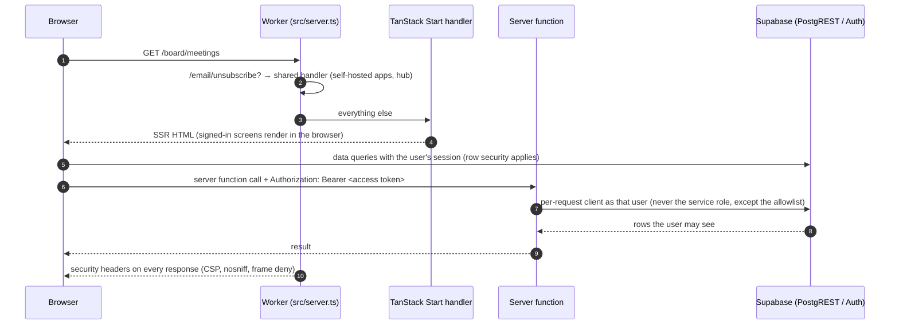

> **Diagram description:** The browser asks the Worker for a page. The Worker's entry (`src/server.ts`) serves `/email/unsubscribe` itself and passes everything else to TanStack Start, which renders the page. Signed-in screens then query Supabase directly with the user's session, so row-level security decides what they see. Server functions receive the user's access token and create a per-request Supabase client as that user; only an allowlisted few use the service role. Every response gets the security headers.

---

## 4. Two modes: hosted and self-hosted

Every app, the hub included, builds in one of two modes, chosen by `VITE_HOSTED`. Self-hosting code is never deleted to make hosted mode work: it is gated by the flag.

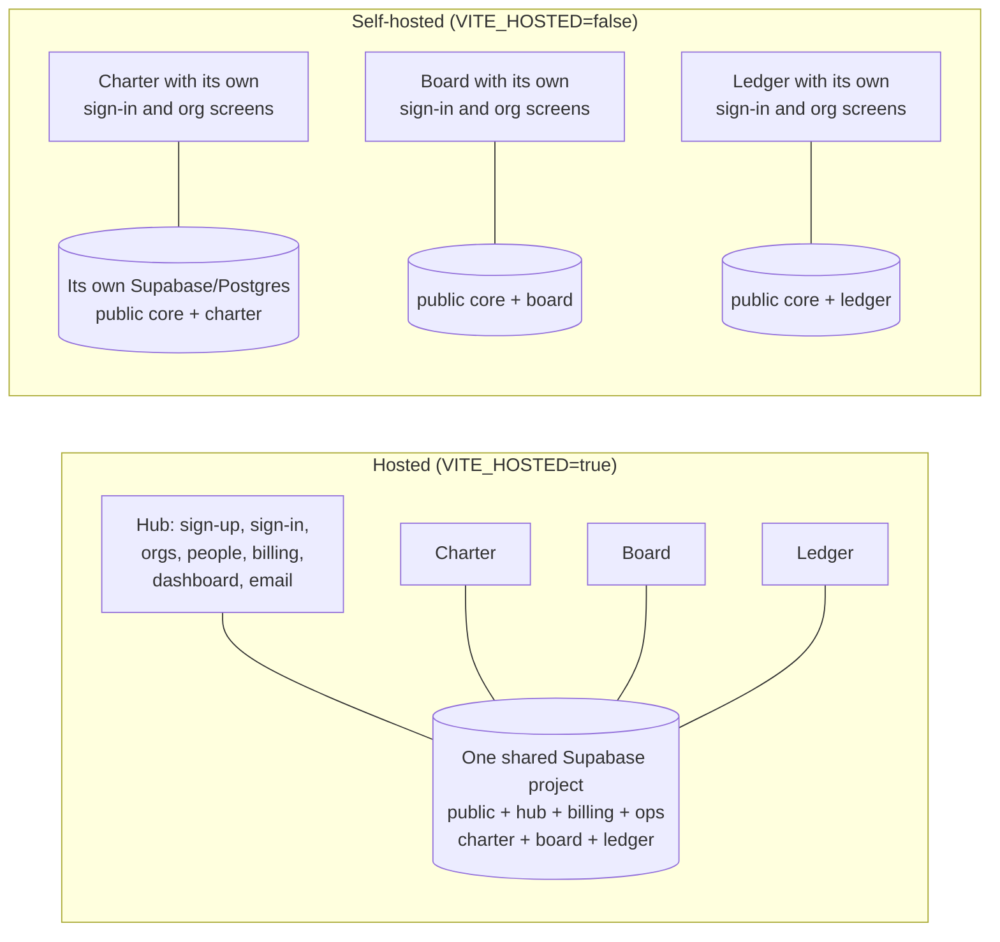

> **Diagram description:** Hosted, the hub provides sign-up, sign-in, organizations, people, billing, the dashboard and email, and all four apps share one Supabase project with every schema. Self-hosted, each app runs alone with its own sign-in and organization screens on its own database, which holds the core (`public`) plus that app's schema only.

|                                                        | Hosted                                                                | Self-hosted                                                                                       |
| ------------------------------------------------------ | --------------------------------------------------------------------- | ------------------------------------------------------------------------------------------------- |
| Landing page                                           | Out of routing; `/` goes to the app                                   | Kept                                                                                              |
| Sign-up and sign-in                                    | The hub (`/login?next=…`)                                             | The app's own screens                                                                             |
| Organizations, people, invitations, ownership          | The hub, through core functions                                       | The app's own screens, through the same core functions                                            |
| Billing                                                | Enforced in the database (`instance_settings.billing_enabled = true`) | Off: always writable                                                                              |
| App switcher                                           | Shown                                                                 | Hidden unless `VITE_SUITE_URLS` is set                                                            |
| Email                                                  | The hub sends everyone's, through Resend                              | Each app sends its own, through the SMTP server its owner enters (or `SMTP_*` / `RESEND_API_KEY`) |
| Integrations (dashboard, board packages, officer sync) | Work: every schema is in one database                                 | Hidden or skipped: the other schema isn't there (feature detection)                               |

A self-hosted database can hold more than one app (they share the core); integrations then work there too.

---

## 5. Identity, sign-in and sessions

- **One Supabase Auth** for the suite. A person signs up once, at the hub.
- **Shared session:** `shared/supabase/client.ts` stores the session in cookies on `.openapphub.org` (hosted), so one sign-in covers every app. Staging and branch previews use `.staging.openapphub.org` instead, so their cookies (the session, and `oah_org`, `oah_theme`, `oah_consent`, whose names are the same in both) never reach production. Signing out anywhere signs out everywhere.
- **Current organization:** the `oah_org` cookie on the parent domain, always re-checked against the person's memberships; a link from the hub can set it with `?org=<id>` (`takeOrgFromUrl`).
- **Legal acceptance:** the hub records Terms and Privacy acceptance (`hub.legal_acceptances`); self-hosted Ledger keeps its own (`ledger.legal_acceptances`).

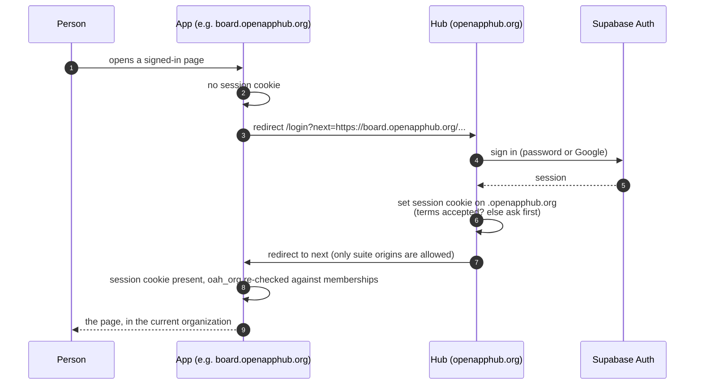

> **Diagram description:** A person opens a signed-in page of an app without a session. The app sends them to the hub's login with a `next` address. The hub signs them in through Supabase Auth, sets the session cookie on the parent domain (asking for the Terms first if needed) and sends them back, but only to a suite address. The app now sees the session, checks the current-organization cookie against their memberships and shows the page.

**Invitations** are one implementation (`public.invitations` and core functions): only the SHA-256 hash of the token is stored, default expiry 14 days. Hosted, the hub sends the invitation email; an invitation can carry an `app` and `app_payload`, finished by that app's `/invite/<token>` page and its `<app>.on_invitation_accepted` function (Charter links a roster record, Board sets an office, Ledger sets the treasurer role).

**Charter members who pay dues are not core members** (they'd count toward plan limits): they sign up at the hub, and Charter gives them portal access through its own tables (`charter.member_profiles.user_id`, `charter.is_portal_member`).

---

## 6. Organizations, roles and the Charter tree

### 6.1 Roles: OpenAppHub, each app, named roles

Since H-09 (core `0011_core_named_roles.sql`, owner decision 2026-11-12) the OpenAppHub role and each app's role are **separate**:

| OpenAppHub role (`public.memberships.role`) | Can, in OpenAppHub only                                                                             |
| ------------------------------------------- | --------------------------------------------------------------------------------------------------- |
| `owner`                                     | Everything, in OpenAppHub and every app; exactly one per organization; transfers ownership          |
| `admin`                                     | People, invitations, named roles, billing and organization settings. **Not an app admin by itself** |
| `member`                                    | The dashboard and their tasks                                                                       |
| `viewer`                                    | The dashboard                                                                                       |

**A person's role in an app** (`public.app_role(org, app, user)`), in order:

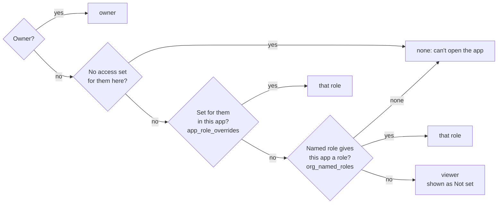

> **Diagram description:** The owner is the owner in every app. Otherwise No access set for the person (`app_role_overrides.no_access`) keeps them out of that app; otherwise a role set for the person in that app wins; otherwise their named role's role for that app (which may be "none", No access); otherwise viewer, which OpenAppHub shows as "Not set: viewer". `public.app_role_source` says which of these applied; `public.org_app_roles(org)` lists everyone's role in every app with its source.

- **Named roles** (`public.org_named_roles`): a name (e.g. Treasurer), a role per app (`app_roles`: admin, member or viewer) and extra permissions per app (`permissions`), from the permissions each app registers in `public.app_permission_types` (`public.register_app_permission`). One per person (`memberships.named_role_id`). `public.has_app_permission(org, app, key)`: app admins have every permission in their app; otherwise the named role grants it.
- **Invitations** carry a named role and/or each app's role (`invitations.named_role_id`, `app_roles`; `public.set_invitation_roles` right after `create_invitation`). An invitation made in an app (Board, Ledger) makes the person an OpenAppHub member with the chosen role in that app only.
- **No access** (core 0015): `app_role()` is null and `public.can_open_app(org, app, user)` is false. The app isn't on their dashboard, the app lists no organization for them (`my_app_memberships`), and each app's read gate (`board.readable_org_ids`, `ledger.can_read`/`readable_org_ids`, `charter.has_permission`/`permitted_units`) keeps them out. They stay in the organization and keep their roles in other apps. Invitations can't give No access (a person invited with no app wouldn't be invited). In OpenCharterApp, a person who is also a member keeps their own member page (their membership and renewals) — those come from being a member, not from a staff role.
- **Who changes roles:** the owner and OpenAppHub admins (`save_named_role`, `delete_named_role`, `set_named_role`, `set_app_role`, `set_app_access`), on the hub's Members page or an app's members page. If the organization turns on **App admins may change people's roles in their own app** (`public.org_role_settings.app_admins_manage_roles`, off by default; Settings → Roles in the apps), an app's admins may also use `set_app_role` and `set_app_access` for that app only (`public._require_app_role_manager`). Never for the owner, never their own access, and never named roles or OpenAppHub roles.
- **Plan limits** count editors with `public.is_org_editor`: the owner, OpenAppHub admins, and anyone who is a member or admin in at least one app (hub `0006_editors_per_app.sql`). Chapters' own organizations never count.
- **The day it shipped:** everyone's role in each app was copied from their OpenAppHub role into `app_role_overrides` once, so nobody's access changed.

Apps add their own roles on top, in their own schemas:

| App     | Overlay                                                                                                                                     | Rule                                                                                                                                         |
| ------- | ------------------------------------------------------------------------------------------------------------------------------------------- | -------------------------------------------------------------------------------------------------------------------------------------------- |
| Charter | `charter.roles`, `permissions`, `role_permissions`, `role_assignments` (custom roles, permission keys, inherited downward through the tree) | Write = `can_write(org, 'charter')` **and** the Charter permission on that unit, from a unit role **or** the named role (whole organization) |
| Board   | `board.officers (org_id, user_id, office)`: chair, secretary, treasurer (needs a member or admin role in Board)                             | Edit records = `can_write(org, 'board')` and (Board admin, chair/secretary, or the `board.edit_records` permission)                          |
| Ledger  | `ledger.member_roles (org_id, user_id, role)`: treasurer (needs a member or admin role in Ledger)                                           | Close books = `can_write(org, 'ledger')` and (Ledger admin, treasurer, or the `ledger.close_books` permission)                               |

A role given inside OpenCharterApp no longer raises the OpenAppHub role: someone new becomes an OpenAppHub member, with the Charter role their assignment needs.

`public.can_write(org, app)` = the person's role **in that app** is an editor role **and** `public.has_app_access(org, app)` (billing, §11). Every app's write policies call it, so a lapsed plan makes every app read-only in the database, not just on screen.

**Workflows run as the organization** (owner decision 2026-11-12): a workflow's steps act with the organization's access, not the access of the person who built it, so being able to build workflows (owners, OpenAppHub admins, and people granted it) reaches every app's data through a workflow. The hub says so wherever that's granted.

### 6.2 Charter's tree inside one organization

The top of a Charter tree (a national, or a standalone association) is one `public.organizations` row: the customer that's billed, and the organization Board and Ledger work with. Regions and chapters are `charter.units` under it:

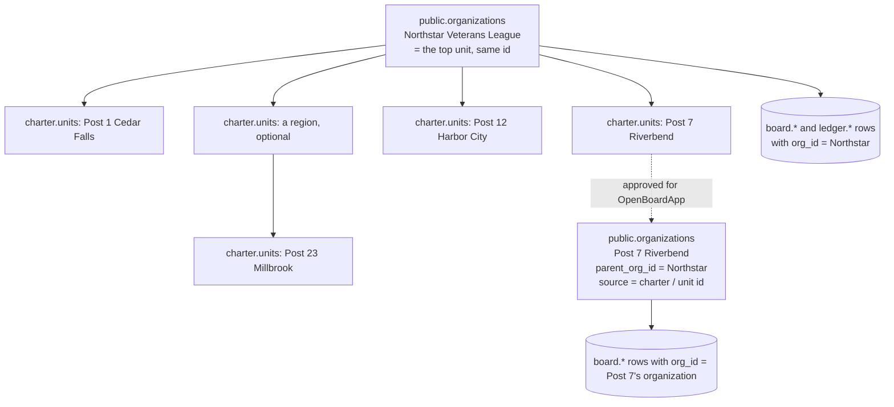

> **Diagram description:** The national is one organization row, and in Charter it is also the top unit with the same id. Posts (chapters) and optional regions are Charter units under it. Board and Ledger data for the national use the national's organization id. When the national approves OpenBoardApp for Post 7, Post 7 gets its own organization row with `parent_org_id` pointing to the national and a source link to its Charter unit, and Post 7's board data uses that new organization id.

- Every Charter table has `org_id` (the customer) and, where it belongs to a chapter or region, `unit_id → charter.units`. `ancestor_ids` (kept by trigger) makes "this unit and everything below" cheap.
- **Permissions and settings flow downward** (`charter.effective_setting` resolves inherit / override / locked up the tree); visibility flows upward only where shared.
- **Membership model**, chosen once per national (locked): _separate memberships_ per unit (two-level dues optional), or _national membership with a home chapter_ (one membership at the national; the chapter gets a member record pointing to it).
- **Child organizations** (core `0006`): a chapter approved for OpenBoardApp gets its own organization, one level below its national's (§14).

---

## 7. The database

### 7.1 Schemas and who owns them

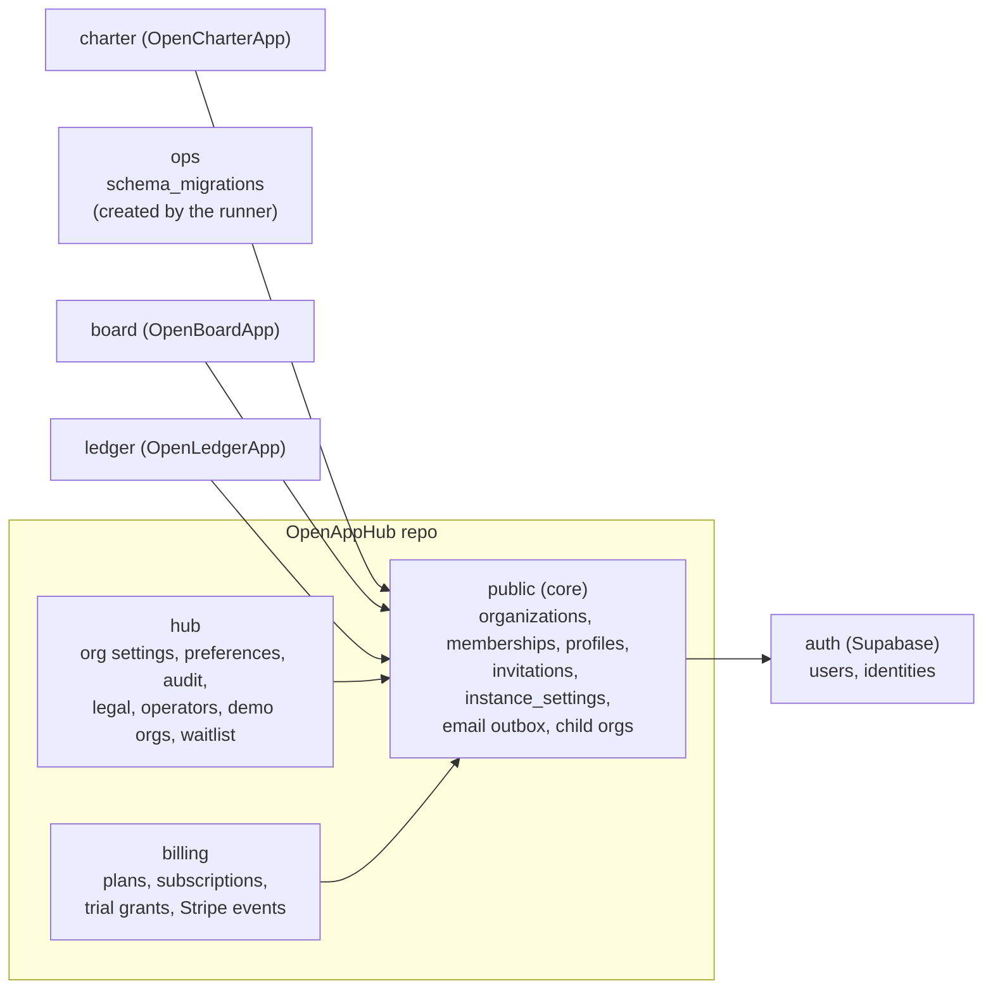

> **Diagram description:** The hub repository owns three schemas: `public` (the core), `hub` and `billing`. The migration runner creates `ops` for its bookkeeping. Each app owns its schema: `charter`, `board`, `ledger`. Every app schema, `hub` and `billing` reference the core; the core references Supabase's `auth.users`.

| Schema    | Owner                  | Exposed to the Data API | Contents                                                                                                                                            |
| --------- | ---------------------- | ----------------------- | --------------------------------------------------------------------------------------------------------------------------------------------------- |
| `public`  | OpenAppHub (`db/core`) | yes                     | The core: organizations (incl. child orgs), memberships, profiles, invitations, instance settings, email outbox and preferences, core functions     |
| `hub`     | OpenAppHub             | no                      | Hub-only: organization billing contact, user preferences, audit of core tables, legal acceptances, platform operators, demo organizations, waitlist |
| `billing` | OpenAppHub             | no                      | Plans, subscriptions, trial grants, Stripe event log                                                                                                |
| `ops`     | the runner             | no                      | `schema_migrations` (file, checksum, applied at)                                                                                                    |
| `charter` | OpenCharterApp         | yes                     | Units, members, memberships, levels, payments, receipts, attributes, roles, seats, appointments, settings, chapter board requests                   |
| `board`   | OpenBoardApp           | yes                     | People, positions, terms, committees, meetings, agendas, attendance, motions, votes, minutes, documents, packets, action items                      |
| `ledger`  | OpenLedgerApp          | yes                     | Accounts, transactions, entries, categories, funds, projects, budgets, pledges, templates, imports, reconciliations, closes                         |

A repo only writes migrations for schemas it owns. Every table: [`database-map.md`](database-map.md).

### 7.2 Migrations: one database, four repos

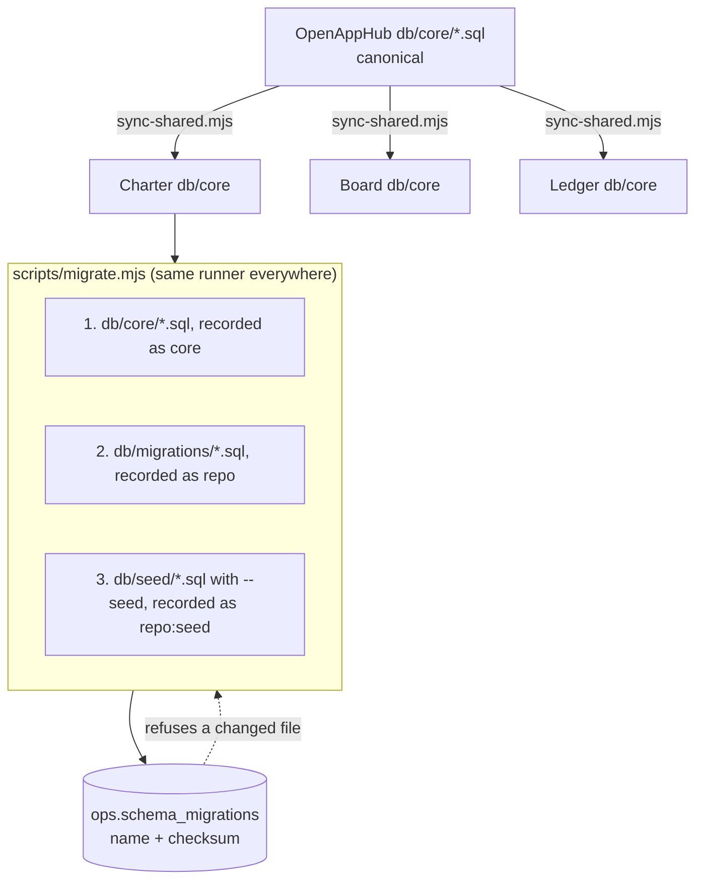

> **Diagram description:** The hub holds the canonical core SQL; `sync-shared.mjs` copies it into each app. Every repo uses the same runner, which applies the core first, then the repo's migrations, then (only with `--seed`, staging and development) its seed files, and records each file with a checksum in `ops.schema_migrations`. It refuses a file that changed after it was applied.

- Core SQL is idempotent (`create … if not exists`, `create or replace`), because every repo applies it.
- **Applied files are never edited**: add a new one. Seed files follow the same rule; a newer seed replaces a function (renaming the older one when it builds on it).
- Migrations are additive: the running code must keep working until its deploy finishes; a destructive change is split across two releases.
- **Who runs them:** the owner, with each repo's **Migrate** workflow (`migrate.yml`, staging or production). The hub's staging database is migrated and seeded by `staging.yml` on every push to `staging`. Nothing applies migrations to production automatically. Order on a fresh database: hub, then Charter, Ledger, Board ([`MIGRATION-NOTES.md`](MIGRATION-NOTES.md) §4).

### 7.3 Row-level security everywhere

Every table has row-level security on. Policies call core helpers (`is_member`, `has_role`, `can_write`, `has_app_access`) and each app's own (Charter's `has_permission` / `permitted_units`, Board's officer checks, Ledger's role checks). Writes that must be atomic or need elevated rights go through `security definer` functions with `search_path = ''`, which re-check the caller. Functions that only triggers or the sender call have `execute` revoked from browsers.

---

## 8. Shared code

The hub repo holds the canonical shared code; each app keeps a read-only copy.

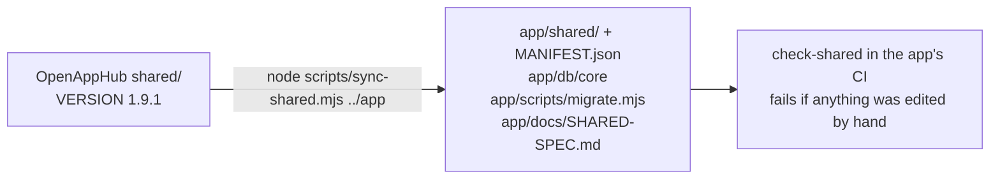

> **Diagram description:** The hub's `shared/` folder (version 1.9.1) is copied into each app by `sync-shared.mjs`, together with the core SQL, the migration runner and the shared spec, with a manifest of checksums. Each app's CI runs `check-shared`, which fails if any vendored file was edited in the app.

| Path                                                                                 | What                                                                                                                                                                                                   |
| ------------------------------------------------------------------------------------ | ------------------------------------------------------------------------------------------------------------------------------------------------------------------------------------------------------ |
| `shared/design/`                                                                     | Tokens, Tailwind preset, `DESIGN.md`                                                                                                                                                                   |
| `shared/ui/`                                                                         | `AppShell`, `SuiteSwitcher`, `OrgSwitcher`, `BillingBanner`, `HelpLink`, `InvitationPage`, `ThemeToggle`, `CookieConsent`, `AppLogo`, `AddToBoardPackage`, `EmailPreferencesPanel`, `EmailServerPanel` |
| `shared/supabase/`                                                                   | Cookie-session client, hosted mode helpers, current organization and `listMyOrgs` (with a chapter's parent), billing state and the read-only rule                                                      |
| `shared/integrations/`                                                               | `isMissing` (feature detection), Board meetings and "add a report to a board package"                                                                                                                  |
| `shared/email/`                                                                      | Templates, Resend and SMTP transports, the sender, signed unsubscribe links, self-hosted settings (server-only parts are marked)                                                                       |
| `shared/format.ts`, `apps.ts`, `docs.ts`, `consent.ts`, `theme.ts`, `brand/marks.ts` | Money and date formats, app names and marks, help links, cookie consent, theme, logos                                                                                                                  |

Change it in the hub, bump `shared/VERSION`, add a line to `shared/README.md`, sync it into each app, and open a pull request in each.

---

## 9. Data between apps

Apps never write into another app's schema. They exchange data three ways (SHARED-SPEC §3.6):

1. **Read-only `api_*` views** in the owning schema, `security_invoker = true` (the reader's own row security applies).
2. **`security invoker` RPCs** the owning app exposes to cause a change it controls (for example, Board's `add_report_to_meeting`).
3. **Trigger-only sync functions** for the one two-way sync (officers, S-14): `security definer`, `execute` revoked from browsers. This is a documented exception.

Consumers feature-detect (`shared/integrations/detect.ts` `isMissing`: missing schema, view or function), so a self-hosted app without the other side just hides the integration. Every view and RPC is documented in the owning app's `INTEGRATION.md` ([`charter/INTEGRATION.md`](charter/INTEGRATION.md), [`board/INTEGRATION.md`](board/INTEGRATION.md), [`ledger/INTEGRATION.md`](ledger/INTEGRATION.md), [`INTEGRATION.md`](INTEGRATION.md) for the hub).

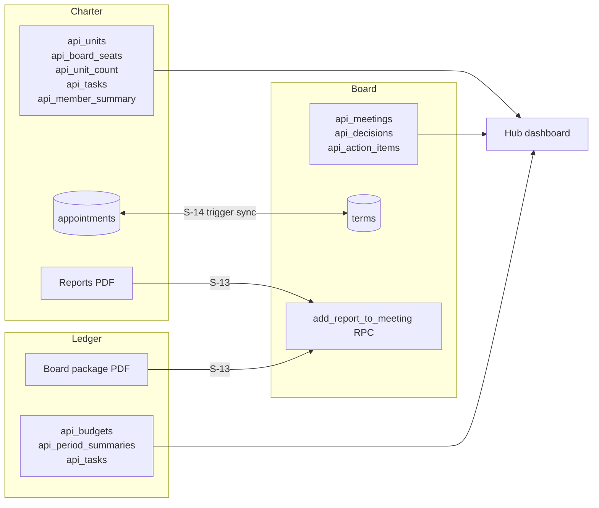

> **Diagram description:** Charter, Board and Ledger each publish read-only views that the hub's dashboard reads. Charter's and Ledger's report PDFs go into a Board meeting's packet through Board's `add_report_to_meeting` function (S-13). Charter's appointments and Board's terms stay in sync both ways through triggers (S-14).

### 9.1 Officers in sync (S-14, S-24)

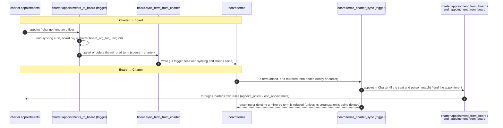

> **Diagram description:** When Charter appoints, changes or ends an officer, a trigger sets a transaction flag to stop echoes, finds the board's organization for that unit (the national's own, or a chapter's once it uses OpenBoardApp) and asks Board to upsert or delete the mirrored term. Board's own trigger sees the flag and stands aside. In the other direction, a term added in Board becomes a Charter appointment when the position and person match a Charter seat and member, and ending a mirrored term in Board ends the appointment in Charter, both through Charter's own functions and rules. Board refuses to rename or delete a mirrored term on its own, except when its whole organization is being deleted.

### 9.2 Reports into a board package (S-13)

`AddToBoardPackage` (shared UI) lists the organization's upcoming Board meetings (draft, scheduled or in progress), builds the report PDF only when the person confirms, calls `board.add_report_to_meeting(meeting, title, file_name, source_app)` (creates the document and version 1 as the caller) and uploads the PDF to `board-files/<org>/documents/<doc>/v1-<name>`. Hidden when Board isn't on the database.

---

## 10. The hub dashboard

`src/lib/dashboard.ts` `loadDashboard` reads every app's views in parallel as the signed-in person, filtered to the current organization; a missing app just leaves its panels out.

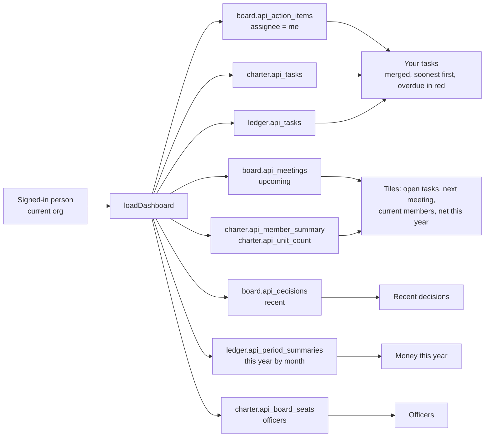

> **Diagram description:** The dashboard loader reads Board's action items assigned to the person, Charter's and Ledger's tasks, Board's upcoming meetings and recent decisions, Ledger's monthly summaries for this year, Charter's member summary, unit count and officers. Tasks from all three apps are merged into "Your tasks", soonest first, with overdue ones in red. The rest feed the tiles (open tasks, next meeting, current members, net this year), "Money this year", "Recent decisions" and "Officers".

**Done and Skip (S-19).** Rows whose view says `completable` get buttons that call the owning app's RPC as the person: `board.complete_action_item`, `ledger.skip_recurring_due`, and `public.complete_automation_task` for tasks a workflow gave them. The app's own rules decide; anything that needs real work stays a link.

A chapter's own organization shows only OpenBoardApp and says whose chapter it is.

**Each person's dashboard (H-03, hub `0008_dashboard_prefs`).** "Choose panels" hides or shows This week, Your tasks, Money this year, Upcoming meetings, Recent decisions, Officers and Your apps; the choice is stored for the person in `hub.user_preferences.dashboard_hidden` (`hub_set_dashboard_panels`, `hub_get_dashboard_prefs`). **This week** (`thisWeek` in `src/lib/dashboard.ts`) groups the next seven days' meetings and due dates by day, in the organization's time zone, with overdue tasks first. A **default organization** (`default_org_id`, `hub_set_default_org`, chosen on the account page) is used when the suite's organization cookie names none of the person's organizations: `getHubContext` passes it to `resolveCurrentOrg`, and the hub then stores it in the cookie so every app opens on it too. A future "dashboard editor" (H-08 in the roadmap) would let people arrange panels and design their own.

---

## 11. Billing

Suite billing is the organization paying OpenAppHub. It lives only in the hub (schema `billing`) and is enforced in the database.

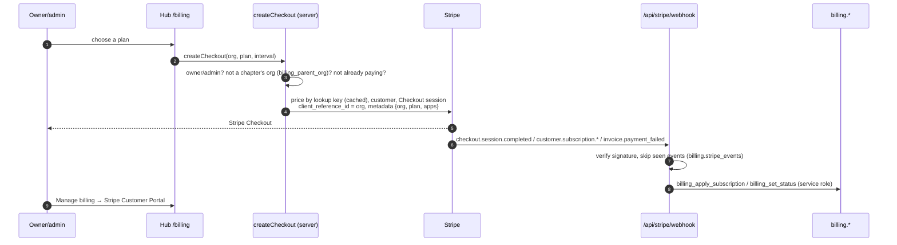

> **Diagram description:** An owner or admin chooses a plan on the hub's billing page. The server checks they may, that the organization isn't a chapter's (whose plan is its parent's) and that it isn't already paying, finds the price in Stripe by lookup key, creates or reuses the Stripe customer and opens Checkout with the organization in the metadata. Stripe then sends webhooks; the hub verifies the signature, skips events it has seen, and writes the subscription with the service role. "Manage billing" opens Stripe's Customer Portal.

**How access is decided** (every write in every app):

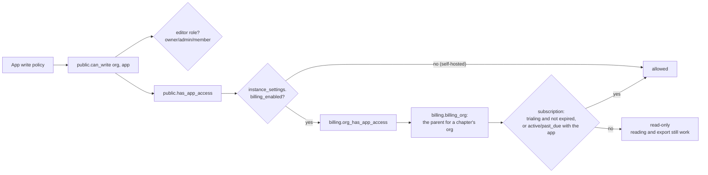

> **Diagram description:** Every app's write policy calls `public.can_write`, which needs an editor role and app access. App access is always granted when billing is off (self-hosted). When it's on, the billing function looks at the subscription of the billing organization (a chapter's organization uses its parent's): a trial that hasn't ended, or an active or past-due plan that includes the app, allows writes; otherwise the app is read-only, while reading and export keep working.

- **Trial:** a trigger on new organizations creates a 30-day trial for all apps; one trial per person (a second organization starts expired). Chapters' organizations get none.
- **Editor limit:** a trigger on memberships refuses editors beyond the plan's limit (viewers and Charter portal members never count; chapters' organizations are exempt).
- **Plans:** `starter` (1 app), `suite`, `plus`; prices live in Stripe by lookup key `<plan>_<interval>`; limits live in `billing.plans`.
- **Screens:** every app shows `BillingBanner` from `get_org_billing` and switches write controls off with `isReadOnly` (S-05).

---

## 12. Payments inside the apps (Charter dues)

Dues are members paying their association. They never touch the hub's Stripe account.

- Each organization connects **its own** Stripe account in Charter (keys stored encrypted with Charter's gateway key). Direct mode only, no Stripe Connect.
- Checkout for dues; Charter's webhook route records payments, failures and refunds (service role, allowlisted), issues receipts (`charter.receipts`, numbered per unit, tax-exempt wording per setting).
- While an organization is read-only, Charter still records payments members already made, refunds and receipts, but refuses new joins and renewals.
- Card data never touches the suite (PCI SAQ-A).
- **Into OpenLedgerApp (S-18 / L-17, owner decision 2026-11-13: always review first).** Charter's `charter.api_payments` (Charter `0015`) lists payments that took money: channel (card or other), purpose, chapter, refunded amount. When an organization switches it on in Ledger (Settings → OpenCharterApp payments, Ledger `0011`), `ledger.charter_drafts(org)` offers what isn't booked yet, one draft per day and channel, refunds separately; the national organization only, or every chapter on its own line; only from a start date. Posting builds balanced entries (card: Stripe balance net of an estimated fee, at the organization's rate; other: Undeposited funds; credits to the new-member and renewal income accounts) and goes through Ledger's `postTransaction` (balanced, books not closed, idempotency key), then `ledger.record_charter_import` notes the payments covered (a payment once, refunds by amount; under an advisory lock, so two reviewers can't book it twice; if recording fails the transaction is voided). Payouts and bank deposits stay the treasurer's transfers. The staging demo books the same way.

---

## 13. Email

One pipeline for every app (S-16). Apps never send directly: they queue email in the core outbox, and a sender drains it.

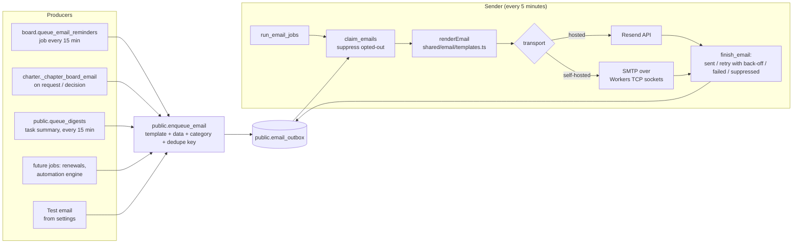

> **Diagram description:** Producers (Board's reminder job, Charter's chapter-request emails, the task summary job, future jobs, and the test email from the settings page) all call `public.enqueue_email` with a template name, its data, a category and a de-duplication key; the row lands in the outbox. Every five minutes the sender runs the due jobs, claims a batch (suppressing what the recipient switched off), renders each email from the shared templates, and sends it through Resend when hosted or through the organization's SMTP server over Workers TCP sockets when self-hosted. It records the outcome: sent, retry with back-off, failed, or suppressed.

| Part                                                                       | Where                                                            |
| -------------------------------------------------------------------------- | ---------------------------------------------------------------- |
| Outbox, jobs, preferences, SMTP settings, `is_instance_owner`              | Core `0005_core_email.sql`                                       |
| Templates (one look; plain text with every HTML email)                     | `shared/email/templates.ts`                                      |
| Resend transport (idempotency key = outbox row)                            | `shared/email/resend.ts`                                         |
| SMTP client (STARTTLS, TLS, AUTH PLAIN/LOGIN)                              | `shared/email/smtp.ts`                                           |
| The sender                                                                 | `shared/email/deliver.ts`                                        |
| Unsubscribe (signed links; GET asks, POST unsubscribes; one-click headers) | `shared/email/unsubscribe.ts`                                    |
| Hosted sender (cron `*/5`) and `/email/unsubscribe`                        | Hub `src/lib/email.server.ts`, `src/server.ts`                   |
| Self-hosted sender and settings                                            | Each app's `server/email-cron.ts`, `src/lib/email.*`, Email page |

- **Categories:** `essential` (always sent), `reminders`, `digest`, `billing`, `org_activity` (can be switched off; the hub's account page and each app's Email page).
- **Never sent:** demo and documentation addresses (`*.demo.openapphub.org`, `example.org`).
- **Retries:** 1, 5, 30, 120 minutes; failed after 5 tries. A row stuck "sending" for 10 minutes is claimed again.
- **Self-hosted SMTP:** set by the owner of the server's first organization (`is_instance_owner`); the password is encrypted (AES-GCM, key derived from the service role key) before it's stored.
- Sign-in, password and invitation emails are still Supabase Auth's (custom SMTP in Supabase).

### 13.1 The task summary (digest, S-17)

Core `0007_core_digest.sql` adds each person's choices to `public.email_preferences` (`digest` off/daily/weekly, `digest_day` 0 Sunday…6 Saturday, `digest_hour` 0–23, `digest_time_zone`, `digest_org_ids` (null = all), `digest_include` tasks/meetings, `digest_last_sent_at`).

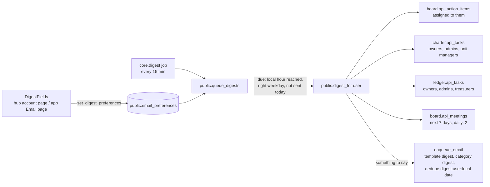

> **Diagram description:** People set their choices with the shared `DigestFields` (hub account page, or an app's Email page), saved by `set_digest_preferences`. The `core.digest` email job runs `public.queue_digests` every 15 minutes; for each person whose local time has reached their hour (on their weekday, for weekly) and who hasn't had one today, `public.digest_for` collects their open Board action items, Charter tasks (owners, admins and people who manage the unit), Ledger tasks (owners, admins and treasurers) and upcoming Board meetings, per organization, from whichever app views exist on this database. If there's anything, one `digest` email is queued, de-duplicated per person per local day. Hosted, the hub's sender sends it; self-hosted, the installed app's sender does.

- The time zone defaults to the person's first organization's, else UTC. Each app's checks run inside `digest_for` (security definer, service role only), since the job has no session.
- The `digest` template groups items under each organization's name (`EmailContent.sections`); one organization gets a plain list.

### 13.2 Notifications (H-02)

Things that happened, told to the people they matter to, **apart from the automation engine** (owner direction 2026-11-13): organizations don't build them, and they work the same everywhere. Core `0013_core_notifications.sql`:

- `public.notification_kinds`: each kind, registered by the core or an app with `register_notification_kind` (who gets it by default, who may turn it on, its email category, whether it shows in the app and goes by email by default).
- `public.notification_preferences`: each person's choice per kind (in the app, by email). No row means the kind's defaults, for its default audience; anyone else allowed gets it only after turning it on.
- `public.notifications`: the list behind the bell, one row per person, read only by that person (`my_notifications`, `unread_notification_count`, `mark_notifications_read`). Kept a year (`core.prune_notifications`).
- `public.notify(org, kind, title, body, link, link_app, users, emails, dedupe, actor)`: writes the list and queues the email (template `notification`, the kind's email category, so the existing email opt-outs still apply). The person who caused it isn't told; each person once per dedupe key.

```mermaid
flowchart LR
    T1[memberships, app roles<br/>joined, left, role changed] --> N[notify]
    T2[automation_tasks<br/>a task for you] --> N
    T3[automation_runs<br/>a workflow failed] --> N
    T4[billing.subscriptions<br/>payment failed, plan changed] --> N
    J[email job, every 6 h<br/>trials ending] --> N
    N --> P{Each person's choice<br/>or the kind's defaults}
    P --> L[(notifications)<br/>the bell in every app]
    P --> E[Email outbox<br/>template notification]
    N --> B[Billing contact<br/>email only]
```

> **Diagram description:** Database triggers on memberships and app roles (someone joined, left or changed roles), on workflow tasks (a task given to someone), on workflow runs (a run failed) and on subscriptions (a payment failed, the plan changed), plus a job every six hours for trials ending, all call `notify`. For each person it looks up their choice for that kind, or the kind's defaults, and writes the in-app list behind the bell, queues an email, or both. Billing notifications also go by email to the organization's billing contact.

Who gets what by default (owner decision 2026-11-13): the **owner** gets people and billing notifications and failed workflows; billing ones also go by email to the **billing contact** (`hub.org_settings.billing_email`; hub `0007_billing_notifications`); a task goes to **its person**. Admins may turn the owner's kinds on for themselves. The bell (`NotificationBell`, shared 1.16.0) is in `AppShell`'s top bar of every app (pass `notificationsClient`) and polls the unread count every minute; `NotificationSettings` is on the hub's account page (Notifications) and, self-hosted, on each app's email page.

### 13.2.1 Approvals and actions from email (C-08)

Core `0014_core_approvals.sql`. **Approvals:** the designer's "Ask for approval" step creates an `approval_requests` row with one `approval_approvers` row per person asked, notifies them (`workflows.approval_requested`), and pauses the run. `decide_approval` records an answer; when the request is decided (the first answer, or everyone approved / one declined, as the builder chose) it calls `_wf2_continue`, and the step gives later steps `outcome`, `approved`, `decided_by`, `comment`, the counts and each response. A time limit sets the run's `resume_at`; when it passes the outcome is `timed_out`. The hub shows waiting approvals in **Your tasks** and on `/approvals/<id>`.

**Actions from email:** each organization allows each kind (`email_action_kinds`: `workflow_tasks`, `workflow_approvals`, Charter's `charter_join_requests`, Board's `board_action_items`; `email_action_settings`, off by default). `notify(…, p_actions, p_action_kind)` and Board's reminder job call `action_links_for`, which makes **one person's** links (two random UUIDs as the token; only its SHA-256 is stored; 7 days; single use) or none when the kind isn't allowed. The email shows them as buttons to the sending app's `/act/<token>` (shared `ActionLinkPage`). That page requires signing in as the person it was sent to (`action_link` returns `other_person` otherwise, and nothing about the action), says what will happen, and on **Confirm** calls the stored function (`rpc_schema.rpc_fn` with `rpc_args`, plus the comment) **as the signed-in person**, so the app's own permission checks apply; then `consume_action_link` uses the link (and its sibling, such as Decline) up. Switching a kind off stops links already sent.

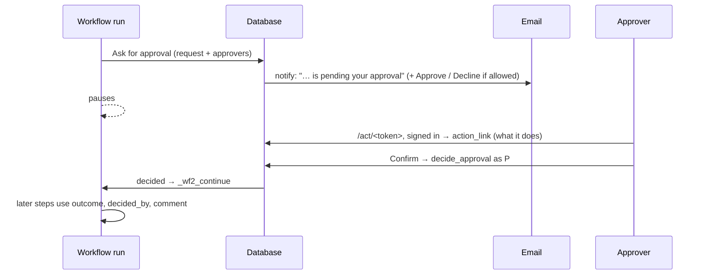

> **Diagram description:** A workflow run asks for approval: the database records the request and the people asked, and notifies them by email with Approve and Decline buttons when the organization allows it. The run pauses. An approver opens the link, signs in, sees what it will do and confirms; the confirm page calls decide_approval as them. When the request is decided, the run carries on and later steps use the outcome, who answered and their comments.

### 13.3 Automations and workflows (S-25)

**Part 1:** reminders and other things the apps do on their own are **automations** each organization can change (core `0008_core_automations.sql`): an app registers each kind with its defaults and a schema; owners and admins change them in the shared Automations panel; the app's job reads them with `public.automation_settings` and records what it did in `public.automation_log`. Board's reminders are the first.

**Part 2:** each organization **builds its own workflows** (core `0009_core_workflows.sql`) on the hub's Automations page: When (an app event, a time before or after something, a schedule) → If / Else if / Otherwise → Then (email, a task, an app's action). Apps register triggers, actions and recipients; the engine knows no app.

```mermaid
flowchart LR
    APP[App migrations<br/>register triggers, actions, recipients] --> CAT[(Catalog)]
    EV[App events<br/>emit_automation_event] --> RUN[run_workflows<br/>every 5 min]
    SC[Scans and schedules] --> RUN
    CAT --> RUN
    WF[(automation_workflows)] --> RUN
    RUN --> LOG[(automation_runs<br/>once per subject)]
    RUN --> OUT[Email outbox]
    RUN --> TASK[(automation_tasks)<br/>hub dashboard]
    RUN --> JOB[(automation_jobs)]
    JOB --> POKE[Hub cron calls the app<br/>signed POST /automation/run]
    POKE --> DO[App does the work<br/>e.g. Ledger reports into a meeting]
```

> **Diagram description:** Apps register their triggers, actions and recipients in the catalog. Every 5 minutes `run_workflows` reads new app events, scans and schedules, matches them against each organization's workflows and records each run once per subject. Its steps queue email, create tasks shown on the hub dashboard, or queue jobs for an app; the hub's cron then calls that app's signed endpoint, and the app does the work (for example, Ledger adds its financial reports to a Board meeting).

**The low-code designer (S-28, core `0012_core_designer.sql`):** workflows as nested steps (conditions, switches, "for each", groups, variables, data steps, waits, stop) where every step's output is available to later steps (`{{steps.<id>.<field>}}`, `{{item.<field>}}`), with retries and "run after" per step. Runs record each step's status and output, so they pause (waits, retries, app jobs) and carry on without repeating anything. Apps add lookups and actions with `register_automation_step`; `test_workflow` runs a workflow without doing anything.

**Templates.** The Automations page starts workflows from a gallery (`src/lib/templates.ts`): renewal reminders, a lapsed-membership notice, welcoming new members, nudging overdue action items, the financial reports before each meeting, a warning when a month closes at a loss. Each is an ordinary version 2 definition the designer opens to adjust and save; one shows as ready when the database has the triggers, steps and recipients it uses (`templateMissing`). "Election results into board terms" (S-23) and award routing are listed as coming with elections (C-27) and awards. `src/lib/suite-overview.fixture.json` is what the whole suite registers, for the templates' tests; regenerate it from a local suite database when an app adds triggers or steps.

Design, every function and what comes next: [`automation-engine.md`](automation-engine.md).

---

## 14. Chapters on OpenBoardApp

A chapter can run its own board in OpenBoardApp if its national allows it (S-24).

```mermaid
sequenceDiagram
    autonumber
    participant CA as Chapter admin
    participant C as Charter (chapter's Board page)
    participant N as National admin
    participant CORE as public._create_child_organization
    participant B as OpenBoardApp
    CA->>C: Ask to use OpenBoardApp
    C->>C: request_chapter_board: policy (off / approval / open)?
    alt policy = approval
        C->>N: email (charter.chapter_board_request)
        N->>C: Board settings → Approve (or Decline with a note)
    end
    C->>CORE: create the chapter's organization<br/>parent = national's, source = charter/unit<br/>owner = requester, admin = national's owner
    C->>B: copy the chapter's current officers as terms
    C->>CA: email (charter.chapter_board_decided)
    CA->>B: Open OpenBoardApp (a normal organization there)
```

> **Diagram description:** A chapter admin asks on the chapter's Board page. Charter checks the national's setting. If approval is needed, the national's owners and admins get an email and approve, or decline with a note, on Board settings. On approval (or straight away when the setting is open), Charter creates the chapter's own organization under the national's, owned by the requester with the national's owner as an admin, copies the chapter's current officers into OpenBoardApp as terms, and emails the requester. OpenBoardApp then treats it like any other organization.

- Core `0006`: `organizations.parent_org_id` (one level), `source_app`, `source_ref`; created only by an app's definer function; a member of a chapter's organization can read its parent's name.
- Billing `0004`: covered by the parent's plan (no trial, no plan, no editor limit; checkout refuses it).
- Charter `0006`: requests, the setting `board.chapters`, the sync per unit (`board_org_for_unit`, `unit_for_board_org`).
- Hub: the dashboard shows only OpenBoardApp for a chapter's organization; Billing says "Covered by <national>".

---

## 15. Inside each app

### 15.1 OpenAppHub (the hub)

```mermaid
flowchart TB
    R[Routes: /, /login, /signup, /auth/callback, /invite/:token,<br/>/welcome, /orgs/new, /members, /settings, /billing,<br/>/account, /audit, /admin/demo, /terms, /privacy, /cookies]
    S[Screens: src/screens/*<br/>DashboardScreen, BillingScreen, AccountScreen, ...]
    L["src/lib: orgs, members, billing-core, stripe, dashboard,<br/>email.server, admin.server (service role), session"]
    API[/api/stripe/webhook, /email/unsubscribe, cron/]
    R --> S --> L
    API --> L
    L --> DB[(public, hub, billing + app views)]
```

> **Diagram description:** The hub's routes cover the landing page, sign-in and sign-up, invitations, the welcome checklist, organizations, members, settings, billing, account, audit log, staging demo tools and legal pages. Screens call the hub's library code, which reads and writes the core, hub and billing schemas and the apps' views. The Stripe webhook, the unsubscribe page and the email cron are server entry points into the same library.

- The service-role client (`admin.server.ts`) is allowlisted: Stripe webhook, invitation email, account deletion, demo tools, the email sender.
- Development previews: `/dev/shell` (shared shell, email settings) and `/dev/hub` (screens with fixtures), development builds only.

### 15.2 OpenCharterApp

Charter is a modular monolith with shared engines ([`charter/architecture.md`](charter/architecture.md) has the full map):

```mermaid
flowchart TB
    subgraph Engines
        ATTR[Attributes]
        RULES[Rules / pricing]
        SETUP[Setup]
        SETT[Settings inheritance]
        PAY[Payment gateway]
        AUTO["Automation (future, S-25)"]
        WF["Approvals (future)"]
        FORM["Forms (future)"]
    end
    subgraph Modules
        M1[members, membership,<br/>home chapter, joining]
        M2[payments, receipts]
        M3[governance: seats,<br/>appointments, chapter boards]
        M4[chapters, branding,<br/>roles, invitations]
        M5[reports, export, demo, email]
    end
    SETUP --> ATTR
    SETUP --> RULES
    RULES --> ATTR
    M1 --> RULES
    M1 --> ATTR
    M2 --> PAY
    M3 --> SETT
    M4 --> SETT
    WF --> RULES
    AUTO --> WF
    FORM --> ATTR
```

> **Diagram description:** Charter's shared engines (attributes, rules and pricing, setup, settings inheritance, the payment gateway, and the future automation, approval and form engines) are used by its modules: members and membership, payments and receipts, governance, chapters and roles, reports and export. Setup uses attributes and rules; rules use attributes; the future approval engine uses rules and the automation engine drives approvals; the future form builder uses attributes.

- Pending migrations are typed in `src/lib/db/pending-schema.ts` until `types.ts` is regenerated.
- More: [`charter/data-domains.md`](charter/data-domains.md), [`charter/tables.md`](charter/tables.md), [`charter/setup-engine.md`](charter/setup-engine.md), [`charter/decisions.md`](charter/decisions.md).

### 15.3 OpenBoardApp

```text
React screens (src/routes, src/components)
        |  only through
Data facade (src/data: db, attempt)  ── data-layer.test.ts forbids direct client imports
        |
Cloud adapter (src/data/cloud-adapter.ts): auth, tables, RPCs, files
        |
Database guards: RLS, same-org triggers, official-record locks, atomic live-vote RPCs
```

Live votes freeze the electorate, lock the motion row and snapshot the official result; approved minutes are locked (amendments are new versions). Details: [`board/architecture.md`](board/architecture.md).

### 15.4 OpenLedgerApp

```text
React screens
        |
Server functions (src/lib/*.functions.ts): sign-in + assertCan, wrapped desktopAware
        |
Services (src/lib/services): posting, voids, statement checks, reports, close
        |
Domain rules (src/lib/domain): pure, run before every write
        |
Ports → adapters: supabase | sqlite (desktop) | memory (tests)
        |
Database guards: RLS, immutability triggers, books lock, atomic RPCs, audited_write
```

Posted transactions are immutable (void and re-post); every change and its history are saved in one transaction. Ledger Solo (desktop) uses SQLite with the same rules, no account and no email. Details: [`ledger/architecture.md`](ledger/architecture.md), [`ledger/desktop.md`](ledger/desktop.md).

---

## 16. Security

```mermaid
flowchart TB
    L1[Browser: VITE_* settings only; no secrets] --> L2[Worker: security headers, CSRF on server functions,<br/>only suite origins in next=, signed unsubscribe links]
    L2 --> L3[Server functions: act as the signed-in user;<br/>service role only for the allowlist]
    L3 --> L4[Database: row-level security on every table;<br/>can_write = role + billing; definer functions re-check the caller]
    L4 --> L5["Audit: hub.audit_log (core tables), charter.audit_events,<br/>board.audit_log, ledger.audit_log (append-only)"]
```

> **Diagram description:** Five layers of defence. The browser only ever gets public settings. The Worker adds security headers, CSRF protection, a strict check on return addresses and signed unsubscribe links. Server functions act as the signed-in user, with the service role reserved for an allowlist. The database applies row-level security on every table, combines role and billing in `can_write`, and makes definer functions re-check the caller. Every app keeps an append-only audit log.

| Topic                        | How                                                                                                                                  |
| ---------------------------- | ------------------------------------------------------------------------------------------------------------------------------------ |
| Tenant isolation             | `org_id` on every row; policies via `is_member` / `has_role`; DB tests in every repo                                                 |
| Service role                 | Allowlist (SHARED-SPEC §7.2): hub (Stripe webhook, invitations, account deletion, demo tools, email sender), Charter (dues webhooks) |
| Secrets                      | Worker secrets only; GitHub secret scanning and push protection; `.env*` ignored except `.env.example`                               |
| Encrypted at rest by the app | Charter's gateway keys; self-hosted SMTP password                                                                                    |
| Tokens                       | Invitation tokens stored as SHA-256; unsubscribe links HMAC-signed                                                                   |
| Email safety                 | Demo/test addresses never sent; GET on unsubscribe never changes anything                                                            |
| Payments                     | Card data never touches the suite (Stripe Checkout)                                                                                  |

---

## 17. Demo and seed data

Staging has three demo accounts (password `OpenAppHubDemo2026`, public on purpose): `demo@` (Riverside Community Association), `national@` (Northstar Veterans League, four posts) and `test@` (no organization) `@demo.openapphub.org`.

```mermaid
flowchart LR
    DR[demo-reset.yml<br/>05:17 and 17:17 UTC] --> R[hub.reset_suite_demo]
    R --> A[reset the accounts<br/>delete their orgs, memberships,<br/>invitations, queued email, terms acceptances]
    A --> O["create Riverside + Northstar<br/>long trials (hub.demo_orgs)"]
    O --> C1[charter.demo_fill / demo_fill_national<br/>members, dues, officers, tasks]
    C1 --> L1[ledger.demo_fill / demo_fill_national<br/>books from Charter's payments]
    L1 --> B1[board.demo_fill / demo_fill_national / demo_fill_post<br/>terms from Charter, reports quote both]
```

> **Diagram description:** Twice a day the demo-reset workflow runs `hub.reset_suite_demo`. It resets the three accounts (removing their organizations, memberships, invitations, queued email and terms acceptances), recreates Riverside and Northstar with long trials, then fills Charter (members, dues, officers, tasks), then Ledger (books built from Charter's payments), then Board (terms from Charter, treasurer's reports quoting both), in that order so the apps agree.

Everything is dated from the day the reset runs, so due dates and "this month" always look current. Details: [`charter/demo-data.md`](charter/demo-data.md), SHARED-SPEC §11.

---

## 18. Branches, CI and deploys

```mermaid
gitGraph
    commit id: "main = production"
    branch staging
    checkout staging
    commit id: "staging = what's next"
    branch claude/feature
    checkout claude/feature
    commit id: "work"
    commit id: "CI green"
    checkout staging
    merge claude/feature id: "PR merged to staging"
    commit id: "owner tests on staging"
    checkout main
    merge staging id: "owner merges to main → deploys"
```

> **Diagram description:** `main` is production. `staging` holds what's next. Work happens on feature branches with pull requests into `staging`, where CI must pass. The owner tests on staging, then merges `staging` into `main`, which deploys production. Nothing merges into `main` without the owner.

- **Pull requests target `staging`.** Nothing merges into `main` without the owner's approval.
- **Deploys:** Cloudflare's Git integration. `main` → production Workers; branch `staging` → the staging Worker (hub) and each app's preview of `staging`; any branch → its own preview.
- **CI** (`ci.yml`) runs on pull requests and pushes to `staging`: types, lint, formatting, unit tests, build, database tests, performance checks, dependency audit, `check-shared`, migration checks; Charter also requires docs or tests with code (`docs-check.sh`). **End-to-end** (`e2e.yml` / `live.yml`): Playwright against staging and the demo accounts, on pull requests and daily.
- **Database:** the owner runs `migrate.yml` (production before merging a PR that needs a migration). The hub's staging database migrates on every push to `staging` (`staging.yml`).

---

## 19. Testing

| Kind                                                               | Where                                                                                   | Runs           |
| ------------------------------------------------------------------ | --------------------------------------------------------------------------------------- | -------------- |
| Unit and component                                                 | Vitest in every repo (`*.test.ts(x)`)                                                   | CI             |
| SQL rules (isolation, permissions, locks, sync, email, child orgs) | `db/tests/*.sql` in every repo, on a throwaway Postgres with a Supabase stub            | CI (`db:test`) |
| Two-app check                                                      | `openboardapp/db/suite/charter_sync.sql` (Charter + Board on one database)              | By hand        |
| Performance                                                        | `db/perf` (Board to 50,000 meetings, Ledger 50k lines, Charter 20,000 members)          | CI             |
| End-to-end                                                         | Playwright on staging with the demo accounts                                            | CI and daily   |
| Hub screens in a browser                                           | OpenAppHub `e2e/` (Playwright on the dev preview `/dev/hub`, sample data, no backend)   | CI             |
| Seeds                                                              | Every repo's DB test applies its seeds; a full suite build applies all of them in order | CI / by hand   |

---

## 20. Future architecture

| Item                             | Shape                                                                              | Roadmap    |
| -------------------------------- | ---------------------------------------------------------------------------------- | ---------- |
| **Charter payments into Ledger** | `charter.api_payments` + a Ledger import with a category map, booked like the demo | S-18, L-17 |
| **Dashboard editor**             | People choose, arrange and size the dashboard's panels                             | H-08       |
| **Self-host packaging**          | Docker image + Compose (app + hosted or minimal Supabase)                          | C-F11      |

---

## 21. Glossary

| Term                 | Meaning                                                                                                        |
| -------------------- | -------------------------------------------------------------------------------------------------------------- |
| Core                 | The shared SQL in `db/core` (schema `public`): organizations, memberships, profiles, invitations, email outbox |
| Hosted / self-hosted | `VITE_HOSTED` true (the suite on openapphub.org) or false (one app on someone's own database)                  |
| Organization         | `public.organizations`: the customer, the billing unit, the id every app uses                                  |
| Child organization   | A chapter's own organization under its national's (`parent_org_id`), for OpenBoardApp                          |
| Unit                 | A Charter national, region or chapter (`charter.units`); the top unit is the organization                      |
| Editor               | A core member with a role above viewer; counts against plan limits                                             |
| `api_*` view         | A read-only view an app publishes for other apps                                                               |
| Mirrored term        | A Board term that comes from a Charter appointment (`source = 'charter'`)                                      |
| Outbox               | `public.email_outbox`: every email waiting to be sent                                                          |
| Demo reset           | `hub.reset_suite_demo()`, every 12 hours on staging                                                            |
| Vendored             | Copied from the hub by `sync-shared.mjs`, never edited in the app                                              |
