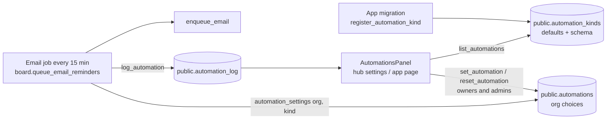

# The automation engine (S-25)

One engine for every schedule and automation an organization may want to change, instead of fixed jobs in each app. It drives reminders now, and is meant to drive OpenCharterApp's award system, renewal reminders, governance alerts, scheduled board packages and every other "the app does this on its own" feature later.

This document is the design. **Parts 1 and 2 and the low-code designer (S-28, §6) are built**: part 1 (shared 1.11.0, core `0008_core_automations.sql`, Board `0009_automation_reminders.sql`) and part 2, the workflows each organization builds (shared 1.12.0–1.13.0, core `0009_core_workflows.sql`, Board `0010`, Charter `0008`, Ledger `0004`), described in §5. What comes next is in [`ROADMAP.md`](ROADMAP.md).

## 1. Words

| Word           | Meaning                                                                                                                                   |
| -------------- | ----------------------------------------------------------------------------------------------------------------------------------------- |
| **Kind**       | One automation an app offers, e.g. `board.meeting_reminders`. Registered by the app's migration with its defaults and what can be changed |
| **Automation** | A kind as one organization has it: on or off, with its settings. No row means the defaults                                                |
| **Settings**   | The kind's parameters (e.g. `days_before: [7, 1]`), checked against the kind's schema                                                     |
| **Run / log**  | What an automation did for an organization ("2 meeting reminders emailed"), kept for a year                                               |
| **Trigger**    | What starts it. Part 1: a schedule (an email job every 15 minutes that checks dates). Later: events in any app                            |
| **Condition**  | When it applies. Later: the rules engine (Charter's C-19)                                                                                 |
| **Action**     | What it does. Part 1: queue email. Later: create a task, start an approval, add to a packet, change a status                              |

## 2. How part 1 works



> **Diagram description:** Each app's migration registers its kinds in `public.automation_kinds` with their defaults and a schema of what can change. The shared Automations panel (on the hub's organization settings page and in each app) lists them with `list_automations`; owners and admins change one with `set_automation` or go back to the defaults with `reset_automation`, which writes `public.automations`. The app's job (for Board, the reminders job that runs every 15 minutes) reads the settings in force for each organization with `automation_settings`, queues email, and records what it did with `log_automation`, which the panel shows as the last run.

### Tables (core 0008)

| Table                     | Columns                                                                                                                    | Who can read / write                                                                                                        |
| ------------------------- | -------------------------------------------------------------------------------------------------------------------------- | --------------------------------------------------------------------------------------------------------------------------- |
| `public.automation_kinds` | `key` (`app.name`), `app`, `name`, `description`, `category`, `default_enabled`, `default_params`, `params_schema`, `sort` | Everyone signed in reads; written only by `register_automation_kind` (service role, migrations)                             |
| `public.automations`      | `org_id`, `kind`, `enabled`, `params`, `updated_by`, `updated_at` (primary key `org_id, kind`)                             | Members read; written only by `set_automation` / `reset_automation` (owners, admins)                                        |
| `public.automation_log`   | `org_id`, `kind`, `at`, `count`, `summary`                                                                                 | Members read; written only by `log_automation` (service role); pruned after a year (`core.automation_log_prune` job, daily) |

### Functions

| Function                                                                                                                | For                                                                               |
| ----------------------------------------------------------------------------------------------------------------------- | --------------------------------------------------------------------------------- |
| `register_automation_kind(key, app, name, description, category, default_enabled, default_params, params_schema, sort)` | An app's migration adds or updates a kind (idempotent)                            |
| `automation_settings(org, kind) → (enabled, params)`                                                                    | Jobs: the settings in force (the organization's choices over the defaults)        |
| `list_automations(org)`                                                                                                 | Members: every kind with its settings in force, defaults, schema and last run     |
| `set_automation(org, kind, enabled, params)`                                                                            | Owners and admins: change it. Settings are checked and cleaned against the schema |
| `reset_automation(org, kind)`                                                                                           | Owners and admins: back to the defaults                                           |
| `log_automation(org, kind, count, summary)`                                                                             | Jobs: record what it did (only when the count is above 0)                         |

### The settings schema

`params_schema` is a small JSON object, one entry per setting. The panel draws the form from it and `set_automation` checks against it, so a new kind needs no new UI code.

| `type`     | Form                  | Checked                                                                                             |
| ---------- | --------------------- | --------------------------------------------------------------------------------------------------- |
| `int`      | A number field        | A whole number from `min` to `max`                                                                  |
| `int_list` | A text field ("7, 1") | 1 to `max_items` whole numbers, each from `min` to `max`; stored sorted high to low without repeats |
| `bool`     | A checkbox            | true or false                                                                                       |

Each entry also has `label`, `help` and `unit` (shown in the form). Unknown settings are refused.

### The first automations (Board 0009)

| Kind                          | Default                             | Settings                                    | Behaviour                                                                                                                                                                                             |
| ----------------------------- | ----------------------------------- | ------------------------------------------- | ----------------------------------------------------------------------------------------------------------------------------------------------------------------------------------------------------- |
| `board.meeting_reminders`     | On; 7 and 1 days before             | `days_before`: up to 5 numbers, 0–60        | Each current board member (a term with an account) gets one email per chosen day; a meeting scheduled inside a window gets that window's email (a meeting set 5 days out still gets the "7 days" one) |
| `board.action_item_reminders` | On; 2 days before, and when overdue | `days_before`: 0–30; `when_overdue`: on/off | The assignee of an open item; overdue once, up to a week late                                                                                                                                         |

The de-duplication keys didn't change, so switching to the engine sent nothing twice.

## 3. Adding an automation (for developers)

1. In the app's migration, call `public.register_automation_kind(...)` with a key `app.name`, plain-language name and description, defaults and a schema.
2. In the job, read `public.automation_settings(org_id, '<key>')` for each organization (skip it when `enabled` is false) and call `public.log_automation(...)` with what it did.
3. Write database tests for the defaults, a changed setting, and switched off.
4. Document it in the customer docs (the app's guide and the hub's Automations page) and here.

## 4. Where it's going: workflows each organization builds (owner direction, 2026-11-12)

The goal is **fully custom**: every organization builds the workflows **it** wants, not the ones we expect it to want. Part 1's fixed kinds (Board's reminders) stay as ready-made workflows, but anything an organization can imagine with the building blocks below, it can build. The first builder is a clear form of **When → If → Then** steps (built: §5); a drag-and-drop designer may follow (S-28, §6).

### The shape of a workflow

- **When** (trigger): something happens in any app (_a form is received_, _a payment arrives_, _a board meeting is scheduled_, _a membership lapses_), or a time comes (_every month on the 1st_, _5 days before each board meeting_).
- **If** (conditions), any number, combined with and / or, and **branches**: _if rank is PFC or lower … else if rank is SPC to SFC … otherwise …_. Conditions read anything the trigger carries (the form's answers, the member's fields, rank, level, chapter, region, the meeting's date, an amount).
- **Then** (actions), in order, per branch: _submit it for approval to …_, _send an email to …_, _create a task for …_, _generate documents from …_, _add them to the meeting's packet_, _change a status_, _wait N days_, _if no answer in N days, escalate to …_.
- **Who** is always a role or seat, resolved at run time from the organization's own structure: _the member's chapter president_, _the regional president_, _the national's awards chair_, _the treasurer_, a named person, or the person who submitted.

### Examples the owner gave

**Award recommendations, routed by rank**

|                            |                                                                             |
| -------------------------- | --------------------------------------------------------------------------- |
| When                       | Form received: _Award recommendation_                                       |
| If rank ≤ PFC              | Submit for approval to **the member's chapter president**                   |
| Else if rank is SPC to SFC | Submit for approval to **the regional president**                           |
| Else                       | Submit for approval to **the national's awards committee**                  |
| Then (on approval)         | Email the submitter; create a task for the quartermaster to order the award |

**Board documents from the books**

|      |                                                                                                                                                                                              |
| ---- | -------------------------------------------------------------------------------------------------------------------------------------------------------------------------------------------- |
| When | A board meeting is **less than 5 days away**                                                                                                                                                 |
| Then | Generate the **financial reports** from OpenLedgerApp **as of the last closed month** (or **as of today**, or **as of a date they pick**) and add them to the meeting's documents and packet |

### Parts

| Part | What                                                                                                                                                                                                                                                                                                    | Needs         |
| ---- | ------------------------------------------------------------------------------------------------------------------------------------------------------------------------------------------------------------------------------------------------------------------------------------------------------- | ------------- |
| 1 ✅ | Catalog of ready-made automations, each organization's settings, history (Board's reminders)                                                                                                                                                                                                            | —             |
| 2 ✅ | **Workflow builder**: workflows as data (`automation_workflows`: trigger, ordered steps, branches with conditions, actions), a validated JSON definition, a step runner with a run history per item, the When → If → Then editor (forms, not drag and drop), test runs ("what would this do for Jane?") | Part 1        |
| 3 🟡 | **Triggers from every app**: an event outbox each app writes (`form.received`, `payment.received`, `membership.lapsed`, `meeting.scheduled`, `task.overdue`, …) plus time triggers relative to dates (_N days before a meeting_)                                                                        | Part 2        |
| 4 ✅ | **Conditions** on any field the trigger carries, including member fields and ordered lists like rank (_≤ PFC_, _between SPC and SFC_), using the rules engine (C-19)                                                                                                                                    | C-19 ✅       |
| 5 🟡 | **Actions**: email, task, approval routing to roles and seats (with reminders and escalation; C-24), document generation from OpenLedgerApp and OpenCharterApp with an as-of choice (last closed month, today, a picked date) into a meeting's packet (S-13), status changes                            | C-24, S-13 ✅ |
| 6    | **Forms** as a trigger (the form builder, C-29) and the **awards** flow built from all of the above (C-30…C-33)                                                                                                                                                                                         | C-29          |
| 7 🟡 | **Nationals share workflows** with their chapters (use as-is, or copy and change), and fixed schedules move in (renewal reminders C-13, the former S-20)                                                                                                                                                | Parts 2–5     |

Status: parts 2 and 4 are done; part 3 has its first triggers (below) and gains more as apps register them; part 5 has email, tasks and Ledger's reports into a meeting (approvals wait for C-24); part 7's sharing is done (fixed schedules still to move in); part 6 waits for the form builder.

Every part keeps the same promise: nothing runs without a record of what it did, owners and admins see and change everything in one place, and sensible ready-made workflows are there for those who don't want to build their own.

## 5. How part 2 works (built)

### A workflow is data

`public.automation_workflows` holds each organization's workflows. The definition is JSON, checked by `public._validate_workflow` on every save:

```json
{
  "trigger": { "type": "board.meeting_upcoming", "params": { "days_before": 5 } },
  "always": [{ "type": "ledger.reports_to_meeting", "as_of": "last_closed_month" }],
  "branches": [
    {
      "match": "all",
      "conditions": [{ "field": "member.fields.rank", "op": "lte", "value": "PFC", "order": 3 }],
      "actions": [
        {
          "type": "task",
          "to": { "type": "charter.seat", "seat": "president", "level": "unit" },
          "title": "Review {{member.name}}"
        }
      ]
    }
  ],
  "otherwise": []
}
```

- **always** runs every time; then the **first branch whose conditions match** (If, Else if…); **otherwise** when none did.
- **Conditions:** `eq`, `ne`, `lt`, `lte`, `gt`, `gte`, `between`, `in`, `contains`, `is_empty`, `is_not_empty`, combined with all/any per branch. Ordered lists (rank) carry each value's place (`order`), so _at most PFC_ compares by rank, not alphabetically.
- **Messages** use `{{placeholders}}` from the trigger's fields.

### Connectors: the engine knows no app

Each app's migration registers what it offers; the engine never names an app:

| Register   | Function                                                                                                                                                                                                                                                          | Built so far                                                                                                                                                                   |
| ---------- | ----------------------------------------------------------------------------------------------------------------------------------------------------------------------------------------------------------------------------------------------------------------- | ------------------------------------------------------------------------------------------------------------------------------------------------------------------------------ |
| Triggers   | `register_automation_trigger(type, app, label, description, kind, scan_fn, params_schema, fields, fields_fn, provides, sort)`; `kind` is `event` (the app calls `emit_automation_event`), `scan` (the runner calls `scan_fn`, e.g. _N days before_) or `schedule` | Charter: payment received, member joined, membership lapsed. Board: meeting coming up, meeting scheduled, action item overdue. Ledger: books locked. Core: on a schedule       |
| Actions    | `register_automation_action(type, app, label, description, params_schema, requires, sort)`; `requires` names what the trigger must provide (e.g. a meeting)                                                                                                       | Core: email, task. Ledger: financial reports into the meeting's packet (as of the last closed month, today or a date)                                                          |
| Recipients | `register_automation_recipient(type, app, label, description, params_schema, resolve_fn, sort, options_fn)`                                                                                                                                                       | Core: roles, the person it's about, a named person. Charter: whoever holds a seat (their chapter, the level above, their region, the national). Board: whoever holds an office |

`fields_fn` adds fields an organization defined itself (Charter's member fields such as rank); `options_fn` offers choices (an organization's seats).

### Running

- `public.run_workflows` runs with the email jobs (every 5 minutes): it takes new `automation_events`, runs scans and schedules, and for each match calls `_automation_execute`, which records the run in `automation_runs` **once per workflow and subject** (a dedupe key), so nothing happens twice.
- **Email** goes through the outbox (template `automation.message`). **Tasks** go into `automation_tasks` and show on the hub dashboard with Done and Skip (`complete_automation_task`) and in the task summary email. **App actions** become `automation_jobs`; the hub's cron then calls each app's signed `POST /automation/run` (`shared/automation/run.ts`: an HMAC from the service role key), the app claims its jobs (`claim_automation_jobs`), does the work as the service role and reports back (`finish_automation_job`). A job is tried up to **5 times**.
- History is pruned after a year (`prune_workflow_history`).

### Who can build, and chapters

- Owners and admins edit (`can_edit_automations`), and can let anyone else build (`grant_automation_editor`; "Can build workflows" on the People page).
- A national **shares** a workflow; a chapter **adopts** it (`adopt_workflow`), and it then runs on **the chapter's own data** only. Organizations never touch each other's data. A national decides whether chapters may build their own (`set_chapters_may_build`).
- `workflow_overview(org)` returns everything the builder needs in one call.

### The builder

The hub's **Automations** page (`src/screens/automations.tsx`, model and plain-language summaries in `src/lib/workflows.ts`): When → If → Then as a form, the workflow read back in plain words, problems listed before saving, run history, shared workflows to adopt. A preview on sample data is at `/dev/hub?screen=workflow` (dev only), which the hub's Playwright tests drive.

### What it doesn't do yet

In When → If → Then workflows: retries for app jobs only, and no loops, variables, waits or nested branches. The designer (§6) has all of them.

## 6. The low-code designer (S-28, built; owner approval 2026-11-12)

A drag-and-drop designer like Power Automate, over the same engine (core `0012_core_designer.sql`, shared 1.15.0). The When → If → Then form stays for simple workflows; any of them can be opened in the designer (it becomes a designer workflow when saved).

### A designer workflow (version 2)

```json
{
  "version": 2,
  "trigger": { "type": "core.schedule", "params": { "frequency": "daily", "hour": 7 } },
  "steps": [
    {
      "id": "find",
      "type": "charter.find_members",
      "name": "Ending soon",
      "params": { "expires_within_days": 30 }
    },
    {
      "id": "each",
      "type": "foreach",
      "params": { "items": "{{steps.find.rows}}" },
      "steps": [
        {
          "id": "mail",
          "type": "email",
          "retry": { "count": 2, "interval_minutes": 5, "backoff": "exponential" },
          "params": {
            "to": { "type": "address", "email": "{{item.email}}" },
            "subject": "Time to renew, {{item.name}}",
            "message": "Yours ends {{item.paid_through}}."
          }
        }
      ]
    }
  ]
}
```

**Every step's output can be used by any later step** (the owner's requirement, as in Power Automate's dynamic content). A parameter is a value or a reference:

| Reference                                         | Is                                                             |
| ------------------------------------------------- | -------------------------------------------------------------- |
| `{{trigger.<field>}}`                             | What started the run (a payment, a meeting…)                   |
| `{{steps.<id>.<field>}}`                          | An earlier step's output, e.g. a lookup's `rows` and `count`   |
| `{{item.<field>}}`, `{{items.<loop id>.<field>}}` | The current item of a "for each" (the nearest, or a named one) |
| `{{loop.<loop id>.number}}`                       | Which item it is (1, 2, 3…)                                    |
| `{{vars.<name>}}`                                 | A variable                                                     |
| `{{today}}`                                       | Today's date                                                   |

A parameter that is **only** a reference keeps its type, so a list stays a list: a lookup's `{{steps.find.rows}}` feeds a later "for each", a filter, a join, or an email to everyone in it. In text, references are filled in as text.

### Steps

| Group             | Steps                                                                                                                                                                                                                                                                                                                                                                                            |
| ----------------- | ------------------------------------------------------------------------------------------------------------------------------------------------------------------------------------------------------------------------------------------------------------------------------------------------------------------------------------------------------------------------------------------------ |
| Do                | `email` (to roles, seats, offices, a person, **an address from the data**, or **everyone in a list**), `task`                                                                                                                                                                                                                                                                                    |
| Decide and repeat | `condition` (then / else), `switch` (cases / default), `foreach` (up to 5,000 items), `scope` (a group)                                                                                                                                                                                                                                                                                          |
| Data              | `compose`, `filter` (keep matching items), `select` (reshape a list), `join` (a list into text), `aggregate` (count, sum, average, min, max)                                                                                                                                                                                                                                                     |
| Variables         | `init_variable` (at the top only), `set_variable`, `increment_variable`, `append_variable`                                                                                                                                                                                                                                                                                                       |
| Time and flow     | `wait` (a duration, or until a date), `terminate` (end as succeeded or failed)                                                                                                                                                                                                                                                                                                                   |
| The apps' steps   | Registered with `public.register_automation_step(type, app, label, description, kind, run_fn, params_schema, output_schema, requires, sort)`: kind `query` (a lookup: `run_fn(p_org uuid, p_params jsonb) → jsonb`, read-only), `call` (does something at once, same signature), `job` (the app does it through `/automation/run`; the run waits). `output_schema` says what later steps can use |

Built so far: **Charter** `charter.find_members` (members by standing, level, chapter, ending within N days, joined within N days); **Board** `board.find_meetings`, `board.find_action_items`, `board.create_action_item`; **Ledger** `ledger.month_totals`, and the existing job `ledger.reports_to_meeting` (its meeting comes from an earlier step through the step's `context`).

**Every step** can also have `retry` (up to 10 times, 1 minute to 1 day apart, the same each time or twice as long each time) and `run_after` (which earlier steps at the same level it waits for, and how they must have ended: succeeded, failed or skipped; by default the previous step succeeded). A failure handled by a later step set to run after it failed doesn't fail the run.

### Running

- `_wf2_start` creates the run; `_wf2_continue` walks the steps. Each step's status, output, condition decisions, loop items, attempts, waits and jobs are recorded in the run's `state`, keyed by the step's id and where it is in loops (`mail[3]`). Carrying on after a pause re-walks the steps and reuses everything already done, so **nothing happens twice**.
- A run **pauses** on a wait, a retry or an app's job (`status` waiting, `resume_at` or `wait_job`). `run_workflows` carries on runs whose time has come (`_wf2_resume_due`); `finish_automation_job` carries on a run as soon as its job is done.
- Limits: 250 steps, 8 levels deep, 5,000 items in a "for each", 10,000 steps run per run.
- `trace` lists each step as it ran (with a short copy of its output) for the run history.
- When → If → Then workflows still run on the version 1 runner, unchanged.

### Checking and testing

- `_validate_workflow_v2` (through `save_workflow`): unique ids, known steps, references only to earlier steps, the loops a step is in, and variables made before; variables made at the top only; "run after" only on earlier steps at the same level; retry limits.
- `public.test_workflow(org, definition, trigger)` runs the steps on this organization's data without doing anything: lookups run (they only read); emails, tasks, the apps' calls and jobs, and waits are only described. `public.sample_trigger_data(org, type)` gives the latest real event of that kind (or the first thing a date trigger finds today) to test with.

### The designer screen

`src/screens/designer.tsx` (model in `src/lib/designer.ts`): the When card, then steps as cards you **drag** (or move with the arrows) between steps and into conditions, cases, loops and groups; "+" between any two steps adds one; each card opens to its settings, where every field has **Insert data** (the data picker: the trigger's data, each earlier step's outputs, the current loop's item fields, variables), and lists are chosen with **Choose a list**. Settings for retries and run after; **In plain words** reads the workflow back; problems are listed before saving; **Test run** shows what each step would do. Dev preview: `/dev/hub?screen=designer`; Playwright tests in `e2e/designer.spec.ts`.

Workflows run as the organization (owner decision 2026-11-12): the designer says so, and so does every place that lets someone build workflows.

## 7. Templates (owner direction 2026-11-13)

The Automations page has **Start from a template** (`src/lib/templates.ts`, `TemplateGallery` in `src/screens/automations.tsx`): ready-made version 2 workflows that open in the designer with their name and description filled in, to adjust and save as the organization's own. Nothing runs until it's saved.

| Template                              | When                                 | What it does                                                              | Apps           |
| ------------------------------------- | ------------------------------------ | ------------------------------------------------------------------------- | -------------- |
| Renewal reminders                     | Every Monday at 9                    | Find members whose membership ends in the coming week; email each of them | Charter        |
| Lapsed membership notice              | A membership lapses                  | Email the member; a task for the chapter's treasurer to follow up         | Charter        |
| Welcome new members                   | Someone becomes a member             | Email them a welcome                                                      | Charter        |
| Nudge overdue action items            | An action item is 3 days overdue     | Email the person it's assigned to                                         | Board          |
| Financial reports before each meeting | A board meeting is 5 days away       | Add the reports, as of the last closed month, to its packet               | Board, Ledger  |
| Warn the treasurer about a loss       | The books are closed for a month     | Get the month's totals; if net is below zero, email the board's treasurer | Ledger, Board  |
| Election results into board terms     | _Coming with elections (C-27), S-23_ | Start the winners' terms in Board and tell them                           | Charter, Board |
| Route award requests for approval     | _Coming with awards (C-29…C-31)_     | Send a request to its approvers in order; tell the member the outcome     | Charter        |

A template is **ready** when the database has its trigger, its app steps and its recipients (`templateMissing`); otherwise the card says which app it needs, or what it's coming with. Every ready template passes the designer's checks against what the whole suite registers (`src/lib/suite-overview.fixture.json`, `src/lib/templates.test.ts`) and was run through `test_workflow` on a local suite database. Templates are kept in the hub's code, not the database, so they change with a release.

**Not the automation engine: notifications.** What the suite tells people about (a payment that didn't go through, someone joined, a task for you) is a separate, fixed part of the core (`0013_core_notifications`, architecture §13.2). Organizations don't build those, and each person chooses what they get.
