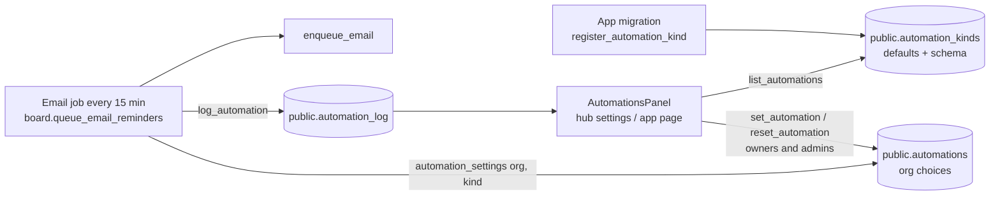

# The automation engine (S-25)

One engine for every schedule and automation an organization may want to change, instead of fixed jobs in each app. It drives reminders now, and is meant to drive OpenCharterApp's award system, renewal reminders, governance alerts, scheduled board packages and every other "the app does this on its own" feature later.

This document is the design. **Part 1 is built** (shared 1.11.0, core `0008_core_automations.sql`, Board `0009_automation_reminders.sql`); later parts are planned in [`ROADMAP.md`](ROADMAP.md).

## 1. Words

| Word           | Meaning                                                                                                                                   |
| -------------- | ----------------------------------------------------------------------------------------------------------------------------------------- |
| **Kind**       | One automation an app offers, e.g. `board.meeting_reminders`. Registered by the app's migration with its defaults and what can be changed |
| **Automation** | A kind as one organization has it: on or off, with its settings. No row means the defaults                                                |
| **Settings**   | The kind's parameters (e.g. `days_before: [7, 1]`), checked against the kind's schema                                                     |
| **Run / log**  | What an automation did for an organization ("2 meeting reminders emailed"), kept for a year                                               |
| **Trigger**    | What starts it. Part 1: a schedule (an email job every 15 minutes that checks dates). Later: events in any app                            |
| **Condition**  | When it applies. Later: the rules engine (Charter's C-19)                                                                                 |
| **Action**     | What it does. Part 1: queue email. Later: create a task, start an approval, add to a packet, change a status                              |

## 2. How part 1 works

> **Diagram description:** Each app's migration registers its kinds in `public.automation_kinds` with their defaults and a schema of what can change. The shared Automations panel (on the hub's organization settings page and in each app) lists them with `list_automations`; owners and admins change one with `set_automation` or go back to the defaults with `reset_automation`, which writes `public.automations`. The app's job (for Board, the reminders job that runs every 15 minutes) reads the settings in force for each organization with `automation_settings`, queues email, and records what it did with `log_automation`, which the panel shows as the last run.

### Tables (core 0008)

| Table                     | Columns                                                                                                                    | Who can read / write                                                                                                        |
| ------------------------- | -------------------------------------------------------------------------------------------------------------------------- | --------------------------------------------------------------------------------------------------------------------------- |
| `public.automation_kinds` | `key` (`app.name`), `app`, `name`, `description`, `category`, `default_enabled`, `default_params`, `params_schema`, `sort` | Everyone signed in reads; written only by `register_automation_kind` (service role, migrations)                             |
| `public.automations`      | `org_id`, `kind`, `enabled`, `params`, `updated_by`, `updated_at` (primary key `org_id, kind`)                             | Members read; written only by `set_automation` / `reset_automation` (owners, admins)                                        |
| `public.automation_log`   | `org_id`, `kind`, `at`, `count`, `summary`                                                                                 | Members read; written only by `log_automation` (service role); pruned after a year (`core.automation_log_prune` job, daily) |

### Functions

| Function                                                                                                                | For                                                                               |
| ----------------------------------------------------------------------------------------------------------------------- | --------------------------------------------------------------------------------- |
| `register_automation_kind(key, app, name, description, category, default_enabled, default_params, params_schema, sort)` | An app's migration adds or updates a kind (idempotent)                            |
| `automation_settings(org, kind) → (enabled, params)`                                                                    | Jobs: the settings in force (the organization's choices over the defaults)        |
| `list_automations(org)`                                                                                                 | Members: every kind with its settings in force, defaults, schema and last run     |
| `set_automation(org, kind, enabled, params)`                                                                            | Owners and admins: change it. Settings are checked and cleaned against the schema |
| `reset_automation(org, kind)`                                                                                           | Owners and admins: back to the defaults                                           |
| `log_automation(org, kind, count, summary)`                                                                             | Jobs: record what it did (only when the count is above 0)                         |

### The settings schema

`params_schema` is a small JSON object, one entry per setting. The panel draws the form from it and `set_automation` checks against it, so a new kind needs no new UI code.

| `type`     | Form                  | Checked                                                                                             |
| ---------- | --------------------- | --------------------------------------------------------------------------------------------------- |
| `int`      | A number field        | A whole number from `min` to `max`                                                                  |
| `int_list` | A text field ("7, 1") | 1 to `max_items` whole numbers, each from `min` to `max`; stored sorted high to low without repeats |
| `bool`     | A checkbox            | true or false                                                                                       |

Each entry also has `label`, `help` and `unit` (shown in the form). Unknown settings are refused.

### The first automations (Board 0009)

| Kind                          | Default                             | Settings                                    | Behaviour                                                                                                                                                                                             |
| ----------------------------- | ----------------------------------- | ------------------------------------------- | ----------------------------------------------------------------------------------------------------------------------------------------------------------------------------------------------------- |
| `board.meeting_reminders`     | On; 7 and 1 days before             | `days_before`: up to 5 numbers, 0–60        | Each current board member (a term with an account) gets one email per chosen day; a meeting scheduled inside a window gets that window's email (a meeting set 5 days out still gets the "7 days" one) |
| `board.action_item_reminders` | On; 2 days before, and when overdue | `days_before`: 0–30; `when_overdue`: on/off | The assignee of an open item; overdue once, up to a week late                                                                                                                                         |

The de-duplication keys didn't change, so switching to the engine sent nothing twice.

## 3. Adding an automation (for developers)

1. In the app's migration, call `public.register_automation_kind(...)` with a key `app.name`, plain-language name and description, defaults and a schema.
2. In the job, read `public.automation_settings(org_id, '<key>')` for each organization (skip it when `enabled` is false) and call `public.log_automation(...)` with what it did.
3. Write database tests for the defaults, a changed setting, and switched off.
4. Document it in the customer docs (the app's guide and the hub's Automations page) and here.

## 4. Where it's going: workflows each organization builds (owner direction, 2026-11-12)

The goal is **fully custom**: every organization builds the workflows **it** wants, not the ones we expect it to want. Part 1's fixed kinds (Board's reminders) stay as ready-made workflows, but anything an organization can imagine with the building blocks below, it can build. No drag and drop is needed: a clear form of **When → If → Then** steps is enough.

### The shape of a workflow

- **When** (trigger): something happens in any app (_a form is received_, _a payment arrives_, _a board meeting is scheduled_, _a membership lapses_), or a time comes (_every month on the 1st_, _5 days before each board meeting_).
- **If** (conditions), any number, combined with and / or, and **branches**: _if rank is PFC or lower … else if rank is SPC to SFC … otherwise …_. Conditions read anything the trigger carries (the form's answers, the member's fields, rank, level, chapter, region, the meeting's date, an amount).
- **Then** (actions), in order, per branch: _submit it for approval to …_, _send an email to …_, _create a task for …_, _generate documents from …_, _add them to the meeting's packet_, _change a status_, _wait N days_, _if no answer in N days, escalate to …_.
- **Who** is always a role or seat, resolved at run time from the organization's own structure: _the member's chapter president_, _the regional president_, _the national's awards chair_, _the treasurer_, a named person, or the person who submitted.

### Examples the owner gave

**Award recommendations, routed by rank**

|                            |                                                                             |
| -------------------------- | --------------------------------------------------------------------------- |
| When                       | Form received: _Award recommendation_                                       |
| If rank ≤ PFC              | Submit for approval to **the member's chapter president**                   |
| Else if rank is SPC to SFC | Submit for approval to **the regional president**                           |
| Else                       | Submit for approval to **the national's awards committee**                  |
| Then (on approval)         | Email the submitter; create a task for the quartermaster to order the award |

**Board documents from the books**

|      |                                                                                                                                                                                              |
| ---- | -------------------------------------------------------------------------------------------------------------------------------------------------------------------------------------------- |
| When | A board meeting is **less than 5 days away**                                                                                                                                                 |
| Then | Generate the **financial reports** from OpenLedgerApp **as of the last closed month** (or **as of today**, or **as of a date they pick**) and add them to the meeting's documents and packet |

### Parts

| Part | What                                                                                                                                                                                                                                                                                                    | Needs         |
| ---- | ------------------------------------------------------------------------------------------------------------------------------------------------------------------------------------------------------------------------------------------------------------------------------------------------------- | ------------- |
| 1 ✅ | Catalog of ready-made automations, each organization's settings, history (Board's reminders)                                                                                                                                                                                                            | —             |
| 2    | **Workflow builder**: workflows as data (`automation_workflows`: trigger, ordered steps, branches with conditions, actions), a validated JSON definition, a step runner with a run history per item, the When → If → Then editor (forms, not drag and drop), test runs ("what would this do for Jane?") | Part 1        |
| 3    | **Triggers from every app**: an event outbox each app writes (`form.received`, `payment.received`, `membership.lapsed`, `meeting.scheduled`, `task.overdue`, …) plus time triggers relative to dates (_N days before a meeting_)                                                                        | Part 2        |
| 4    | **Conditions** on any field the trigger carries, including member fields and ordered lists like rank (_≤ PFC_, _between SPC and SFC_), using the rules engine (C-19)                                                                                                                                    | C-19 ✅       |
| 5    | **Actions**: email, task, approval routing to roles and seats (with reminders and escalation; C-24), document generation from OpenLedgerApp and OpenCharterApp with an as-of choice (last closed month, today, a picked date) into a meeting's packet (S-13), status changes                            | C-24, S-13 ✅ |
| 6    | **Forms** as a trigger (the form builder, C-29) and the **awards** flow built from all of the above (C-30…C-33)                                                                                                                                                                                         | C-29          |
| 7    | **Nationals share workflows** with their chapters (use as-is, or copy and change), and fixed schedules move in (renewal reminders C-13, the former S-20)                                                                                                                                                | Parts 2–5     |

Every part keeps the same promise: nothing runs without a record of what it did, owners and admins see and change everything in one place, and sensible ready-made workflows are there for those who don't want to build their own.
