# Database map

Every table in the suite's database, grouped by what it's for, with how the tables connect. Use it to answer questions like "how do we track billing?" or "where does a dues payment end up?": find the domain below, read the diagram, then open the column list.

Generated from the schema built by every repo's migrations (core `0001`–`0016`, hub `0001`–`0009`, Charter `0001`–`0016`, Board `0001`–`0018`, Ledger `0001`–`0012`) on 2026-11-13: every relationship in a diagram is a real foreign key, and every column list is the real table. Architecture and the reasons behind it: [`architecture.md`](architecture.md). Charter's hand-written table map with write paths: [`charter/tables.md`](charter/tables.md).

**How to read the diagrams** (Mermaid entity-relationship diagrams):

- A box is a table, named `schema_table` (for example `billing_subscriptions` is `billing.subscriptions`). It lists the primary key (`PK`), foreign keys (`FK`), unique columns (`UK`) and the columns you most often need; the full list is in the collapsible section under each diagram.
- A box with only an `id` is a table from another domain that this one points to (for example `public_organizations`).
- A line is a foreign key, labelled with the column. `}o--||` means "many rows here point to exactly one row there"; `}o--o|` means the column can be empty; `|o--||` means at most one row here per row there (one-to-one).
- Links that aren't foreign keys (between apps, or by convention) are listed in [Logical links](#logical-links-not-foreign-keys).

**Contents**

1. [The whole database at a glance](#1-the-whole-database-at-a-glance)
2. [Follow a question](#2-follow-a-question)
3. [Core: organizations, people, invitations](#3-core-organizations-people-invitations) (`public`)
4. [Hub](#4-hub) (`hub`)
5. [Billing](#5-billing) (`billing`)
6. [Email](#6-email) (`public`)
7. [OpenCharterApp](#7-opencharterapp) (`charter`): organization tree and settings · roles and permissions · members and membership · money · governance
8. [OpenBoardApp](#8-openboardapp) (`board`): people and terms · meetings and votes · records
9. [OpenLedgerApp](#9-openledgerapp) (`ledger`): the books · planning · bank and statement checks · administration
10. [Integration views (api_*)](#10-integration-views-api_)
11. [Logical links (not foreign keys)](#11-logical-links-not-foreign-keys)
12. [Conventions](#12-conventions)

---

## 1. The whole database at a glance

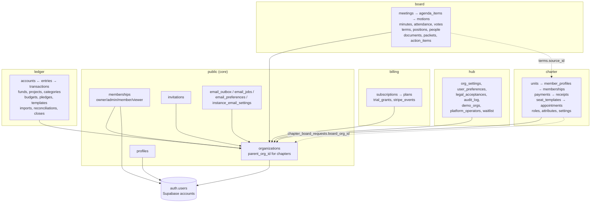

> **Diagram description:** Supabase's `auth.users` holds the accounts. The core (`public`) holds organizations (with `parent_org_id` for chapters' organizations), memberships with their role, profiles, invitations and the email tables. The `hub`, `billing`, `charter`, `board` and `ledger` schemas all point to `public.organizations`. Two dotted lines are cross-app links that aren't foreign keys: Board's mirrored terms point to Charter appointments, and Charter's chapter requests point to the chapter's own organization.

Tables per schema: `public` 9, `hub` 8, `billing` 4, `charter` 34, `board` 21, `ledger` 25 (plus `ops.schema_migrations`).

---

## 2. Follow a question

| Question                                                | Start at                                                                                     | Then                                                                                                                                                                                                                                                                                                                                                       |
| ------------------------------------------------------- | -------------------------------------------------------------------------------------------- | ---------------------------------------------------------------------------------------------------------------------------------------------------------------------------------------------------------------------------------------------------------------------------------------------------------------------------------------------------------- |
| **How do we track billing?**                            | `billing.subscriptions` (one per organization)                                               | `billing.plans` (limits), `billing.trial_grants` (one trial per person), `billing.stripe_events` (webhook idempotency), `public.organizations.parent_org_id` (a chapter uses its parent's subscription), `hub.org_settings` (billing contact), `public.instance_settings.billing_enabled` (§5)                                                             |
| **Who belongs to an organization, with what role?**     | `public.memberships`                                                                         | `public.profiles` (name), `public.invitations` (pending), a role in each app: `public.app_role_overrides` (set for the person) and `public.org_named_roles` (their named role; extra permissions from `public.app_permission_types`), otherwise viewer; app overlays: `charter.role_assignments`, `board.officers`, `ledger.member_roles` (§3, §7, §8, §9) |
| **Where does a dues payment end up?**                   | `charter.payments`                                                                           | `charter.memberships` (what it paid for), `charter.receipts` (+ `receipt_counters`), `charter.gateway_connections` (whose Stripe), `charter.webhook_events`; in Ledger (demo, and S-18 later): `ledger.transactions` + `ledger.entries` on Membership Dues (§7.4)                                                                                          |
| **Who is on a board?**                                  | `charter.appointments` (Charter's officers)                                                  | `charter.seat_templates`, `seat_terms`; mirrored to `board.terms` (`source = 'charter'`), `board.positions`, `board.officers` (app access) (§7.5, §8.1)                                                                                                                                                                                                    |
| **What happened at a meeting?**                         | `board.meetings`                                                                             | `agenda_items`, `attendance`, `motions` (+ `vote_electorate`, `member_votes` for live votes), `minutes`, `action_items`, `packets` (§8.2)                                                                                                                                                                                                                  |
| **Which reminders does an organization get, and when?** | `public.automations` (its choices) over `public.automation_kinds` (defaults)                 | `automation_log` (what each did), `email_outbox` (§6.1)                                                                                                                                                                                                                                                                                                    |
| **What emails are waiting or were sent?**               | `public.email_outbox`                                                                        | `email_jobs` (what queues them), `email_preferences` (opt-outs), `hub.user_preferences` (billing/activity opt-outs), `instance_email_settings` (self-hosted SMTP) (§6)                                                                                                                                                                                     |
| **How is a ledger balanced?**                           | `ledger.transactions`                                                                        | `ledger.entries` (debits positive, credits negative, sum to zero per transaction), `accounts`, `categories`, `funds`, `projects` (§9.1)                                                                                                                                                                                                                    |
| **Is a month closed / reconciled?**                     | `ledger.period_closes`, `ledger.reconciliations`                                             | `ledger.entries.reconciliation_id`, `bank_transactions`, `import_batches` (§9.3)                                                                                                                                                                                                                                                                           |
| **Which chapters use OpenBoardApp?**                    | `charter.chapter_board_requests`                                                             | `public.organizations` where `parent_org_id` is the national and `source_app = 'charter'` (§7.1)                                                                                                                                                                                                                                                           |
| **Who changed what?**                                   | `hub.audit_log` (core tables), `charter.audit_events`, `board.audit_log`, `ledger.audit_log` | Each is append-only, written by triggers                                                                                                                                                                                                                                                                                                                   |
| **What does the hub dashboard read?**                   | The `api_*` views                                                                            | §10                                                                                                                                                                                                                                                                                                                                                        |

---

## 3. Core: organizations, people, invitations

Schema `public`, from `db/core` (every repo vendors it). The organization is the one id every app uses; memberships give people a core role in it. A chapter's own organization (S-24) has `parent_org_id` (one level only, enforced by a trigger) and `source_app` / `source_ref` (the Charter unit it came from). `instance_settings` is one row: `billing_enabled` (true only on the hosted suite) and `hub_url`.

Key functions: `create_organization`, `rename_organization`, `delete_organization`, `transfer_ownership`, `create_invitation` / `get_invitation` / `accept_invitation` / `revoke_invitation`, `org_member_directory`, `is_member`, `has_role`, `can_write`, `has_app_access`, `set_organization_preferences`, `_create_child_organization` (apps' definer functions only), `is_member_of_child`.

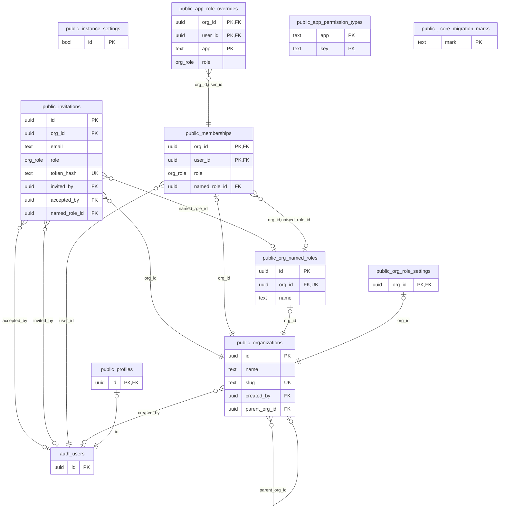

<details><summary><code>public.organizations</code> (10 columns)</summary>

| Column          | Type                     | Null | Default             | Key / reference                              |
| --------------- | ------------------------ | ---- | ------------------- | -------------------------------------------- |
| `id`            | uuid                     |      | `gen_random_uuid()` | PK                                           |
| `name`          | text                     |      |                     |                                              |
| `slug`          | text                     | yes  |                     | unique                                       |
| `created_by`    | uuid                     | yes  |                     | → `auth.users` (on delete set null)          |
| `created_at`    | timestamp with time zone |      | `now()`             |                                              |
| `time_zone`     | text                     |      | `'UTC'::text`       |                                              |
| `currency`      | text                     |      | `'USD'::text`       |                                              |
| `parent_org_id` | uuid                     | yes  |                     | → `public.organizations` (on delete cascade) |
| `source_app`    | text                     | yes  |                     |                                              |
| `source_ref`    | uuid                     | yes  |                     |                                              |

Unique together: (source_app, source_ref).

</details>

<details><summary><code>public.memberships</code> (5 columns)</summary>

| Column          | Type                     | Null | Default              | Key / reference                                           |
| --------------- | ------------------------ | ---- | -------------------- | --------------------------------------------------------- |
| `org_id`        | uuid                     |      |                      | PK unique → `public.org_named_roles` (on delete set null) |
| `user_id`       | uuid                     |      |                      | PK → `auth.users` (on delete cascade)                     |
| `role`          | org_role                 |      | `'member'::org_role` |                                                           |
| `created_at`    | timestamp with time zone |      | `now()`              |                                                           |
| `named_role_id` | uuid                     | yes  |                      | → `public.org_named_roles` (on delete set null)           |

</details>

<details><summary><code>public.profiles</code> (4 columns)</summary>

| Column         | Type                     | Null | Default | Key / reference                       |
| -------------- | ------------------------ | ---- | ------- | ------------------------------------- |
| `id`           | uuid                     |      |         | PK → `auth.users` (on delete cascade) |
| `display_name` | text                     | yes  |         |                                       |
| `avatar_url`   | text                     | yes  |         |                                       |
| `updated_at`   | timestamp with time zone |      | `now()` |                                       |

</details>

<details><summary><code>public.invitations</code> (15 columns)</summary>

| Column          | Type                     | Null | Default             | Key / reference                                 |
| --------------- | ------------------------ | ---- | ------------------- | ----------------------------------------------- |
| `id`            | uuid                     |      | `gen_random_uuid()` | PK                                              |
| `org_id`        | uuid                     |      |                     | → `public.organizations` (on delete cascade)    |
| `email`         | text                     | yes  |                     |                                                 |
| `role`          | org_role                 | yes  |                     |                                                 |
| `app`           | text                     | yes  |                     |                                                 |
| `app_payload`   | jsonb                    |      | `'{}'::jsonb`       |                                                 |
| `token_hash`    | text                     |      |                     | unique                                          |
| `expires_at`    | timestamp with time zone |      |                     |                                                 |
| `invited_by`    | uuid                     | yes  |                     | → `auth.users` (on delete set null)             |
| `created_at`    | timestamp with time zone |      | `now()`             |                                                 |
| `accepted_by`   | uuid                     | yes  |                     | → `auth.users` (on delete set null)             |
| `accepted_at`   | timestamp with time zone | yes  |                     |                                                 |
| `revoked_at`    | timestamp with time zone | yes  |                     |                                                 |
| `named_role_id` | uuid                     | yes  |                     | → `public.org_named_roles` (on delete set null) |
| `app_roles`     | jsonb                    |      | `'{}'::jsonb`       |                                                 |

</details>

<details><summary><code>public.instance_settings</code> (3 columns)</summary>

| Column            | Type    | Null | Default | Key / reference |
| ----------------- | ------- | ---- | ------- | --------------- |
| `id`              | boolean |      | `true`  | PK              |
| `billing_enabled` | boolean |      | `false` |                 |
| `hub_url`         | text    | yes  |         |                 |

</details>

<details><summary><code>public.app_role_overrides</code> (7 columns)</summary>

| Column      | Type                     | Null | Default      | Key / reference                               |
| ----------- | ------------------------ | ---- | ------------ | --------------------------------------------- |
| `org_id`    | uuid                     |      |              | PK → `public.memberships` (on delete cascade) |
| `user_id`   | uuid                     |      |              | PK → `public.memberships` (on delete cascade) |
| `app`       | text                     |      |              | PK                                            |
| `role`      | org_role                 |      |              |                                               |
| `set_by`    | uuid                     | yes  | `auth.uid()` |                                               |
| `set_at`    | timestamp with time zone |      | `now()`      |                                               |
| `no_access` | boolean                  |      | `false`      |                                               |

</details>

<details><summary><code>public.org_named_roles</code> (8 columns)</summary>

| Column        | Type                     | Null | Default             | Key / reference                                     |
| ------------- | ------------------------ | ---- | ------------------- | --------------------------------------------------- |
| `id`          | uuid                     |      | `gen_random_uuid()` | PK                                                  |
| `org_id`      | uuid                     |      |                     | unique → `public.organizations` (on delete cascade) |
| `name`        | text                     |      |                     |                                                     |
| `description` | text                     |      | `''::text`          |                                                     |
| `app_roles`   | jsonb                    |      | `'{}'::jsonb`       |                                                     |
| `permissions` | jsonb                    |      | `'{}'::jsonb`       |                                                     |
| `created_at`  | timestamp with time zone |      | `now()`             |                                                     |
| `updated_at`  | timestamp with time zone |      | `now()`             |                                                     |

Unique together: (id, org_id).

</details>

<details><summary><code>public.org_role_settings</code> (5 columns)</summary>

| Column                    | Type                     | Null | Default      | Key / reference                                 |
| ------------------------- | ------------------------ | ---- | ------------ | ----------------------------------------------- |
| `org_id`                  | uuid                     |      |              | PK → `public.organizations` (on delete cascade) |
| `app_admins_manage_roles` | boolean                  |      | `false`      |                                                 |
| `set_by`                  | uuid                     | yes  | `auth.uid()` |                                                 |
| `set_at`                  | timestamp with time zone |      | `now()`      |                                                 |
| `require_mfa_admins`      | boolean                  |      | `false`      |                                                 |

</details>

<details><summary><code>public.app_permission_types</code> (5 columns)</summary>

| Column        | Type    | Null | Default    | Key / reference |
| ------------- | ------- | ---- | ---------- | --------------- |
| `app`         | text    |      |            | PK              |
| `key`         | text    |      |            | PK              |
| `label`       | text    |      |            |                 |
| `description` | text    |      | `''::text` |                 |
| `sort`        | integer |      | `100`      |                 |

</details>

<details><summary><code>public._core_migration_marks</code> (2 columns)</summary>

| Column    | Type                     | Null | Default | Key / reference |
| --------- | ------------------------ | ---- | ------- | --------------- |
| `mark`    | text                     |      |         | PK              |
| `done_at` | timestamp with time zone |      | `now()` |                 |

</details>

---

## 4. Hub

Schema `hub` (not exposed to the Data API; reached through definer functions). Hosted only. `instance` marks the environment (`staging` enables demo tools); `audit_log` records changes to core tables (who did what, old and new values) and survives the organization's deletion; `demo_orgs` gives demo organizations a long trial and lets the reset find them.

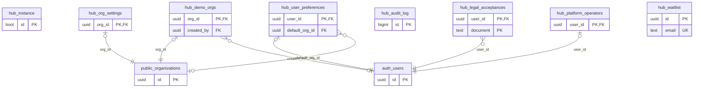

<details><summary><code>hub.instance</code> (2 columns)</summary>

| Column        | Type    | Null | Default | Key / reference |
| ------------- | ------- | ---- | ------- | --------------- |
| `id`          | boolean |      | `true`  | PK              |
| `environment` | text    | yes  |         |                 |

</details>

<details><summary><code>hub.org_settings</code> (6 columns)</summary>

| Column                 | Type                     | Null | Default | Key / reference                                 |
| ---------------------- | ------------------------ | ---- | ------- | ----------------------------------------------- |
| `org_id`               | uuid                     |      |         | PK → `public.organizations` (on delete cascade) |
| `billing_email`        | text                     | yes  |         |                                                 |
| `billing_name`         | text                     | yes  |         |                                                 |
| `updated_at`           | timestamp with time zone |      | `now()` |                                                 |
| `setup_preferences_at` | timestamp with time zone | yes  |         |                                                 |
| `setup_dismissed_at`   | timestamp with time zone | yes  |         |                                                 |

</details>

<details><summary><code>hub.user_preferences</code> (7 columns)</summary>

| Column                | Type                     | Null | Default        | Key / reference                               |
| --------------------- | ------------------------ | ---- | -------------- | --------------------------------------------- |
| `user_id`             | uuid                     |      |                | PK → `auth.users` (on delete cascade)         |
| `billing_emails`      | boolean                  |      | `true`         |                                               |
| `org_activity_emails` | boolean                  |      | `true`         |                                               |
| `product_news`        | boolean                  |      | `false`        |                                               |
| `updated_at`          | timestamp with time zone |      | `now()`        |                                               |
| `dashboard_hidden`    | text[]                   |      | `'{}'::text[]` |                                               |
| `default_org_id`      | uuid                     | yes  |                | → `public.organizations` (on delete set null) |

</details>

<details><summary><code>hub.legal_acceptances</code> (3 columns)</summary>

| Column        | Type                     | Null | Default | Key / reference                       |
| ------------- | ------------------------ | ---- | ------- | ------------------------------------- |
| `user_id`     | uuid                     |      |         | PK → `auth.users` (on delete cascade) |
| `document`    | text                     |      |         | PK                                    |
| `accepted_at` | timestamp with time zone |      |         |                                       |

</details>

<details><summary><code>hub.audit_log</code> (9 columns)</summary>

| Column       | Type                     | Null | Default | Key / reference |
| ------------ | ------------------------ | ---- | ------- | --------------- |
| `id`         | bigint                   |      |         | PK              |
| `org_id`     | uuid                     | yes  |         |                 |
| `actor`      | uuid                     | yes  |         |                 |
| `action`     | text                     |      |         |                 |
| `table_name` | text                     |      |         |                 |
| `row_key`    | text                     | yes  |         |                 |
| `old_data`   | jsonb                    | yes  |         |                 |
| `new_data`   | jsonb                    | yes  |         |                 |
| `at`         | timestamp with time zone |      | `now()` |                 |

</details>

<details><summary><code>hub.platform_operators</code> (3 columns)</summary>

| Column     | Type                     | Null | Default | Key / reference                       |
| ---------- | ------------------------ | ---- | ------- | ------------------------------------- |
| `user_id`  | uuid                     |      |         | PK → `auth.users` (on delete cascade) |
| `note`     | text                     | yes  |         |                                       |
| `added_at` | timestamp with time zone |      | `now()` |                                       |

</details>

<details><summary><code>hub.demo_orgs</code> (3 columns)</summary>

| Column       | Type                     | Null | Default | Key / reference                                 |
| ------------ | ------------------------ | ---- | ------- | ----------------------------------------------- |
| `org_id`     | uuid                     |      |         | PK → `public.organizations` (on delete cascade) |
| `created_by` | uuid                     | yes  |         | → `auth.users` (on delete set null)             |
| `created_at` | timestamp with time zone |      | `now()` |                                                 |

</details>

<details><summary><code>hub.waitlist</code> (4 columns)</summary>

| Column       | Type                     | Null | Default             | Key / reference |
| ------------ | ------------------------ | ---- | ------------------- | --------------- |
| `id`         | uuid                     |      | `gen_random_uuid()` | PK              |
| `email`      | text                     |      |                     | unique          |
| `source`     | text                     | yes  |                     |                 |
| `created_at` | timestamp with time zone |      | `now()`             |                 |

</details>

---

## 5. Billing

Schema `billing` (not exposed). One subscription per organization (`org_id` is the primary key). Written only by the Stripe webhook (service role) and the triggers below; read through `public.get_org_billing`.

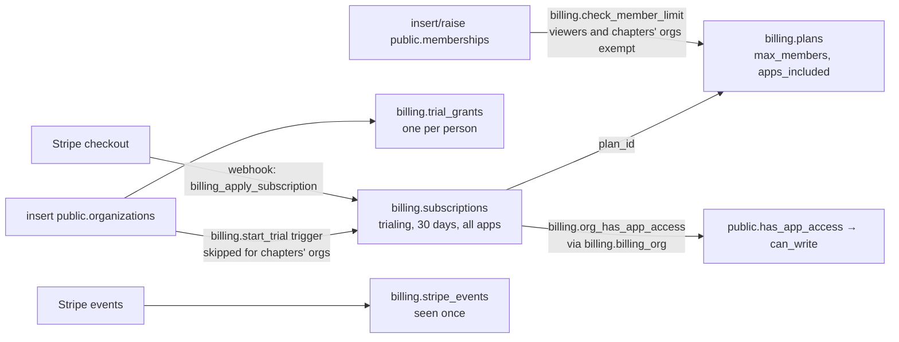

> **Diagram description:** Creating an organization starts a 30-day trial subscription for all apps (skipped for a chapter's organization) and records the creator's one trial. A Stripe checkout's webhook writes the subscription. The subscription's plan sets the editor limit, which a trigger checks when memberships are added or raised (viewers and chapters' organizations are exempt). Access for every app is decided from the subscription of the billing organization (a chapter uses its parent's). Every Stripe event id is recorded once so a webhook is never applied twice.

Statuses: `trialing`, `active`, `past_due`, `canceled`, `unpaid`, `incomplete`, `expired`. Functions: `get_org_billing`, `billing_plans`, `billing_member_count`, `billing_parent_org`, `billing_customer_for_org`, `billing_set_customer`, `billing_record_event`, `billing_forget_event`, `billing_apply_subscription`, `billing_set_status`; internal: `org_has_app_access`, `billing_org`, `start_trial`, `check_member_limit`, `trial_days`, `trial_member_limit`.

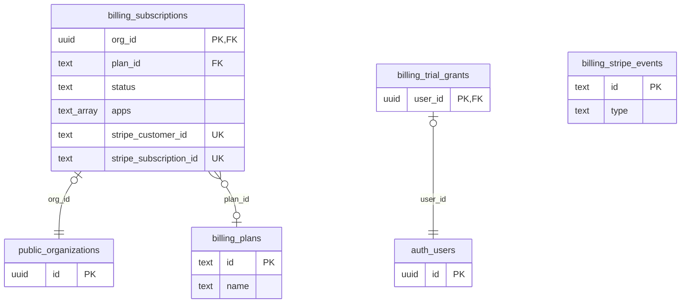

<details><summary><code>billing.plans</code> (7 columns)</summary>

| Column          | Type    | Null | Default | Key / reference |
| --------------- | ------- | ---- | ------- | --------------- |
| `id`            | text    |      |         | PK              |
| `name`          | text    |      |         |                 |
| `max_members`   | integer | yes  |         |                 |
| `storage_gb`    | integer |      | `5`     |                 |
| `apps_included` | integer | yes  |         |                 |
| `max_units`     | integer | yes  |         |                 |
| `active`        | boolean |      | `true`  |                 |

</details>

<details><summary><code>billing.subscriptions</code> (11 columns)</summary>

| Column                   | Type                     | Null | Default        | Key / reference                                 |
| ------------------------ | ------------------------ | ---- | -------------- | ----------------------------------------------- |
| `org_id`                 | uuid                     |      |                | PK → `public.organizations` (on delete cascade) |
| `plan_id`                | text                     | yes  |                | → `billing.plans` (on delete no action)         |
| `status`                 | text                     |      |                |                                                 |
| `apps`                   | text[]                   |      | `'{}'::text[]` |                                                 |
| `trial_ends_at`          | timestamp with time zone | yes  |                |                                                 |
| `current_period_end`     | timestamp with time zone | yes  |                |                                                 |
| `cancel_at_period_end`   | boolean                  |      | `false`        |                                                 |
| `stripe_customer_id`     | text                     | yes  |                | unique                                          |
| `stripe_subscription_id` | text                     | yes  |                | unique                                          |
| `updated_at`             | timestamp with time zone |      | `now()`        |                                                 |
| `stripe_event_at`        | timestamp with time zone | yes  |                |                                                 |

</details>

<details><summary><code>billing.trial_grants</code> (3 columns)</summary>

| Column       | Type                     | Null | Default | Key / reference                       |
| ------------ | ------------------------ | ---- | ------- | ------------------------------------- |
| `user_id`    | uuid                     |      |         | PK → `auth.users` (on delete cascade) |
| `org_id`     | uuid                     | yes  |         |                                       |
| `granted_at` | timestamp with time zone |      | `now()` |                                       |

</details>

<details><summary><code>billing.stripe_events</code> (3 columns)</summary>

| Column        | Type                     | Null | Default | Key / reference |
| ------------- | ------------------------ | ---- | ------- | --------------- |
| `id`          | text                     |      |         | PK              |
| `type`        | text                     |      |         |                 |
| `received_at` | timestamp with time zone |      | `now()` |                 |

</details>

---

## 6. Email

In the core (`0005_core_email.sql`), so it works hosted and self-hosted. Browsers can't read the outbox; people manage only their own preferences (`get_email_preferences` / `set_email_preferences`). The sender uses `run_email_jobs`, `claim_emails`, `finish_email`; apps' jobs use `enqueue_email`.

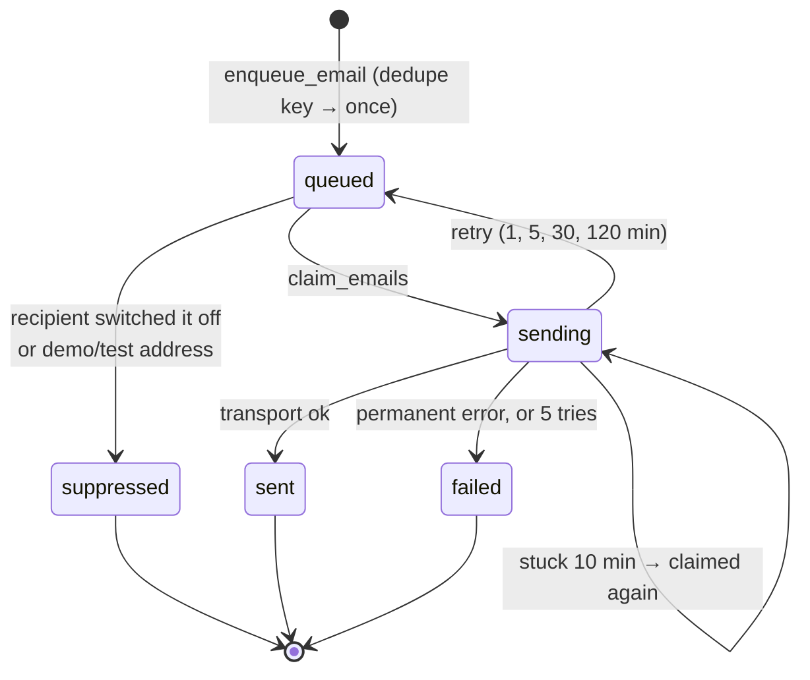

> **Diagram description:** An email starts queued (a de-duplication key makes sure the same reminder is only queued once). It may be suppressed (the recipient switched that kind of email off, or it's a demo or test address). The sender claims it (sending), and it ends sent, goes back to queued for a retry with back-off, or fails after a permanent error or five tries. A row stuck in sending for ten minutes is claimed again.

**Notifications (H-02, core `0013_core_notifications.sql`).** `notification_kinds` is the catalog (registered with `register_notification_kind`); `notification_preferences` is each person's choice per kind (in the app, by email; no row = the kind's defaults); `notifications` is the list behind the bell, one row per person, unique per person and dedupe key. `notify()` writes the list and queues the email in `email_outbox` (template `notification`). Billing kinds are raised by hub `0007` from `billing.subscriptions`; each person's dashboard panels and default organization are `hub.user_preferences.dashboard_hidden` and `default_org_id` (hub `0008`).

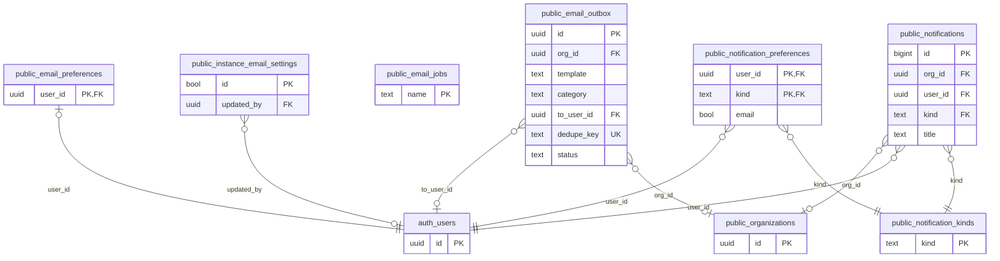

<details><summary><code>public.email_outbox</code> (17 columns)</summary>

| Column        | Type                     | Null | Default             | Key / reference                              |
| ------------- | ------------------------ | ---- | ------------------- | -------------------------------------------- |
| `id`          | uuid                     |      | `gen_random_uuid()` | PK                                           |
| `org_id`      | uuid                     | yes  |                     | → `public.organizations` (on delete cascade) |
| `app`         | text                     |      |                     |                                              |
| `template`    | text                     |      |                     |                                              |
| `category`    | text                     |      | `'essential'::text` |                                              |
| `to_user_id`  | uuid                     | yes  |                     | → `auth.users` (on delete cascade)           |
| `to_email`    | text                     | yes  |                     |                                              |
| `data`        | jsonb                    |      | `'{}'::jsonb`       |                                              |
| `dedupe_key`  | text                     | yes  |                     | unique                                       |
| `status`      | text                     |      | `'queued'::text`    |                                              |
| `attempts`    | integer                  |      | `0`                 |                                              |
| `last_error`  | text                     | yes  |                     |                                              |
| `provider_id` | text                     | yes  |                     |                                              |
| `send_after`  | timestamp with time zone |      | `now()`             |                                              |
| `claimed_at`  | timestamp with time zone | yes  |                     |                                              |
| `created_at`  | timestamp with time zone |      | `now()`             |                                              |
| `sent_at`     | timestamp with time zone | yes  |                     |                                              |

</details>

<details><summary><code>public.email_preferences</code> (10 columns)</summary>

| Column                | Type                     | Null | Default                      | Key / reference                       |
| --------------------- | ------------------------ | ---- | ---------------------------- | ------------------------------------- |
| `user_id`             | uuid                     |      |                              | PK → `auth.users` (on delete cascade) |
| `reminders`           | boolean                  |      | `true`                       |                                       |
| `digest`              | text                     |      | `'weekly'::text`             |                                       |
| `updated_at`          | timestamp with time zone |      | `now()`                      |                                       |
| `digest_day`          | integer                  |      | `1`                          |                                       |
| `digest_hour`         | integer                  |      | `7`                          |                                       |
| `digest_time_zone`    | text                     | yes  |                              |                                       |
| `digest_org_ids`      | uuid[]                   | yes  |                              |                                       |
| `digest_include`      | text[]                   |      | `'{tasks,meetings}'::text[]` |                                       |
| `digest_last_sent_at` | timestamp with time zone | yes  |                              |                                       |

</details>

<details><summary><code>public.email_jobs</code> (5 columns)</summary>

| Column        | Type                     | Null | Default                | Key / reference |
| ------------- | ------------------------ | ---- | ---------------------- | --------------- |
| `name`        | text                     |      |                        | PK              |
| `fn`          | text                     |      |                        |                 |
| `every`       | interval                 |      | `'00:15:00'::interval` |                 |
| `last_run_at` | timestamp with time zone | yes  |                        |                 |
| `last_error`  | text                     | yes  |                        |                 |

</details>

<details><summary><code>public.instance_email_settings</code> (11 columns)</summary>

| Column              | Type                     | Null | Default            | Key / reference                     |
| ------------------- | ------------------------ | ---- | ------------------ | ----------------------------------- |
| `id`                | boolean                  |      | `true`             | PK                                  |
| `smtp_host`         | text                     | yes  |                    |                                     |
| `smtp_port`         | integer                  | yes  |                    |                                     |
| `smtp_security`     | text                     |      | `'starttls'::text` |                                     |
| `smtp_username`     | text                     | yes  |                    |                                     |
| `smtp_password_enc` | text                     | yes  |                    |                                     |
| `from_address`      | text                     | yes  |                    |                                     |
| `from_name`         | text                     | yes  |                    |                                     |
| `reply_to`          | text                     | yes  |                    |                                     |
| `updated_by`        | uuid                     | yes  |                    | → `auth.users` (on delete set null) |
| `updated_at`        | timestamp with time zone |      | `now()`            |                                     |

</details>

<details><summary><code>public.notification_kinds</code> (11 columns)</summary>

| Column           | Type      | Null | Default                       | Key / reference |
| ---------------- | --------- | ---- | ----------------------------- | --------------- |
| `kind`           | text      |      |                               | PK              |
| `app`            | text      |      |                               |                 |
| `label`          | text      |      |                               |                 |
| `description`    | text      |      | `''::text`                    |                 |
| `audience`       | text      |      | `''::text`                    |                 |
| `default_roles`  | orgrole[] |      | `'{owner}'::org_role[]`       |                 |
| `eligible_roles` | orgrole[] |      | `'{owner,admin}'::org_role[]` |                 |
| `email_category` | text      |      | `'org_activity'::text`        |                 |
| `default_in_app` | boolean   |      | `true`                        |                 |
| `default_email`  | boolean   |      | `true`                        |                 |
| `sort`           | integer   |      | `100`                         |                 |

</details>

<details><summary><code>public.notification_preferences</code> (5 columns)</summary>

| Column       | Type                     | Null | Default | Key / reference                                      |
| ------------ | ------------------------ | ---- | ------- | ---------------------------------------------------- |
| `user_id`    | uuid                     |      |         | PK → `auth.users` (on delete cascade)                |
| `kind`       | text                     |      |         | PK → `public.notification_kinds` (on delete cascade) |
| `in_app`     | boolean                  |      |         |                                                      |
| `email`      | boolean                  |      |         |                                                      |
| `updated_at` | timestamp with time zone |      | `now()` |                                                      |

</details>

<details><summary><code>public.notifications</code> (11 columns)</summary>

| Column       | Type                     | Null | Default    | Key / reference                                   |
| ------------ | ------------------------ | ---- | ---------- | ------------------------------------------------- |
| `id`         | bigint                   |      |            | PK                                                |
| `org_id`     | uuid                     | yes  |            | → `public.organizations` (on delete cascade)      |
| `user_id`    | uuid                     |      |            | → `auth.users` (on delete cascade)                |
| `kind`       | text                     |      |            | → `public.notification_kinds` (on delete cascade) |
| `title`      | text                     |      |            |                                                   |
| `body`       | text                     |      | `''::text` |                                                   |
| `link`       | text                     | yes  |            |                                                   |
| `link_app`   | text                     | yes  |            |                                                   |
| `created_at` | timestamp with time zone |      | `now()`    |                                                   |
| `read_at`    | timestamp with time zone | yes  |            |                                                   |
| `dedupe_key` | text                     | yes  |            |                                                   |

Unique together: (user_id, dedupe_key).

</details>

### 6.1 Automations (S-25)

In the core (`0008_core_automations.sql`). Apps register their kinds (`register_automation_kind`); an organization's choices are rows in `automations` (none = the defaults), changed by owners and admins with `set_automation` / `reset_automation`; jobs read `automation_settings` and record runs in `automation_log` with `log_automation`. See [`automation-engine.md`](automation-engine.md).

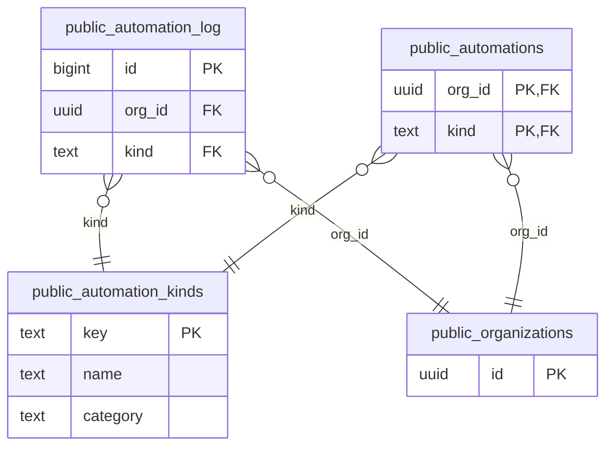

<details><summary><code>public.automation_kinds</code> (9 columns)</summary>

| Column            | Type    | Null | Default             | Key / reference |
| ----------------- | ------- | ---- | ------------------- | --------------- |
| `key`             | text    |      |                     | PK              |
| `app`             | text    |      |                     |                 |
| `name`            | text    |      |                     |                 |
| `description`     | text    |      |                     |                 |
| `category`        | text    |      | `'reminders'::text` |                 |
| `default_enabled` | boolean |      | `true`              |                 |
| `default_params`  | jsonb   |      | `'{}'::jsonb`       |                 |
| `params_schema`   | jsonb   |      | `'{}'::jsonb`       |                 |
| `sort`            | integer |      | `100`               |                 |

</details>

<details><summary><code>public.automations</code> (6 columns)</summary>

| Column       | Type                     | Null | Default       | Key / reference                                    |
| ------------ | ------------------------ | ---- | ------------- | -------------------------------------------------- |
| `org_id`     | uuid                     |      |               | PK → `public.organizations` (on delete cascade)    |
| `kind`       | text                     |      |               | PK → `public.automation_kinds` (on delete cascade) |
| `enabled`    | boolean                  |      |               |                                                    |
| `params`     | jsonb                    |      | `'{}'::jsonb` |                                                    |
| `updated_by` | uuid                     | yes  | `auth.uid()`  |                                                    |
| `updated_at` | timestamp with time zone |      | `now()`       |                                                    |

</details>

<details><summary><code>public.automation_log</code> (6 columns)</summary>

| Column    | Type                     | Null | Default | Key / reference                                 |
| --------- | ------------------------ | ---- | ------- | ----------------------------------------------- |
| `id`      | bigint                   |      |         | PK                                              |
| `org_id`  | uuid                     |      |         | → `public.organizations` (on delete cascade)    |
| `kind`    | text                     |      |         | → `public.automation_kinds` (on delete cascade) |
| `at`      | timestamp with time zone |      | `now()` |                                                 |
| `count`   | integer                  |      | `0`     |                                                 |
| `summary` | text                     |      |         |                                                 |

</details>

### 6.2 Workflows each organization builds (S-25 part 2)

In the core (`0009_core_workflows.sql`). Apps register what they offer in `automation_trigger_types`, `automation_action_types` and `automation_recipient_types`; each organization's workflows are `automation_workflows` (the When → If → Then definition as JSON; `shared` for a national's chapters, `adopted_from` when a chapter uses one). `automation_events` is what apps report happened; `automation_runs` records each run once per workflow and subject; steps create `automation_tasks` (on the hub dashboard) and `automation_jobs` (for an app to do). `automation_org_settings` holds whether chapters may build their own; `automation_editors` are the people besides owners and admins who may build. See [`automation-engine.md`](automation-engine.md) §5.

**Approvals and actions from email (C-08, core `0014`).** `approval_requests` is one "Ask for approval" step's question (what, how it's decided, an optional time limit, its outcome), with one `approval_approvers` row per person asked (their answer and comment). `email_action_kinds` lists the kinds of action an email may carry (apps register theirs); `email_action_settings` is each organization's choice per kind (off by default). `action_links` are the signed links themselves: one person, one action (the app function to call and its arguments), 7 days, used once; only the token's SHA-256 is kept.

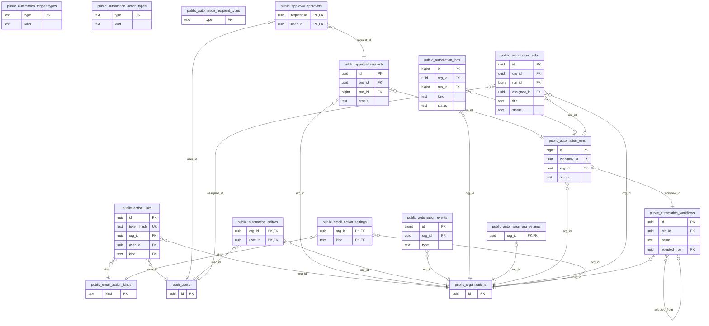

<details><summary><code>public.automation_workflows</code> (12 columns)</summary>

| Column         | Type                     | Null | Default             | Key / reference                                     |
| -------------- | ------------------------ | ---- | ------------------- | --------------------------------------------------- |
| `id`           | uuid                     |      | `gen_random_uuid()` | PK                                                  |
| `org_id`       | uuid                     |      |                     | → `public.organizations` (on delete cascade)        |
| `name`         | text                     |      |                     |                                                     |
| `description`  | text                     |      | `''::text`          |                                                     |
| `enabled`      | boolean                  |      | `true`              |                                                     |
| `definition`   | jsonb                    | yes  |                     |                                                     |
| `adopted_from` | uuid                     | yes  |                     | → `public.automation_workflows` (on delete cascade) |
| `shared`       | boolean                  |      | `false`             |                                                     |
| `created_by`   | uuid                     | yes  | `auth.uid()`        |                                                     |
| `updated_by`   | uuid                     | yes  | `auth.uid()`        |                                                     |
| `created_at`   | timestamp with time zone |      | `now()`             |                                                     |
| `updated_at`   | timestamp with time zone |      | `now()`             |                                                     |

Unique together: (org_id, adopted_from).

</details>

<details><summary><code>public.automation_trigger_types</code> (11 columns)</summary>

| Column          | Type    | Null | Default        | Key / reference |
| --------------- | ------- | ---- | -------------- | --------------- |
| `type`          | text    |      |                | PK              |
| `app`           | text    |      |                |                 |
| `label`         | text    |      |                |                 |
| `description`   | text    |      | `''::text`     |                 |
| `kind`          | text    |      |                |                 |
| `scan_fn`       | text    | yes  |                |                 |
| `params_schema` | jsonb   |      | `'{}'::jsonb`  |                 |
| `fields`        | jsonb   |      | `'[]'::jsonb`  |                 |
| `fields_fn`     | text    | yes  |                |                 |
| `provides`      | text[]  |      | `'{}'::text[]` |                 |
| `sort`          | integer |      | `100`          |                 |

</details>

<details><summary><code>public.automation_action_types</code> (10 columns)</summary>

| Column          | Type    | Null | Default        | Key / reference |
| --------------- | ------- | ---- | -------------- | --------------- |
| `type`          | text    |      |                | PK              |
| `app`           | text    |      |                |                 |
| `label`         | text    |      |                |                 |
| `description`   | text    |      | `''::text`     |                 |
| `params_schema` | jsonb   |      | `'{}'::jsonb`  |                 |
| `requires`      | text[]  |      | `'{}'::text[]` |                 |
| `sort`          | integer |      | `100`          |                 |
| `kind`          | text    |      | `'job'::text`  |                 |
| `run_fn`        | text    | yes  |                |                 |
| `output_schema` | jsonb   |      | `'[]'::jsonb`  |                 |

</details>

<details><summary><code>public.automation_recipient_types</code> (8 columns)</summary>

| Column          | Type    | Null | Default       | Key / reference |
| --------------- | ------- | ---- | ------------- | --------------- |
| `type`          | text    |      |               | PK              |
| `app`           | text    |      |               |                 |
| `label`         | text    |      |               |                 |
| `description`   | text    |      | `''::text`    |                 |
| `params_schema` | jsonb   |      | `'{}'::jsonb` |                 |
| `resolve_fn`    | text    |      |               |                 |
| `options_fn`    | text    | yes  |               |                 |
| `sort`          | integer |      | `100`         |                 |

</details>

<details><summary><code>public.automation_org_settings</code> (3 columns)</summary>

| Column               | Type                     | Null | Default | Key / reference                                 |
| -------------------- | ------------------------ | ---- | ------- | ----------------------------------------------- |
| `org_id`             | uuid                     |      |         | PK → `public.organizations` (on delete cascade) |
| `chapters_may_build` | boolean                  |      | `true`  |                                                 |
| `updated_at`         | timestamp with time zone |      | `now()` |                                                 |

</details>

<details><summary><code>public.automation_editors</code> (4 columns)</summary>

| Column       | Type                     | Null | Default      | Key / reference                                 |
| ------------ | ------------------------ | ---- | ------------ | ----------------------------------------------- |
| `org_id`     | uuid                     |      |              | PK → `public.organizations` (on delete cascade) |
| `user_id`    | uuid                     |      |              | PK → `auth.users` (on delete cascade)           |
| `granted_by` | uuid                     | yes  | `auth.uid()` |                                                 |
| `granted_at` | timestamp with time zone |      | `now()`      |                                                 |

</details>

<details><summary><code>public.automation_events</code> (6 columns)</summary>

| Column         | Type                     | Null | Default       | Key / reference                              |
| -------------- | ------------------------ | ---- | ------------- | -------------------------------------------- |
| `id`           | bigint                   |      |               | PK                                           |
| `org_id`       | uuid                     |      |               | → `public.organizations` (on delete cascade) |
| `type`         | text                     |      |               |                                              |
| `ctx`          | jsonb                    |      | `'{}'::jsonb` |                                              |
| `occurred_at`  | timestamp with time zone |      | `now()`       |                                              |
| `processed_at` | timestamp with time zone | yes  |               |                                              |

</details>

<details><summary><code>public.automation_runs</code> (17 columns)</summary>

| Column         | Type                     | Null | Default        | Key / reference                                     |
| -------------- | ------------------------ | ---- | -------------- | --------------------------------------------------- |
| `id`           | bigint                   |      |                | PK                                                  |
| `workflow_id`  | uuid                     |      |                | → `public.automation_workflows` (on delete cascade) |
| `org_id`       | uuid                     |      |                | → `public.organizations` (on delete cascade)        |
| `dedupe_key`   | text                     |      |                |                                                     |
| `trigger_type` | text                     |      |                |                                                     |
| `ctx`          | jsonb                    |      | `'{}'::jsonb`  |                                                     |
| `status`       | text                     |      | `'done'::text` |                                                     |
| `branch`       | text                     | yes  |                |                                                     |
| `log`          | jsonb                    |      | `'[]'::jsonb`  |                                                     |
| `error`        | text                     | yes  |                |                                                     |
| `started_at`   | timestamp with time zone |      | `now()`        |                                                     |
| `finished_at`  | timestamp with time zone | yes  |                |                                                     |
| `version`      | integer                  |      | `1`            |                                                     |
| `state`        | jsonb                    |      | `'{}'::jsonb`  |                                                     |
| `trace`        | jsonb                    |      | `'[]'::jsonb`  |                                                     |
| `resume_at`    | timestamp with time zone | yes  |                |                                                     |
| `wait_job`     | bigint                   | yes  |                |                                                     |

Unique together: (workflow_id, dedupe_key).

</details>

<details><summary><code>public.automation_tasks</code> (12 columns)</summary>

| Column        | Type                     | Null | Default             | Key / reference                                 |
| ------------- | ------------------------ | ---- | ------------------- | ----------------------------------------------- |
| `id`          | uuid                     |      | `gen_random_uuid()` | PK                                              |
| `org_id`      | uuid                     |      |                     | → `public.organizations` (on delete cascade)    |
| `run_id`      | bigint                   | yes  |                     | → `public.automation_runs` (on delete set null) |
| `assignee_id` | uuid                     |      |                     | → `auth.users` (on delete cascade)              |
| `title`       | text                     |      |                     |                                                 |
| `note`        | text                     |      | `''::text`          |                                                 |
| `link`        | text                     | yes  |                     |                                                 |
| `due_on`      | date                     | yes  |                     |                                                 |
| `status`      | text                     |      | `'open'::text`      |                                                 |
| `created_at`  | timestamp with time zone |      | `now()`             |                                                 |
| `done_at`     | timestamp with time zone | yes  |                     |                                                 |
| `done_by`     | uuid                     | yes  |                     |                                                 |

</details>

<details><summary><code>public.automation_jobs</code> (12 columns)</summary>

| Column       | Type                     | Null | Default          | Key / reference                                 |
| ------------ | ------------------------ | ---- | ---------------- | ----------------------------------------------- |
| `id`         | bigint                   |      |                  | PK                                              |
| `org_id`     | uuid                     |      |                  | → `public.organizations` (on delete cascade)    |
| `run_id`     | bigint                   | yes  |                  | → `public.automation_runs` (on delete set null) |
| `app`        | text                     |      |                  |                                                 |
| `kind`       | text                     |      |                  |                                                 |
| `payload`    | jsonb                    |      | `'{}'::jsonb`    |                                                 |
| `status`     | text                     |      | `'queued'::text` |                                                 |
| `attempts`   | integer                  |      | `0`              |                                                 |
| `result`     | jsonb                    | yes  |                  |                                                 |
| `error`      | text                     | yes  |                  |                                                 |
| `created_at` | timestamp with time zone |      | `now()`          |                                                 |
| `updated_at` | timestamp with time zone |      | `now()`          |                                                 |

</details>

<details><summary><code>public.approval_requests</code> (11 columns)</summary>

| Column       | Type                     | Null | Default             | Key / reference                                |
| ------------ | ------------------------ | ---- | ------------------- | ---------------------------------------------- |
| `id`         | uuid                     |      | `gen_random_uuid()` | PK                                             |
| `org_id`     | uuid                     |      |                     | → `public.organizations` (on delete cascade)   |
| `run_id`     | bigint                   | yes  |                     | → `public.automation_runs` (on delete cascade) |
| `step_key`   | text                     |      | `''::text`          |                                                |
| `what`       | text                     |      |                     |                                                |
| `details`    | text                     |      | `''::text`          |                                                |
| `mode`       | text                     |      | `'first'::text`     |                                                |
| `due_at`     | timestamp with time zone | yes  |                     |                                                |
| `status`     | text                     |      | `'pending'::text`   |                                                |
| `decided_at` | timestamp with time zone | yes  |                     |                                                |
| `created_at` | timestamp with time zone |      | `now()`             |                                                |

</details>

<details><summary><code>public.approval_approvers</code> (5 columns)</summary>

| Column       | Type                     | Null | Default    | Key / reference                                     |
| ------------ | ------------------------ | ---- | ---------- | --------------------------------------------------- |
| `request_id` | uuid                     |      |            | PK → `public.approval_requests` (on delete cascade) |
| `user_id`    | uuid                     |      |            | PK → `auth.users` (on delete cascade)               |
| `decision`   | text                     | yes  |            |                                                     |
| `comment`    | text                     |      | `''::text` |                                                     |
| `decided_at` | timestamp with time zone | yes  |            |                                                     |

</details>

<details><summary><code>public.email_action_kinds</code> (5 columns)</summary>

| Column        | Type    | Null | Default    | Key / reference |
| ------------- | ------- | ---- | ---------- | --------------- |
| `kind`        | text    |      |            | PK              |
| `app`         | text    |      |            |                 |
| `label`       | text    |      |            |                 |
| `description` | text    |      | `''::text` |                 |
| `sort`        | integer |      | `100`      |                 |

</details>

<details><summary><code>public.email_action_settings</code> (5 columns)</summary>

| Column    | Type                     | Null | Default      | Key / reference                                      |
| --------- | ------------------------ | ---- | ------------ | ---------------------------------------------------- |
| `org_id`  | uuid                     |      |              | PK → `public.organizations` (on delete cascade)      |
| `kind`    | text                     |      |              | PK → `public.email_action_kinds` (on delete cascade) |
| `allowed` | boolean                  |      | `false`      |                                                      |
| `set_by`  | uuid                     | yes  | `auth.uid()` |                                                      |
| `set_at`  | timestamp with time zone |      | `now()`      |                                                      |

</details>

<details><summary><code>public.action_links</code> (16 columns)</summary>

| Column        | Type                     | Null | Default                        | Key / reference                                   |
| ------------- | ------------------------ | ---- | ------------------------------ | ------------------------------------------------- |
| `id`          | uuid                     |      | `gen_random_uuid()`            | PK                                                |
| `token_hash`  | text                     |      |                                | unique                                            |
| `org_id`      | uuid                     |      |                                | → `public.organizations` (on delete cascade)      |
| `user_id`     | uuid                     |      |                                | → `auth.users` (on delete cascade)                |
| `kind`        | text                     |      |                                | → `public.email_action_kinds` (on delete cascade) |
| `label`       | text                     |      |                                |                                                   |
| `what`        | text                     |      | `''::text`                     |                                                   |
| `rpc_schema`  | text                     |      |                                |                                                   |
| `rpc_fn`      | text                     |      |                                |                                                   |
| `rpc_args`    | jsonb                    |      | `'{}'::jsonb`                  |                                                   |
| `comment_arg` | text                     | yes  |                                |                                                   |
| `open_link`   | text                     | yes  |                                |                                                   |
| `open_app`    | text                     | yes  |                                |                                                   |
| `created_at`  | timestamp with time zone |      | `now()`                        |                                                   |
| `expires_at`  | timestamp with time zone |      | `(now() + '7 days'::interval)` |                                                   |
| `used_at`     | timestamp with time zone | yes  |                                |                                                   |

</details>

---

## 7. OpenCharterApp

Schema `charter`. Every table has `org_id` (the customer, `public.organizations`) and, where it belongs to a national, region or chapter, `unit_id → charter.units` (the top unit has the same id as the organization). Charter's own permissions guard units inside the organization. Hand-written details (write paths, which RPC writes what): [`charter/tables.md`](charter/tables.md); domains: [`charter/data-domains.md`](charter/data-domains.md).

### 7.1 Organization tree, settings, setup, audit

`units` is the tree (`parent_id`, `ancestor_ids` kept by trigger, `type`: national, region, chapter, standalone). `org_settings` stores every setting per unit with a `mode` (inherit, override, locked) resolved by `charter.effective_setting`. `chapter_board_requests` tracks chapters asking to use OpenBoardApp (S-24), with `board_org_id` once approved. `audit_events` is Charter's append-only history.

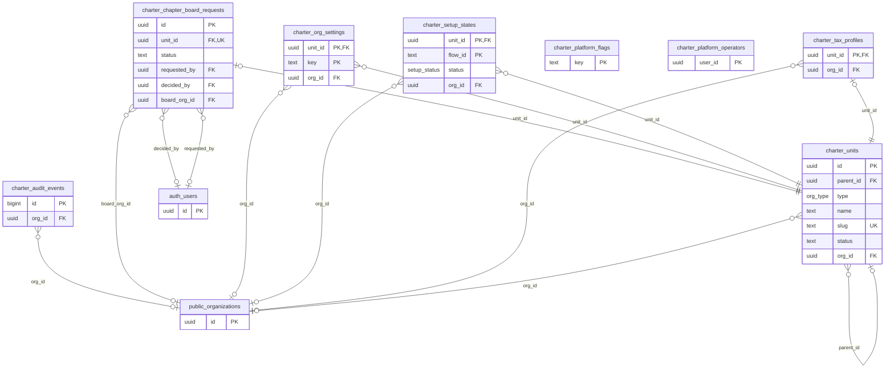

<details><summary><code>charter.units</code> (14 columns)</summary>

| Column         | Type                     | Null | Default                   | Key / reference                              |
| -------------- | ------------------------ | ---- | ------------------------- | -------------------------------------------- |
| `id`           | uuid                     |      | `gen_random_uuid()`       | PK                                           |
| `parent_id`    | uuid                     | yes  |                           | → `charter.units` (on delete restrict)       |
| `type`         | org_type                 |      |                           |                                              |
| `name`         | text                     |      |                           |                                              |
| `slug`         | text                     |      |                           | unique                                       |
| `ancestor_ids` | uuid[]                   |      | `'{}'::uuid[]`            |                                              |
| `timezone`     | text                     |      | `'America/Chicago'::text` |                                              |
| `status`       | text                     |      | `'active'::text`          |                                              |
| `created_by`   | uuid                     | yes  |                           |                                              |
| `created_at`   | timestamp with time zone |      | `now()`                   |                                              |
| `updated_at`   | timestamp with time zone |      | `now()`                   |                                              |
| `logo_path`    | text                     | yes  |                           |                                              |
| `is_demo`      | boolean                  |      | `false`                   |                                              |
| `org_id`       | uuid                     | yes  |                           | → `public.organizations` (on delete cascade) |

</details>

<details><summary><code>charter.org_settings</code> (6 columns)</summary>

| Column       | Type                     | Null | Default                            | Key / reference                              |
| ------------ | ------------------------ | ---- | ---------------------------------- | -------------------------------------------- |
| `unit_id`    | uuid                     |      |                                    | PK → `charter.units` (on delete cascade)     |
| `key`        | text                     |      |                                    | PK                                           |
| `value`      | jsonb                    | yes  |                                    |                                              |
| `mode`       | setting_mode             |      | `'override'::charter.setting_mode` |                                              |
| `updated_at` | timestamp with time zone |      | `now()`                            |                                              |
| `org_id`     | uuid                     | yes  |                                    | → `public.organizations` (on delete cascade) |

</details>

<details><summary><code>charter.tax_profiles</code> (12 columns)</summary>

| Column          | Type                     | Null | Default      | Key / reference                              |
| --------------- | ------------------------ | ---- | ------------ | -------------------------------------------- |
| `unit_id`       | uuid                     |      |              | PK → `charter.units` (on delete cascade)     |
| `legal_name`    | text                     |      | `''::text`   |                                              |
| `ein`           | text                     |      | `''::text`   |                                              |
| `tax_status`    | text                     |      | `''::text`   |                                              |
| `address_line1` | text                     |      | `''::text`   |                                              |
| `address_line2` | text                     |      | `''::text`   |                                              |
| `city`          | text                     |      | `''::text`   |                                              |
| `region`        | text                     |      | `''::text`   |                                              |
| `postal_code`   | text                     |      | `''::text`   |                                              |
| `country`       | text                     |      | `'US'::text` |                                              |
| `updated_at`    | timestamp with time zone |      | `now()`      |                                              |
| `org_id`        | uuid                     | yes  |              | → `public.organizations` (on delete cascade) |

</details>

<details><summary><code>charter.setup_states</code> (8 columns)</summary>

| Column       | Type                     | Null | Default                               | Key / reference                              |
| ------------ | ------------------------ | ---- | ------------------------------------- | -------------------------------------------- |
| `unit_id`    | uuid                     |      |                                       | PK → `charter.units` (on delete cascade)     |
| `flow_id`    | text                     |      |                                       | PK                                           |
| `answers`    | jsonb                    |      | `'{}'::jsonb`                         |                                              |
| `status`     | setup_status             |      | `'in_progress'::charter.setup_status` |                                              |
| `applied_at` | timestamp with time zone | yes  |                                       |                                              |
| `updated_by` | uuid                     | yes  |                                       |                                              |
| `updated_at` | timestamp with time zone |      | `now()`                               |                                              |
| `org_id`     | uuid                     | yes  |                                       | → `public.organizations` (on delete cascade) |

</details>

<details><summary><code>charter.platform_flags</code> (3 columns)</summary>

| Column       | Type                     | Null | Default | Key / reference |
| ------------ | ------------------------ | ---- | ------- | --------------- |
| `key`        | text                     |      |         | PK              |
| `value`      | jsonb                    |      |         |                 |
| `updated_at` | timestamp with time zone |      | `now()` |                 |

</details>

<details><summary><code>charter.platform_operators</code> (2 columns)</summary>

| Column     | Type                     | Null | Default | Key / reference |
| ---------- | ------------------------ | ---- | ------- | --------------- |
| `user_id`  | uuid                     |      |         | PK              |
| `added_at` | timestamp with time zone |      | `now()` |                 |

</details>

<details><summary><code>charter.audit_events</code> (11 columns)</summary>

| Column        | Type                     | Null | Default                                  | Key / reference                              |
| ------------- | ------------------------ | ---- | ---------------------------------------- | -------------------------------------------- |
| `id`          | bigint                   |      | `nextval('charter.audit_events_id_seq'…` | PK                                           |
| `unit_id`     | uuid                     | yes  |                                          |                                              |
| `actor_id`    | uuid                     | yes  |                                          |                                              |
| `action`      | text                     |      |                                          |                                              |
| `target_type` | text                     |      |                                          |                                              |
| `target_id`   | text                     | yes  |                                          |                                              |
| `before`      | jsonb                    | yes  |                                          |                                              |
| `after`       | jsonb                    | yes  |                                          |                                              |
| `created_at`  | timestamp with time zone |      | `now()`                                  |                                              |
| `tx_id`       | bigint                   | yes  | `txid_current()`                         |                                              |
| `org_id`      | uuid                     | yes  |                                          | → `public.organizations` (on delete cascade) |

</details>

<details><summary><code>charter.chapter_board_requests</code> (10 columns)</summary>

| Column         | Type                     | Null | Default             | Key / reference                               |
| -------------- | ------------------------ | ---- | ------------------- | --------------------------------------------- |
| `id`           | uuid                     |      | `gen_random_uuid()` | PK                                            |
| `org_id`       | uuid                     |      |                     |                                               |
| `unit_id`      | uuid                     |      |                     | unique → `charter.units` (on delete cascade)  |
| `status`       | text                     |      | `'pending'::text`   |                                               |
| `requested_by` | uuid                     | yes  |                     | → `auth.users` (on delete set null)           |
| `requested_at` | timestamp with time zone |      | `now()`             |                                               |
| `decided_by`   | uuid                     | yes  |                     | → `auth.users` (on delete set null)           |
| `decided_at`   | timestamp with time zone | yes  |                     |                                               |
| `note`         | text                     | yes  |                     |                                               |
| `board_org_id` | uuid                     | yes  |                     | → `public.organizations` (on delete set null) |

</details>

### 7.2 Roles and permissions

Roles are bundles of permission keys; an assignment is (person, role, unit) and applies to that unit and everything below. Core owner/admin = Charter `org_admin` at the top unit. Checked by `charter.has_permission(user, permission, unit)` and `charter.permitted_units(permission)`.

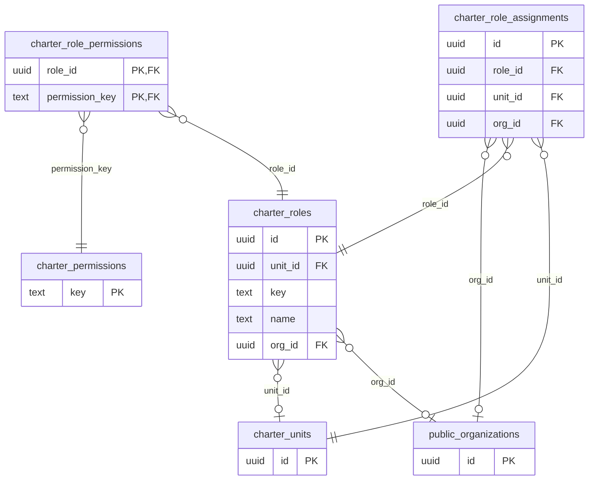

<details><summary><code>charter.roles</code> (8 columns)</summary>

| Column        | Type                     | Null | Default             | Key / reference                              |
| ------------- | ------------------------ | ---- | ------------------- | -------------------------------------------- |
| `id`          | uuid                     |      | `gen_random_uuid()` | PK                                           |
| `unit_id`     | uuid                     | yes  |                     | → `charter.units` (on delete cascade)        |
| `key`         | text                     |      |                     |                                              |
| `name`        | text                     |      |                     |                                              |
| `description` | text                     |      | `''::text`          |                                              |
| `active`      | boolean                  |      | `true`              |                                              |
| `created_at`  | timestamp with time zone |      | `now()`             |                                              |
| `org_id`      | uuid                     | yes  |                     | → `public.organizations` (on delete cascade) |

Unique together: (unit_id, key).

</details>

<details><summary><code>charter.permissions</code> (2 columns)</summary>

| Column        | Type | Null | Default | Key / reference |
| ------------- | ---- | ---- | ------- | --------------- |
| `key`         | text |      |         | PK              |
| `description` | text |      |         |                 |

</details>

<details><summary><code>charter.role_permissions</code> (2 columns)</summary>

| Column           | Type | Null | Default | Key / reference                                |
| ---------------- | ---- | ---- | ------- | ---------------------------------------------- |
| `role_id`        | uuid |      |         | PK → `charter.roles` (on delete cascade)       |
| `permission_key` | text |      |         | PK → `charter.permissions` (on delete cascade) |

</details>

<details><summary><code>charter.role_assignments</code> (7 columns)</summary>

| Column       | Type                     | Null | Default             | Key / reference                              |
| ------------ | ------------------------ | ---- | ------------------- | -------------------------------------------- |
| `id`         | uuid                     |      | `gen_random_uuid()` | PK                                           |
| `user_id`    | uuid                     |      |                     |                                              |
| `role_id`    | uuid                     |      |                     | → `charter.roles` (on delete cascade)        |
| `unit_id`    | uuid                     |      |                     | → `charter.units` (on delete cascade)        |
| `source`     | text                     |      | `'manual'::text`    |                                              |
| `created_at` | timestamp with time zone |      | `now()`             |                                              |
| `org_id`     | uuid                     | yes  |                     | → `public.organizations` (on delete cascade) |

Unique together: (user_id, role_id, unit_id).

</details>

### 7.3 Members and membership

`member_profiles` is a person's record in one unit (with or without an account; `home_of` points to the national membership in the home-chapter model). `memberships` holds a level (`membership_tiers`), a term (`tier_terms`: length and price), `status`, `paid_through` and, in the home-chapter model, `home_org_id`. `pricing_rules` change the price by member fields (for example rank); `attribute_*` are the organization's own member and chapter fields; `membership_events` and `affiliation_history` are histories.

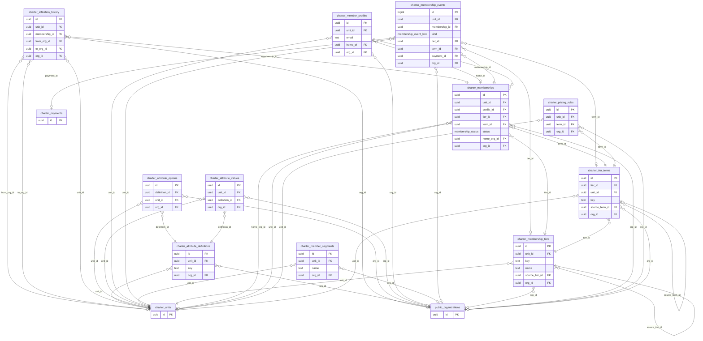

<details><summary><code>charter.member_profiles</code> (12 columns)</summary>

| Column             | Type                     | Null | Default             | Key / reference                              |
| ------------------ | ------------------------ | ---- | ------------------- | -------------------------------------------- |
| `id`               | uuid                     |      | `gen_random_uuid()` | PK                                           |
| `unit_id`          | uuid                     |      |                     | → `charter.units` (on delete cascade)        |
| `user_id`          | uuid                     | yes  |                     |                                              |
| `display_name`     | text                     |      | `''::text`          |                                              |
| `email`            | text                     |      | `''::text`          |                                              |
| `created_at`       | timestamp with time zone |      | `now()`             |                                              |
| `source`           | text                     |      | `'signup'::text`    |                                              |
| `claimed_at`       | timestamp with time zone | yes  |                     |                                              |
| `directory_listed` | boolean                  | yes  |                     |                                              |
| `home_of`          | uuid                     | yes  |                     | → `charter.memberships` (on delete set null) |
| `left_at`          | timestamp with time zone | yes  |                     |                                              |
| `org_id`           | uuid                     | yes  |                     | → `public.organizations` (on delete cascade) |

Unique together: (unit_id, user_id).

</details>

<details><summary><code>charter.memberships</code> — Memberships and standing per member record (D-166, D-174). (13 columns)</summary>

| Column         | Type                     | Null | Default             | Key / reference                                    |
| -------------- | ------------------------ | ---- | ------------------- | -------------------------------------------------- |
| `id`           | uuid                     |      | `gen_random_uuid()` | PK                                                 |
| `unit_id`      | uuid                     |      |                     | → `charter.units` (on delete cascade)              |
| `profile_id`   | uuid                     |      |                     | → `charter.member_profiles` (on delete cascade)    |
| `tier_id`      | uuid                     |      |                     | → `charter.membership_tiers` (on delete no action) |
| `term_id`      | uuid                     |      |                     | → `charter.tier_terms` (on delete no action)       |
| `status`       | membership_status        |      |                     |                                                    |
| `joined_on`    | date                     | yes  |                     |                                                    |
| `paid_through` | date                     | yes  |                     |                                                    |
| `lifetime`     | boolean                  |      | `false`             |                                                    |
| `created_at`   | timestamp with time zone |      | `now()`             |                                                    |
| `updated_at`   | timestamp with time zone |      | `now()`             |                                                    |
| `home_org_id`  | uuid                     | yes  |                     | → `charter.units` (on delete set null)             |
| `org_id`       | uuid                     | yes  |                     | → `public.organizations` (on delete cascade)       |

Unique together: (unit_id, profile_id).

</details>

<details><summary><code>charter.membership_tiers</code> — Membership levels (tiers) defined per organization; retired via active=false, never deleted. (15 columns)</summary>

| Column           | Type                     | Null | Default                                   | Key / reference                                   |
| ---------------- | ------------------------ | ---- | ----------------------------------------- | ------------------------------------------------- |
| `id`             | uuid                     |      | `gen_random_uuid()`                       | PK                                                |
| `unit_id`        | uuid                     |      |                                           | → `charter.units` (on delete cascade)             |
| `key`            | text                     |      |                                           |                                                   |
| `name`           | text                     |      |                                           |                                                   |
| `description`    | text                     |      | `''::text`                                |                                                   |
| `tax_treatment`  | tax_treatment            |      | `'non_deductible'::charter.tax_treatment` |                                                   |
| `sort_order`     | integer                  |      | `0`                                       |                                                   |
| `active`         | boolean                  |      | `true`                                    |                                                   |
| `created_at`     | timestamp with time zone |      | `now()`                                   |                                                   |
| `suggested`      | boolean                  |      | `false`                                   |                                                   |
| `source_tier_id` | uuid                     | yes  |                                           | → `charter.membership_tiers` (on delete set null) |
| `link_mode`      | text                     | yes  |                                           |                                                   |
| `price_rule`     | text                     | yes  |                                           |                                                   |
| `price_value`    | integer                  | yes  |                                           |                                                   |
| `org_id`         | uuid                     | yes  |                                           | → `public.organizations` (on delete cascade)      |

Unique together: (unit_id, key).

</details>

<details><summary><code>charter.tier_terms</code> — Terms of a membership level (E-11). Retire with active = false; there is no DELETE policy, so rows are never deleted. (14 columns)</summary>

| Column           | Type                     | Null | Default             | Key / reference                                  |
| ---------------- | ------------------------ | ---- | ------------------- | ------------------------------------------------ |
| `id`             | uuid                     |      | `gen_random_uuid()` | PK                                               |
| `tier_id`        | uuid                     |      |                     | → `charter.membership_tiers` (on delete cascade) |
| `unit_id`        | uuid                     |      |                     | → `charter.units` (on delete cascade)            |
| `key`            | text                     |      |                     |                                                  |
| `label`          | text                     |      |                     |                                                  |
| `length_count`   | integer                  | yes  |                     |                                                  |
| `length_unit`    | term_unit                | yes  |                     |                                                  |
| `price_minor`    | integer                  |      |                     |                                                  |
| `currency`       | character                |      | `'USD'::bpchar`     |                                                  |
| `sort_order`     | integer                  |      | `0`                 |                                                  |
| `active`         | boolean                  |      | `true`              |                                                  |
| `created_at`     | timestamp with time zone |      | `now()`             |                                                  |
| `source_term_id` | uuid                     | yes  |                     | → `charter.tier_terms` (on delete set null)      |
| `org_id`         | uuid                     | yes  |                     | → `public.organizations` (on delete cascade)     |

Unique together: (tier_id, key).

</details>

<details><summary><code>charter.pricing_rules</code> — Pricing rules by member fields (0021). Write only via save_pricing_rule / set_pricing_rule_active. (12 columns)</summary>

| Column         | Type                     | Null | Default             | Key / reference                              |
| -------------- | ------------------------ | ---- | ------------------- | -------------------------------------------- |
| `id`           | uuid                     |      | `gen_random_uuid()` | PK                                           |
| `unit_id`      | uuid                     |      |                     | → `charter.units` (on delete cascade)        |
| `term_id`      | uuid                     |      |                     | → `charter.tier_terms` (on delete cascade)   |
| `label`        | text                     |      | `''::text`          |                                              |
| `conditions`   | jsonb                    |      | `'[]'::jsonb`       |                                              |
| `price_minor`  | integer                  | yes  |                     |                                              |
| `discount_pct` | integer                  | yes  |                     |                                              |
| `sort_order`   | integer                  |      | `0`                 |                                              |
| `active`       | boolean                  |      | `true`              |                                              |
| `created_by`   | uuid                     | yes  |                     |                                              |
| `created_at`   | timestamp with time zone |      | `now()`             |                                              |
| `org_id`       | uuid                     | yes  |                     | → `public.organizations` (on delete cascade) |

</details>

<details><summary><code>charter.membership_events</code> — Append-only membership history (E-13a). Written only by membership RPCs; never changed or deleted. (13 columns)</summary>

| Column          | Type                     | Null | Default                                  | Key / reference                                    |
| --------------- | ------------------------ | ---- | ---------------------------------------- | -------------------------------------------------- |
| `id`            | bigint                   |      | `nextval('charter.membership_events_id…` | PK                                                 |
| `unit_id`       | uuid                     |      |                                          | → `charter.units` (on delete cascade)              |
| `membership_id` | uuid                     |      |                                          | → `charter.memberships` (on delete cascade)        |
| `kind`          | membership_event_kind    |      |                                          |                                                    |
| `tier_id`       | uuid                     | yes  |                                          | → `charter.membership_tiers` (on delete no action) |
| `term_id`       | uuid                     | yes  |                                          | → `charter.tier_terms` (on delete no action)       |
| `period_start`  | date                     | yes  |                                          |                                                    |
| `period_end`    | date                     | yes  |                                          |                                                    |
| `payment_id`    | uuid                     | yes  |                                          | → `charter.payments` (on delete no action)         |
| `note`          | text                     |      | `''::text`                               |                                                    |
| `actor_id`      | uuid                     | yes  |                                          |                                                    |
| `created_at`    | timestamp with time zone |      | `now()`                                  |                                                    |
| `org_id`        | uuid                     | yes  |                                          | → `public.organizations` (on delete cascade)       |

</details>

<details><summary><code>charter.affiliation_history</code> — Home-chapter changes (0030, D-166). Append-only; written only by definer functions. (8 columns)</summary>

| Column          | Type                     | Null | Default             | Key / reference                              |
| --------------- | ------------------------ | ---- | ------------------- | -------------------------------------------- |
| `id`            | uuid                     |      | `gen_random_uuid()` | PK                                           |
| `unit_id`       | uuid                     |      |                     | → `charter.units` (on delete cascade)        |
| `membership_id` | uuid                     |      |                     | → `charter.memberships` (on delete cascade)  |
| `from_org_id`   | uuid                     | yes  |                     | → `charter.units` (on delete set null)       |
| `to_org_id`     | uuid                     | yes  |                     | → `charter.units` (on delete set null)       |
| `changed_by`    | uuid                     | yes  |                     |                                              |
| `created_at`    | timestamp with time zone |      | `now()`             |                                              |
| `org_id`        | uuid                     | yes  |                     | → `public.organizations` (on delete cascade) |

</details>

<details><summary><code>charter.member_segments</code> — Saved member list filters (E-14). (7 columns)</summary>

| Column       | Type                     | Null | Default             | Key / reference                              |
| ------------ | ------------------------ | ---- | ------------------- | -------------------------------------------- |
| `id`         | uuid                     |      | `gen_random_uuid()` | PK                                           |
| `unit_id`    | uuid                     |      |                     | → `charter.units` (on delete cascade)        |
| `name`       | text                     |      |                     |                                              |
| `filter`     | jsonb                    |      | `'{}'::jsonb`       |                                              |
| `created_by` | uuid                     | yes  |                     |                                              |
| `created_at` | timestamp with time zone |      | `now()`             |                                              |
| `org_id`     | uuid                     | yes  |                     | → `public.organizations` (on delete cascade) |

Unique together: (unit_id, name).

</details>

<details><summary><code>charter.attribute_definitions</code> (16 columns)</summary>

| Column              | Type                     | Null | Default                                  | Key / reference                              |
| ------------------- | ------------------------ | ---- | ---------------------------------------- | -------------------------------------------- |
| `id`                | uuid                     |      | `gen_random_uuid()`                      | PK                                           |
| `unit_id`           | uuid                     |      |                                          | → `charter.units` (on delete cascade)        |
| `applies_to`        | attribute_subject        |      | `'member'::charter.attribute_subject`    |                                              |
| `key`               | text                     |      |                                          |                                              |
| `label`             | text                     |      |                                          |                                              |
| `help`              | text                     |      | `''::text`                               |                                              |
| `data_type`         | attribute_type           |      |                                          |                                              |
| `required`          | boolean                  |      | `false`                                  |                                              |
| `visibility`        | attribute_visibility     |      | `'admins'::charter.attribute_visibility` |                                              |
| `member_editable`   | boolean                  |      | `false`                                  |                                              |
| `show_in_directory` | boolean                  |      | `false`                                  |                                              |
| `sort_order`        | integer                  |      | `0`                                      |                                              |
| `active`            | boolean                  |      | `true`                                   |                                              |
| `created_at`        | timestamp with time zone |      | `now()`                                  |                                              |
| `locked`            | boolean                  |      | `false`                                  |                                              |
| `org_id`            | uuid                     | yes  |                                          | → `public.organizations` (on delete cascade) |

Unique together: (unit_id, applies_to, key).

</details>

<details><summary><code>charter.attribute_options</code> (8 columns)</summary>

| Column          | Type    | Null | Default             | Key / reference                                       |
| --------------- | ------- | ---- | ------------------- | ----------------------------------------------------- |
| `id`            | uuid    |      | `gen_random_uuid()` | PK                                                    |
| `definition_id` | uuid    |      |                     | → `charter.attribute_definitions` (on delete cascade) |
| `unit_id`       | uuid    |      |                     | → `charter.units` (on delete cascade)                 |
| `value`         | text    |      |                     |                                                       |
| `label`         | text    |      |                     |                                                       |
| `sort_order`    | integer |      | `0`                 |                                                       |
| `active`        | boolean |      | `true`              |                                                       |
| `org_id`        | uuid    | yes  |                     | → `public.organizations` (on delete cascade)          |

Unique together: (definition_id, value).

</details>

<details><summary><code>charter.attribute_values</code> (8 columns)</summary>

| Column          | Type                     | Null | Default             | Key / reference                                       |
| --------------- | ------------------------ | ---- | ------------------- | ----------------------------------------------------- |
| `id`            | uuid                     |      | `gen_random_uuid()` | PK                                                    |
| `unit_id`       | uuid                     |      |                     | → `charter.units` (on delete cascade)                 |
| `definition_id` | uuid                     |      |                     | → `charter.attribute_definitions` (on delete cascade) |
| `entity_id`     | uuid                     |      |                     |                                                       |
| `value`         | jsonb                    |      |                     |                                                       |
| `updated_by`    | uuid                     | yes  |                     |                                                       |
| `updated_at`    | timestamp with time zone |      | `now()`             |                                                       |
| `org_id`        | uuid                     | yes  |                     | → `public.organizations` (on delete cascade)          |

Unique together: (definition_id, entity_id).

</details>

### 7.4 Money: payments and receipts

`payments` (purpose join/renew, `amount_minor`, `status`, `method`, `received_on`, gateway reference) belong to a membership and a profile; each paid payment gets a `receipts` row numbered by `receipt_counters`. `gateway_connections` is the organization's own Stripe (or manual) connection; `gateway_secrets` holds its keys encrypted; `webhook_events` makes webhooks idempotent.

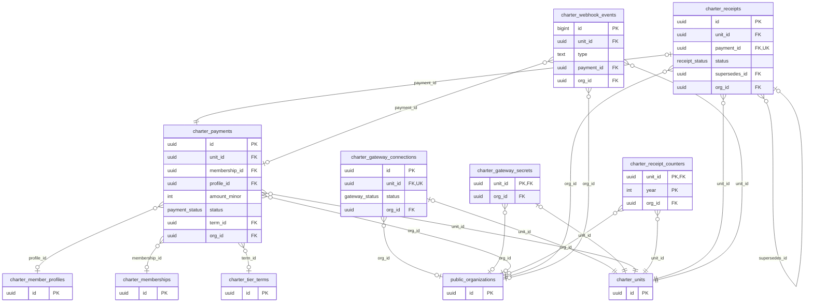

<details><summary><code>charter.payments</code> — Payments received by an org (E-13a, E-12). Written only by definer functions; never deleted. (23 columns)</summary>

| Column                  | Type                     | Null | Default                             | Key / reference                                   |
| ----------------------- | ------------------------ | ---- | ----------------------------------- | ------------------------------------------------- |
| `id`                    | uuid                     |      | `gen_random_uuid()`                 | PK                                                |
| `unit_id`               | uuid                     |      |                                     | → `charter.units` (on delete cascade)             |
| `membership_id`         | uuid                     | yes  |                                     | → `charter.memberships` (on delete no action)     |
| `profile_id`            | uuid                     | yes  |                                     | → `charter.member_profiles` (on delete no action) |
| `payer_user_id`         | uuid                     | yes  |                                     |                                                   |
| `purpose`               | payment_purpose          |      |                                     |                                                   |
| `amount_minor`          | integer                  |      |                                     |                                                   |
| `currency`              | character                |      | `'USD'::bpchar`                     |                                                   |
| `status`                | payment_status           |      |                                     |                                                   |
| `gateway`               | payment_gateway          |      | `'manual'::charter.payment_gateway` |                                                   |
| `method`                | payment_method           | yes  |                                     |                                                   |
| `gateway_ref`           | text                     | yes  |                                     |                                                   |
| `livemode`              | boolean                  |      | `true`                              |                                                   |
| `received_on`           | date                     | yes  |                                     |                                                   |
| `note`                  | text                     |      | `''::text`                          |                                                   |
| `created_by`            | uuid                     | yes  |                                     |                                                   |
| `created_at`            | timestamp with time zone |      | `now()`                             |                                                   |
| `checkout_ref`          | text                     | yes  |                                     |                                                   |
| `failure_reason`        | text                     | yes  |                                     |                                                   |
| `refunded_amount_minor` | integer                  |      | `0`                                 |                                                   |
| `term_id`               | uuid                     | yes  |                                     | → `charter.tier_terms` (on delete no action)      |
| `join_answers`          | jsonb                    |      | `'{}'::jsonb`                       |                                                   |
| `org_id`                | uuid                     | yes  |                                     | → `public.organizations` (on delete cascade)      |

</details>

<details><summary><code>charter.receipts</code> — Immutable receipts (E-15, D-044). Written only by definer functions; voided or superseded, never edited or deleted. (14 columns)</summary>

| Column          | Type                     | Null | Default                            | Key / reference                                 |
| --------------- | ------------------------ | ---- | ---------------------------------- | ----------------------------------------------- |
| `id`            | uuid                     |      | `gen_random_uuid()`                | PK                                              |
| `unit_id`       | uuid                     |      |                                    | → `charter.units` (on delete cascade)           |
| `payment_id`    | uuid                     |      |                                    | unique → `charter.payments` (on delete cascade) |
| `number`        | text                     |      |                                    |                                                 |
| `year`          | integer                  |      |                                    |                                                 |
| `seq`           | integer                  |      |                                    |                                                 |
| `status`        | receipt_status           |      | `'issued'::charter.receipt_status` |                                                 |
| `supersedes_id` | uuid                     | yes  |                                    | → `charter.receipts` (on delete no action)      |
| `snapshot`      | jsonb                    |      |                                    |                                                 |
| `issued_at`     | timestamp with time zone |      | `now()`                            |                                                 |
| `voided_at`     | timestamp with time zone | yes  |                                    |                                                 |
| `void_reason`   | text                     | yes  |                                    |                                                 |
| `voided_by`     | uuid                     | yes  |                                    |                                                 |
| `org_id`        | uuid                     | yes  |                                    | → `public.organizations` (on delete cascade)    |

Unique together: (unit_id, number); (unit_id, year, seq).

</details>

<details><summary><code>charter.receipt_counters</code> — Receipt numbering per org and year (E-15). Written only by definer functions. (4 columns)</summary>

| Column     | Type    | Null | Default | Key / reference                              |
| ---------- | ------- | ---- | ------- | -------------------------------------------- |
| `unit_id`  | uuid    |      |         | PK → `charter.units` (on delete cascade)     |
| `year`     | integer |      |         | PK                                           |
| `last_seq` | integer |      | `0`     |                                              |
| `org_id`   | uuid    | yes  |         | → `public.organizations` (on delete cascade) |

</details>

<details><summary><code>charter.gateway_connections</code> — Which payment gateway an org uses (E-12). Written only by connect / disconnect RPCs; secrets live in charter.gateway_secrets. (10 columns)</summary>

| Column          | Type                     | Null | Default                              | Key / reference                              |
| --------------- | ------------------------ | ---- | ------------------------------------ | -------------------------------------------- |
| `id`            | uuid                     |      | `gen_random_uuid()`                  | PK                                           |
| `unit_id`       | uuid                     |      |                                      | unique → `charter.units` (on delete cascade) |
| `gateway`       | payment_gateway          |      |                                      |                                              |
| `status`        | gateway_status           |      | `'verified'::charter.gateway_status` |                                              |
| `account_label` | text                     |      | `''::text`                           |                                              |
| `livemode`      | boolean                  |      | `false`                              |                                              |
| `connected_by`  | uuid                     | yes  |                                      |                                              |
| `connected_at`  | timestamp with time zone |      | `now()`                              |                                              |
| `updated_at`    | timestamp with time zone |      | `now()`                              |                                              |
| `org_id`        | uuid                     | yes  |                                      | → `public.organizations` (on delete cascade) |

</details>

<details><summary><code>charter.gateway_secrets</code> (4 columns)</summary>

| Column       | Type                     | Null | Default | Key / reference                              |
| ------------ | ------------------------ | ---- | ------- | -------------------------------------------- |
| `unit_id`    | uuid                     |      |         | PK → `charter.units` (on delete cascade)     |
| `sealed`     | text                     |      |         |                                              |
| `updated_at` | timestamp with time zone |      | `now()` |                                              |
| `org_id`     | uuid                     | yes  |         | → `public.organizations` (on delete cascade) |

</details>

<details><summary><code>charter.webhook_events</code> — Gateway events already handled (E-12); written only by definer functions. Never deleted. (8 columns)</summary>

| Column        | Type                     | Null | Default                                  | Key / reference                              |
| ------------- | ------------------------ | ---- | ---------------------------------------- | -------------------------------------------- |
| `id`          | bigint                   |      | `nextval('charter.webhook_events_id_se…` | PK                                           |
| `unit_id`     | uuid                     |      |                                          | → `charter.units` (on delete cascade)        |
| `gateway`     | payment_gateway          |      |                                          |                                              |
| `event_id`    | text                     |      |                                          |                                              |
| `type`        | text                     |      |                                          |                                              |
| `payment_id`  | uuid                     | yes  |                                          | → `charter.payments` (on delete no action)   |
| `received_at` | timestamp with time zone |      | `now()`                                  |                                              |
| `org_id`      | uuid                     | yes  |                                          | → `public.organizations` (on delete cascade) |

Unique together: (gateway, event_id).

</details>

### 7.5 Governance: seats and appointments

`seat_templates` define seats (defined at a unit, `scope`: self, chapters, or both; required, count, term length, optional role). `appointments` put a member profile in a seat in a unit (start, planned end, end, reason) and may create a `role_assignment`. `seat_title_overrides` rename a seat for one unit; `seat_terms` set a unit's own term rules; `seat_contacts` give a seat a contact email. Appointments sync to OpenBoardApp's terms (S-14).

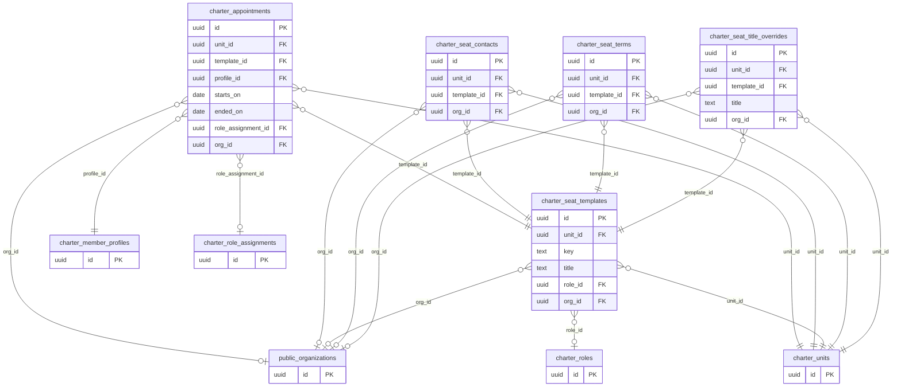

<details><summary><code>charter.seat_templates</code> — Marker: confirms migration 0040 (overview counts people once) has been applied. (15 columns)</summary>

| Column               | Type                     | Null | Default                      | Key / reference                              |
| -------------------- | ------------------------ | ---- | ---------------------------- | -------------------------------------------- |
| `id`                 | uuid                     |      | `gen_random_uuid()`          | PK                                           |
| `unit_id`            | uuid                     |      |                              | → `charter.units` (on delete cascade)        |
| `key`                | text                     |      |                              |                                              |
| `title`              | text                     |      |                              |                                              |
| `description`        | text                     |      | `''::text`                   |                                              |
| `required`           | boolean                  |      | `false`                      |                                              |
| `seat_count`         | integer                  |      | `1`                          |                                              |
| `default_term_count` | integer                  | yes  |                              |                                              |
| `default_term_unit`  | term_unit                | yes  |                              |                                              |
| `role_id`            | uuid                     | yes  |                              | → `charter.roles` (on delete no action)      |
| `scope`              | seat_scope               |      | `'self'::charter.seat_scope` |                                              |
| `sort_order`         | integer                  |      | `0`                          |                                              |
| `active`             | boolean                  |      | `true`                       |                                              |
| `created_at`         | timestamp with time zone |      | `now()`                      |                                              |
| `org_id`             | uuid                     | yes  |                              | → `public.organizations` (on delete cascade) |

Unique together: (unit_id, key).

</details>

<details><summary><code>charter.seat_title_overrides</code> — An org's own title for a seat its parent defined (E-17). Written only by set_seat_title; null = the default title. (6 columns)</summary>

| Column        | Type                     | Null | Default             | Key / reference                                |
| ------------- | ------------------------ | ---- | ------------------- | ---------------------------------------------- |
| `id`          | uuid                     |      | `gen_random_uuid()` | PK                                             |
| `unit_id`     | uuid                     |      |                     | → `charter.units` (on delete cascade)          |
| `template_id` | uuid                     |      |                     | → `charter.seat_templates` (on delete cascade) |
| `title`       | text                     | yes  |                     |                                                |
| `updated_at`  | timestamp with time zone |      | `now()`             |                                                |
| `org_id`      | uuid                     | yes  |                     | → `public.organizations` (on delete cascade)   |

Unique together: (unit_id, template_id).

</details>

<details><summary><code>charter.seat_terms</code> — Term rules per org and seat (E-17, D-142). Append-only: a by-law change adds a row with its effective date. (11 columns)</summary>

| Column            | Type                     | Null | Default             | Key / reference                                |
| ----------------- | ------------------------ | ---- | ------------------- | ---------------------------------------------- |
| `id`              | uuid                     |      | `gen_random_uuid()` | PK                                             |
| `unit_id`         | uuid                     |      |                     | → `charter.units` (on delete cascade)          |
| `template_id`     | uuid                     |      |                     | → `charter.seat_templates` (on delete cascade) |
| `length_count`    | integer                  | yes  |                     |                                                |
| `length_unit`     | term_unit                | yes  |                     |                                                |
| `effective_from`  | date                     |      |                     |                                                |
| `bylaw_reference` | text                     |      | `''::text`          |                                                |
| `note`            | text                     |      | `''::text`          |                                                |
| `set_by`          | uuid                     | yes  |                     |                                                |
| `created_at`      | timestamp with time zone |      | `now()`             |                                                |
| `org_id`          | uuid                     | yes  |                     | → `public.organizations` (on delete cascade)   |

</details>

<details><summary><code>charter.seat_contacts</code> — Role email per org and seat (D-156). Null / no row = show each officer's own email. Written only by set_seat_contact. (7 columns)</summary>

| Column        | Type                     | Null | Default             | Key / reference                                |
| ------------- | ------------------------ | ---- | ------------------- | ---------------------------------------------- |
| `id`          | uuid                     |      | `gen_random_uuid()` | PK                                             |
| `unit_id`     | uuid                     |      |                     | → `charter.units` (on delete cascade)          |
| `template_id` | uuid                     |      |                     | → `charter.seat_templates` (on delete cascade) |
| `role_email`  | text                     | yes  |                     |                                                |
| `updated_by`  | uuid                     | yes  |                     |                                                |
| `updated_at`  | timestamp with time zone |      | `now()`             |                                                |
| `org_id`      | uuid                     | yes  |                     | → `public.organizations` (on delete cascade)   |

Unique together: (unit_id, template_id).

</details>

<details><summary><code>charter.appointments</code> — Who holds which seat, past and present (E-17). Written only by definer RPCs; ended, never deleted. (14 columns)</summary>

| Column               | Type                     | Null | Default             | Key / reference                                   |
| -------------------- | ------------------------ | ---- | ------------------- | ------------------------------------------------- |
| `id`                 | uuid                     |      | `gen_random_uuid()` | PK                                                |
| `unit_id`            | uuid                     |      |                     | → `charter.units` (on delete cascade)             |
| `template_id`        | uuid                     |      |                     | → `charter.seat_templates` (on delete cascade)    |
| `profile_id`         | uuid                     |      |                     | → `charter.member_profiles` (on delete cascade)   |
| `seat_number`        | integer                  |      |                     |                                                   |
| `starts_on`          | date                     |      |                     |                                                   |
| `planned_end`        | date                     | yes  |                     |                                                   |
| `ended_on`           | date                     | yes  |                     |                                                   |
| `end_reason`         | text                     |      | `''::text`          |                                                   |
| `role_assignment_id` | uuid                     | yes  |                     | → `charter.role_assignments` (on delete set null) |
| `appointed_by`       | uuid                     | yes  |                     |                                                   |
| `ended_by`           | uuid                     | yes  |                     |                                                   |
| `created_at`         | timestamp with time zone |      | `now()`             |                                                   |
| `org_id`             | uuid                     | yes  |                     | → `public.organizations` (on delete cascade)      |

Unique together: (unit_id, template_id, seat_number); (unit_id, template_id, profile_id).

</details>

---

## 8. OpenBoardApp

Schema `board`. Every table has `org_id → public.organizations` (a national's or a chapter's own). Same-organization triggers stop a row pointing to another organization's parent row; approved minutes, closed votes and distributed packets are locked.

### 8.1 People, positions, terms, committees

`terms` are board seats over time (`person_name`, an account `user_id` or a `people` record, `position`, start and end). `source = 'charter'` / `source_id` mark a term mirrored from a Charter appointment. `officers` (chair, secretary, treasurer) give app permissions; `positions` define titles and term lengths; `committees` and `committee_members` are committees.

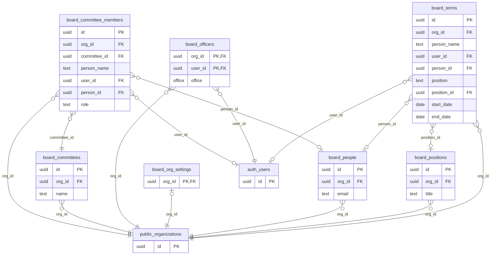

<details><summary><code>board.org_settings</code> (10 columns)</summary>

| Column               | Type                     | Null | Default                                   | Key / reference                                 |
| -------------------- | ------------------------ | ---- | ----------------------------------------- | ----------------------------------------------- |
| `org_id`             | uuid                     |      |                                           | PK → `public.organizations` (on delete cascade) |
| `timezone`           | text                     |      | `'America/Chicago'::text`                 |                                                 |
| `quorum_count`       | integer                  |      | `1`                                       |                                                 |
| `vote_recording`     | text                     |      | `'totals'::text`                          |                                                 |
| `vote_close_modes`   | text[]                   |      | `'{chair}'::text[]`                       |                                                 |
| `vote_timer_minutes` | integer                  | yes  |                                           |                                                 |
| `vote_closer_roles`  | text[]                   |      | `'{owner,admin,chair,secretary}'::text[]` |                                                 |
| `seconder_required`  | boolean                  |      | `true`                                    |                                                 |
| `decision_rule`      | text                     |      | `'majority_cast'::text`                   |                                                 |
| `updated_at`         | timestamp with time zone |      | `now()`                                   |                                                 |

</details>

<details><summary><code>board.officers</code> (4 columns)</summary>

| Column       | Type                     | Null | Default | Key / reference                                 |
| ------------ | ------------------------ | ---- | ------- | ----------------------------------------------- |
| `org_id`     | uuid                     |      |         | PK → `public.organizations` (on delete cascade) |
| `user_id`    | uuid                     |      |         | PK → `auth.users` (on delete cascade)           |
| `office`     | office                   |      |         |                                                 |
| `created_at` | timestamp with time zone |      | `now()` |                                                 |

</details>

<details><summary><code>board.people</code> (6 columns)</summary>

| Column       | Type                     | Null | Default             | Key / reference                              |
| ------------ | ------------------------ | ---- | ------------------- | -------------------------------------------- |
| `id`         | uuid                     |      | `gen_random_uuid()` | PK                                           |
| `org_id`     | uuid                     |      |                     | → `public.organizations` (on delete cascade) |
| `full_name`  | text                     |      |                     |                                              |
| `email`      | text                     | yes  |                     |                                              |
| `notes`      | text                     | yes  |                     |                                              |
| `created_at` | timestamp with time zone |      | `now()`             |                                              |

</details>

<details><summary><code>board.positions</code> (6 columns)</summary>

| Column       | Type                     | Null | Default             | Key / reference                              |
| ------------ | ------------------------ | ---- | ------------------- | -------------------------------------------- |
| `id`         | uuid                     |      | `gen_random_uuid()` | PK                                           |
| `org_id`     | uuid                     |      |                     | → `public.organizations` (on delete cascade) |
| `title`      | text                     |      |                     |                                              |
| `term_years` | integer                  | yes  |                     |                                              |
| `sort_order` | integer                  |      | `0`                 |                                              |
| `created_at` | timestamp with time zone |      | `now()`             |                                              |

Unique together: (org_id, title).

</details>

<details><summary><code>board.terms</code> (13 columns)</summary>

| Column        | Type                     | Null | Default             | Key / reference                              |
| ------------- | ------------------------ | ---- | ------------------- | -------------------------------------------- |
| `id`          | uuid                     |      | `gen_random_uuid()` | PK                                           |
| `org_id`      | uuid                     |      |                     | → `public.organizations` (on delete cascade) |
| `person_name` | text                     |      |                     |                                              |
| `user_id`     | uuid                     | yes  |                     | → `auth.users` (on delete set null)          |
| `person_id`   | uuid                     | yes  |                     | → `board.people` (on delete set null)        |
| `position`    | text                     |      | `'Director'::text`  |                                              |
| `position_id` | uuid                     | yes  |                     | → `board.positions` (on delete set null)     |
| `start_date`  | date                     |      |                     |                                              |
| `end_date`    | date                     | yes  |                     |                                              |
| `notes`       | text                     | yes  |                     |                                              |
| `created_at`  | timestamp with time zone |      | `now()`             |                                              |
| `source`      | text                     | yes  |                     |                                              |
| `source_id`   | uuid                     | yes  |                     |                                              |

Unique together: (source, source_id).

</details>

<details><summary><code>board.committees</code> (5 columns)</summary>

| Column        | Type                     | Null | Default             | Key / reference                              |
| ------------- | ------------------------ | ---- | ------------------- | -------------------------------------------- |
| `id`          | uuid                     |      | `gen_random_uuid()` | PK                                           |
| `org_id`      | uuid                     |      |                     | → `public.organizations` (on delete cascade) |
| `name`        | text                     |      |                     |                                              |
| `description` | text                     | yes  |                     |                                              |
| `created_at`  | timestamp with time zone |      | `now()`             |                                              |

</details>

<details><summary><code>board.committee_members</code> (8 columns)</summary>

| Column         | Type                     | Null | Default             | Key / reference                              |
| -------------- | ------------------------ | ---- | ------------------- | -------------------------------------------- |
| `id`           | uuid                     |      | `gen_random_uuid()` | PK                                           |
| `org_id`       | uuid                     |      |                     | → `public.organizations` (on delete cascade) |
| `committee_id` | uuid                     |      |                     | → `board.committees` (on delete cascade)     |
| `person_name`  | text                     |      |                     |                                              |
| `user_id`      | uuid                     | yes  |                     | → `auth.users` (on delete set null)          |
| `person_id`    | uuid                     | yes  |                     | → `board.people` (on delete set null)        |
| `role`         | text                     |      | `'Member'::text`    |                                              |
| `created_at`   | timestamp with time zone |      | `now()`             |                                              |

</details>

### 8.2 Meetings, agendas, votes, minutes, action items

A `meeting` has `agenda_items` (some are vote items with a proposed motion and an optional decision rule), `attendance`, `motions` (with counts and outcome; live votes freeze the electorate in `vote_electorate` and record ballots in `member_votes`), `minutes` (versions; approved ones are locked) and `action_items` (assignee, due date, status). `meeting_templates` hold a reusable agenda.

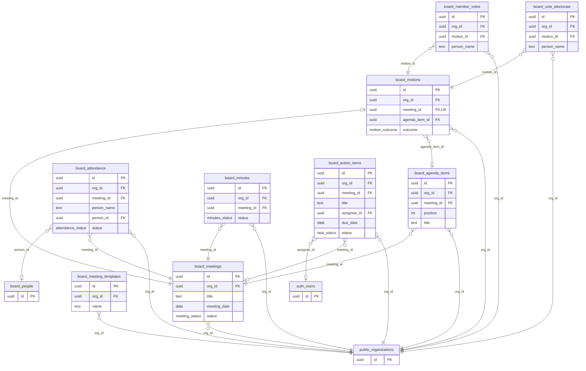

<details><summary><code>board.meetings</code> (9 columns)</summary>

| Column         | Type                     | Null | Default                         | Key / reference                              |
| -------------- | ------------------------ | ---- | ------------------------------- | -------------------------------------------- |
| `id`           | uuid                     |      | `gen_random_uuid()`             | PK                                           |
| `org_id`       | uuid                     |      |                                 | → `public.organizations` (on delete cascade) |
| `title`        | text                     |      |                                 |                                              |
| `meeting_date` | date                     |      |                                 |                                              |
| `start_time`   | text                     | yes  |                                 |                                              |
| `location`     | text                     | yes  |                                 |                                              |
| `status`       | meeting_status           |      | `'draft'::board.meeting_status` |                                              |
| `created_by`   | uuid                     | yes  | `auth.uid()`                    |                                              |
| `created_at`   | timestamp with time zone |      | `now()`                         |                                              |

</details>

<details><summary><code>board.meeting_templates</code> (9 columns)</summary>

| Column          | Type                     | Null | Default                         | Key / reference                              |
| --------------- | ------------------------ | ---- | ------------------------------- | -------------------------------------------- |
| `id`            | uuid                     |      | `gen_random_uuid()`             | PK                                           |
| `org_id`        | uuid                     |      |                                 | → `public.organizations` (on delete cascade) |
| `name`          | text                     |      |                                 |                                              |
| `meeting_title` | text                     |      | `'Regular Board Meeting'::text` |                                              |
| `start_time`    | text                     | yes  |                                 |                                              |
| `location`      | text                     | yes  |                                 |                                              |
| `agenda`        | jsonb                    |      | `'[]'::jsonb`                   |                                              |
| `created_by`    | uuid                     | yes  | `auth.uid()`                    |                                              |
| `created_at`    | timestamp with time zone |      | `now()`                         |                                              |

Unique together: (org_id, name).

</details>

<details><summary><code>board.agenda_items</code> (13 columns)</summary>

| Column             | Type                     | Null | Default             | Key / reference                              |
| ------------------ | ------------------------ | ---- | ------------------- | -------------------------------------------- |
| `id`               | uuid                     |      | `gen_random_uuid()` | PK                                           |
| `org_id`           | uuid                     |      |                     | → `public.organizations` (on delete cascade) |
| `meeting_id`       | uuid                     |      |                     | → `board.meetings` (on delete cascade)       |
| `position`         | integer                  |      | `0`                 |                                              |
| `title`            | text                     |      |                     |                                              |
| `presenter`        | text                     | yes  |                     |                                              |
| `duration_minutes` | integer                  | yes  |                     |                                              |
| `description`      | text                     | yes  |                     |                                              |
| `notes`            | text                     |      | `''::text`          |                                              |
| `proposed_motion`  | text                     | yes  |                     |                                              |
| `is_vote_item`     | boolean                  |      | `false`             |                                              |
| `decision_rule`    | text                     | yes  |                     |                                              |
| `created_at`       | timestamp with time zone |      | `now()`             |                                              |

</details>

<details><summary><code>board.attendance</code> (9 columns)</summary>

| Column        | Type                     | Null | Default                              | Key / reference                              |
| ------------- | ------------------------ | ---- | ------------------------------------ | -------------------------------------------- |
| `id`          | uuid                     |      | `gen_random_uuid()`                  | PK                                           |
| `org_id`      | uuid                     |      |                                      | → `public.organizations` (on delete cascade) |
| `meeting_id`  | uuid                     |      |                                      | → `board.meetings` (on delete cascade)       |
| `person_name` | text                     |      |                                      |                                              |
| `user_id`     | uuid                     | yes  |                                      |                                              |
| `person_id`   | uuid                     | yes  |                                      | → `board.people` (on delete set null)        |
| `status`      | attendance_status        |      | `'present'::board.attendance_status` |                                              |
| `is_voting`   | boolean                  |      | `true`                               |                                              |
| `created_at`  | timestamp with time zone |      | `now()`                              |                                              |

</details>

<details><summary><code>board.motions</code> (25 columns)</summary>

| Column               | Type                     | Null | Default                           | Key / reference                               |
| -------------------- | ------------------------ | ---- | --------------------------------- | --------------------------------------------- |
| `id`                 | uuid                     |      | `gen_random_uuid()`               | PK                                            |
| `org_id`             | uuid                     |      |                                   | → `public.organizations` (on delete cascade)  |
| `meeting_id`         | uuid                     |      |                                   | unique → `board.meetings` (on delete cascade) |
| `agenda_item_id`     | uuid                     | yes  |                                   | → `board.agenda_items` (on delete set null)   |
| `motion_text`        | text                     |      |                                   |                                               |
| `moved_by`           | text                     | yes  |                                   |                                               |
| `seconded_by`        | text                     | yes  |                                   |                                               |
| `votes_yes`          | integer                  |      | `0`                               |                                               |
| `votes_no`           | integer                  |      | `0`                               |                                               |
| `votes_abstain`      | integer                  |      | `0`                               |                                               |
| `votes_recused`      | integer                  |      | `0`                               |                                               |
| `outcome`            | motion_outcome           |      | `'pending'::board.motion_outcome` |                                               |
| `roll_call`          | jsonb                    | yes  |                                   |                                               |
| `voting_status`      | text                     |      | `'manual'::text`                  |                                               |
| `opened_at`          | timestamp with time zone | yes  |                                   |                                               |
| `opened_by`          | uuid                     | yes  |                                   |                                               |
| `closes_at`          | timestamp with time zone | yes  |                                   |                                               |
| `closed_at`          | timestamp with time zone | yes  |                                   |                                               |
| `closed_by`          | uuid                     | yes  |                                   |                                               |
| `vote_record`        | jsonb                    | yes  |                                   |                                               |
| `disposition_source` | text                     | yes  |                                   |                                               |
| `disposition_note`   | text                     | yes  |                                   |                                               |
| `disposition_by`     | uuid                     | yes  |                                   |                                               |
| `disposition_at`     | timestamp with time zone | yes  |                                   |                                               |
| `created_at`         | timestamp with time zone |      | `now()`                           |                                               |

</details>

<details><summary><code>board.vote_electorate</code> (7 columns)</summary>

| Column          | Type                     | Null | Default             | Key / reference                              |
| --------------- | ------------------------ | ---- | ------------------- | -------------------------------------------- |
| `id`            | uuid                     |      | `gen_random_uuid()` | PK                                           |
| `org_id`        | uuid                     |      |                     | → `public.organizations` (on delete cascade) |
| `motion_id`     | uuid                     |      |                     | → `board.motions` (on delete cascade)        |
| `attendance_id` | uuid                     | yes  |                     |                                              |
| `user_id`       | uuid                     |      |                     |                                              |
| `person_name`   | text                     |      |                     |                                              |
| `created_at`    | timestamp with time zone |      | `now()`             |                                              |

Unique together: (motion_id, user_id).

</details>

<details><summary><code>board.member_votes</code> (8 columns)</summary>

| Column          | Type                     | Null | Default             | Key / reference                              |
| --------------- | ------------------------ | ---- | ------------------- | -------------------------------------------- |
| `id`            | uuid                     |      | `gen_random_uuid()` | PK                                           |
| `org_id`        | uuid                     |      |                     | → `public.organizations` (on delete cascade) |
| `motion_id`     | uuid                     |      |                     | → `board.motions` (on delete cascade)        |
| `attendance_id` | uuid                     | yes  |                     |                                              |
| `user_id`       | uuid                     |      |                     |                                              |
| `person_name`   | text                     |      |                     |                                              |
| `vote`          | text                     |      |                     |                                              |
| `created_at`    | timestamp with time zone |      | `now()`             |                                              |

Unique together: (motion_id, user_id).

</details>

<details><summary><code>board.minutes</code> (11 columns)</summary>

| Column         | Type                     | Null | Default                         | Key / reference                              |
| -------------- | ------------------------ | ---- | ------------------------------- | -------------------------------------------- |
| `id`           | uuid                     |      | `gen_random_uuid()`             | PK                                           |
| `org_id`       | uuid                     |      |                                 | → `public.organizations` (on delete cascade) |
| `meeting_id`   | uuid                     |      |                                 | → `board.meetings` (on delete cascade)       |
| `version`      | integer                  |      |                                 |                                              |
| `content`      | text                     |      | `''::text`                      |                                              |
| `status`       | minutes_status           |      | `'draft'::board.minutes_status` |                                              |
| `created_by`   | uuid                     | yes  | `auth.uid()`                    |                                              |
| `submitted_at` | timestamp with time zone | yes  |                                 |                                              |
| `approved_by`  | uuid                     | yes  |                                 |                                              |
| `approved_at`  | timestamp with time zone | yes  |                                 |                                              |
| `created_at`   | timestamp with time zone |      | `now()`                         |                                              |

Unique together: (meeting_id, version).

</details>

<details><summary><code>board.action_items</code> (10 columns)</summary>

| Column        | Type                     | Null | Default                     | Key / reference                              |
| ------------- | ------------------------ | ---- | --------------------------- | -------------------------------------------- |
| `id`          | uuid                     |      | `gen_random_uuid()`         | PK                                           |
| `org_id`      | uuid                     |      |                             | → `public.organizations` (on delete cascade) |
| `meeting_id`  | uuid                     | yes  |                             | → `board.meetings` (on delete set null)      |
| `title`       | text                     |      |                             |                                              |
| `details`     | text                     | yes  |                             |                                              |
| `assignee_id` | uuid                     | yes  |                             | → `auth.users` (on delete set null)          |
| `due_date`    | date                     | yes  |                             |                                              |
| `status`      | task_status              |      | `'open'::board.task_status` |                                              |
| `created_by`  | uuid                     | yes  | `auth.uid()`                |                                              |
| `created_at`  | timestamp with time zone |      | `now()`                     |                                              |

</details>

### 8.3 Documents, packets, letterhead, audit

`documents` with `document_versions` (files in `board-files/<org>/…`; reports from Charter and Ledger arrive here through `add_report_to_meeting`), `packets` (generated board packets per meeting, versioned, distributed ones locked), `letterheads` (the organization's stationery), `audit_log` (append-only).

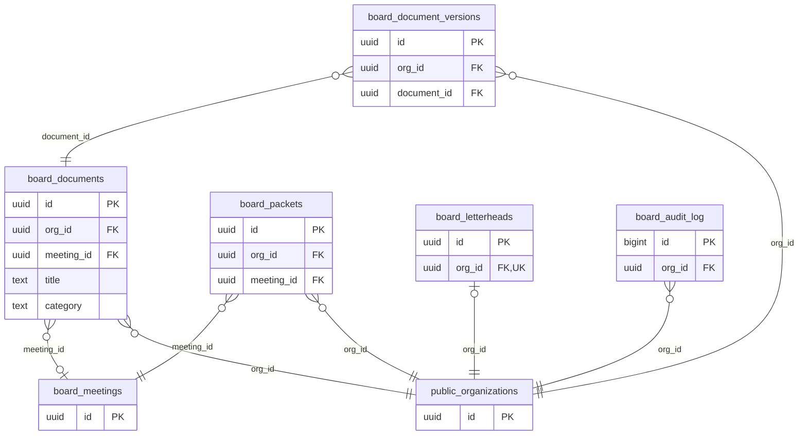

<details><summary><code>board.documents</code> (7 columns)</summary>

| Column       | Type                     | Null | Default             | Key / reference                              |
| ------------ | ------------------------ | ---- | ------------------- | -------------------------------------------- |
| `id`         | uuid                     |      | `gen_random_uuid()` | PK                                           |
| `org_id`     | uuid                     |      |                     | → `public.organizations` (on delete cascade) |
| `meeting_id` | uuid                     | yes  |                     | → `board.meetings` (on delete set null)      |
| `title`      | text                     |      |                     |                                              |
| `category`   | text                     |      | `'General'::text`   |                                              |
| `created_by` | uuid                     | yes  | `auth.uid()`        |                                              |
| `created_at` | timestamp with time zone |      | `now()`             |                                              |

</details>

<details><summary><code>board.document_versions</code> (10 columns)</summary>

| Column         | Type                     | Null | Default             | Key / reference                              |
| -------------- | ------------------------ | ---- | ------------------- | -------------------------------------------- |
| `id`           | uuid                     |      | `gen_random_uuid()` | PK                                           |
| `org_id`       | uuid                     |      |                     | → `public.organizations` (on delete cascade) |
| `document_id`  | uuid                     |      |                     | → `board.documents` (on delete cascade)      |
| `version`      | integer                  |      |                     |                                              |
| `storage_path` | text                     |      |                     |                                              |
| `file_name`    | text                     |      |                     |                                              |
| `mime_type`    | text                     | yes  |                     |                                              |
| `size_bytes`   | bigint                   | yes  |                     |                                              |
| `uploaded_by`  | uuid                     | yes  | `auth.uid()`        |                                              |
| `created_at`   | timestamp with time zone |      | `now()`             |                                              |

Unique together: (document_id, version).

</details>

<details><summary><code>board.packets</code> (9 columns)</summary>

| Column           | Type                     | Null | Default             | Key / reference                              |
| ---------------- | ------------------------ | ---- | ------------------- | -------------------------------------------- |
| `id`             | uuid                     |      | `gen_random_uuid()` | PK                                           |
| `org_id`         | uuid                     |      |                     | → `public.organizations` (on delete cascade) |
| `meeting_id`     | uuid                     |      |                     | → `board.meetings` (on delete cascade)       |
| `version`        | integer                  |      |                     |                                              |
| `storage_path`   | text                     |      |                     |                                              |
| `contents`       | jsonb                    |      | `'[]'::jsonb`       |                                              |
| `distributed_at` | timestamp with time zone | yes  |                     |                                              |
| `created_by`     | uuid                     | yes  | `auth.uid()`        |                                              |
| `created_at`     | timestamp with time zone |      | `now()`             |                                              |

Unique together: (meeting_id, version).

</details>

<details><summary><code>board.letterheads</code> (8 columns)</summary>

| Column          | Type                     | Null | Default             | Key / reference                                     |
| --------------- | ------------------------ | ---- | ------------------- | --------------------------------------------------- |
| `id`            | uuid                     |      | `gen_random_uuid()` | PK                                                  |
| `org_id`        | uuid                     |      |                     | unique → `public.organizations` (on delete cascade) |
| `storage_path`  | text                     |      |                     |                                                     |
| `file_name`     | text                     |      |                     |                                                     |
| `mime_type`     | text                     |      |                     |                                                     |
| `header_points` | integer                  |      | `120`               |                                                     |
| `footer_points` | integer                  |      | `54`                |                                                     |
| `updated_at`    | timestamp with time zone |      | `now()`             |                                                     |

</details>

<details><summary><code>board.audit_log</code> (9 columns)</summary>

| Column       | Type                     | Null | Default | Key / reference                              |
| ------------ | ------------------------ | ---- | ------- | -------------------------------------------- |
| `id`         | bigint                   |      |         | PK                                           |
| `org_id`     | uuid                     |      |         | → `public.organizations` (on delete cascade) |
| `actor_id`   | uuid                     | yes  |         |                                              |
| `action`     | text                     |      |         |                                              |
| `entity`     | text                     |      |         |                                              |
| `entity_id`  | uuid                     | yes  |         |                                              |
| `summary`    | text                     | yes  |         |                                              |
| `details`    | jsonb                    | yes  |         |                                              |
| `created_at` | timestamp with time zone |      | `now()` |                                              |

</details>

---

## 9. OpenLedgerApp

Schema `ledger`. Every table has `org_id → public.organizations`. Posted transactions are immutable (void and re-post); every change and its history entry are written together (`audited_write`).

### 9.1 The books

A `transaction` has two or more `entries` (each on an `account`, `amount_cents` positive for debits and negative for credits; they sum to zero), optionally tagged with a `category`, `fund` (restricted or not) and `project`, plus `tags`. `period_closes` record month and year-end closes (the books lock).

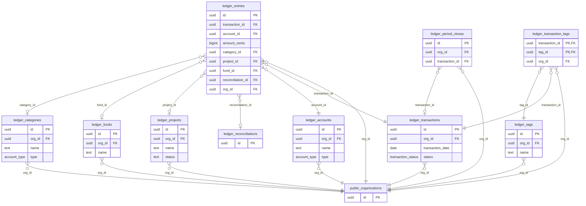

<details><summary><code>ledger.accounts</code> (7 columns)</summary>

| Column       | Type                     | Null | Default             | Key / reference                              |
| ------------ | ------------------------ | ---- | ------------------- | -------------------------------------------- |
| `id`         | uuid                     |      | `gen_random_uuid()` | PK                                           |
| `org_id`     | uuid                     |      |                     | → `public.organizations` (on delete cascade) |
| `name`       | text                     |      |                     |                                              |
| `type`       | account_type             |      |                     |                                              |
| `subtype`    | text                     | yes  |                     |                                              |
| `is_active`  | boolean                  |      | `true`              |                                              |
| `created_at` | timestamp with time zone |      | `now()`             |                                              |

Unique together: (org_id, name).

</details>

<details><summary><code>ledger.transactions</code> (11 columns)</summary>

| Column             | Type                     | Null | Default                               | Key / reference                              |
| ------------------ | ------------------------ | ---- | ------------------------------------- | -------------------------------------------- |
| `id`               | uuid                     |      | `gen_random_uuid()`                   | PK                                           |
| `org_id`           | uuid                     |      |                                       | → `public.organizations` (on delete cascade) |
| `transaction_date` | date                     |      |                                       |                                              |
| `posted_date`      | date                     | yes  |                                       |                                              |
| `description`      | text                     |      |                                       |                                              |
| `source`           | transaction_source       |      | `'manual'::ledger.transaction_source` |                                              |
| `status`           | transaction_status       |      | `'posted'::ledger.transaction_status` |                                              |
| `created_by`       | uuid                     | yes  |                                       |                                              |
| `created_at`       | timestamp with time zone |      | `now()`                               |                                              |
| `updated_at`       | timestamp with time zone |      | `now()`                               |                                              |
| `idempotency_key`  | text                     | yes  |                                       |                                              |

Unique together: (org_id, idempotency_key).

</details>

<details><summary><code>ledger.entries</code> (11 columns)</summary>

| Column              | Type                     | Null | Default             | Key / reference                                 |
| ------------------- | ------------------------ | ---- | ------------------- | ----------------------------------------------- |
| `id`                | uuid                     |      | `gen_random_uuid()` | PK                                              |
| `transaction_id`    | uuid                     |      |                     | → `ledger.transactions` (on delete cascade)     |
| `account_id`        | uuid                     |      |                     | → `ledger.accounts` (on delete no action)       |
| `amount_cents`      | bigint                   |      |                     |                                                 |
| `category_id`       | uuid                     | yes  |                     | → `ledger.categories` (on delete no action)     |
| `project_id`        | uuid                     | yes  |                     | → `ledger.projects` (on delete no action)       |
| `fund_id`           | uuid                     | yes  |                     | → `ledger.funds` (on delete no action)          |
| `memo`              | text                     | yes  |                     |                                                 |
| `created_at`        | timestamp with time zone |      | `now()`             |                                                 |
| `reconciliation_id` | uuid                     | yes  |                     | → `ledger.reconciliations` (on delete set null) |
| `org_id`            | uuid                     |      |                     | → `public.organizations` (on delete cascade)    |

</details>

<details><summary><code>ledger.categories</code> (6 columns)</summary>

| Column       | Type                     | Null | Default                          | Key / reference                              |
| ------------ | ------------------------ | ---- | -------------------------------- | -------------------------------------------- |
| `id`         | uuid                     |      | `gen_random_uuid()`              | PK                                           |
| `org_id`     | uuid                     |      |                                  | → `public.organizations` (on delete cascade) |
| `name`       | text                     |      |                                  |                                              |
| `type`       | account_type             |      | `'expense'::ledger.account_type` |                                              |
| `created_at` | timestamp with time zone |      | `now()`                          |                                              |
| `is_active`  | boolean                  |      | `true`                           |                                              |

Unique together: (org_id, name).

</details>

<details><summary><code>ledger.tags</code> (5 columns)</summary>

| Column       | Type                     | Null | Default             | Key / reference                              |
| ------------ | ------------------------ | ---- | ------------------- | -------------------------------------------- |
| `id`         | uuid                     |      | `gen_random_uuid()` | PK                                           |
| `org_id`     | uuid                     |      |                     | → `public.organizations` (on delete cascade) |
| `name`       | text                     |      |                     |                                              |
| `created_at` | timestamp with time zone |      | `now()`             |                                              |
| `is_active`  | boolean                  |      | `true`              |                                              |

Unique together: (org_id, name).

</details>

<details><summary><code>ledger.transaction_tags</code> (3 columns)</summary>

| Column           | Type | Null | Default | Key / reference                                |
| ---------------- | ---- | ---- | ------- | ---------------------------------------------- |
| `transaction_id` | uuid |      |         | PK → `ledger.transactions` (on delete cascade) |
| `tag_id`         | uuid |      |         | PK → `ledger.tags` (on delete cascade)         |
| `org_id`         | uuid |      |         | → `public.organizations` (on delete cascade)   |

</details>

<details><summary><code>ledger.funds</code> (6 columns)</summary>

| Column          | Type                     | Null | Default             | Key / reference                              |
| --------------- | ------------------------ | ---- | ------------------- | -------------------------------------------- |
| `id`            | uuid                     |      | `gen_random_uuid()` | PK                                           |
| `org_id`        | uuid                     |      |                     | → `public.organizations` (on delete cascade) |
| `name`          | text                     |      |                     |                                              |
| `is_restricted` | boolean                  |      | `false`             |                                              |
| `created_at`    | timestamp with time zone |      | `now()`             |                                              |
| `is_active`     | boolean                  |      | `true`              |                                              |

Unique together: (org_id, name).

</details>

<details><summary><code>ledger.projects</code> (6 columns)</summary>

| Column         | Type                     | Null | Default             | Key / reference                              |
| -------------- | ------------------------ | ---- | ------------------- | -------------------------------------------- |
| `id`           | uuid                     |      | `gen_random_uuid()` | PK                                           |
| `org_id`       | uuid                     |      |                     | → `public.organizations` (on delete cascade) |
| `name`         | text                     |      |                     |                                              |
| `budget_cents` | bigint                   |      | `0`                 |                                              |
| `status`       | text                     |      | `'active'::text`    |                                              |
| `created_at`   | timestamp with time zone |      | `now()`             |                                              |

Unique together: (org_id, name).

</details>

<details><summary><code>ledger.period_closes</code> (7 columns)</summary>

| Column             | Type                     | Null | Default             | Key / reference                               |
| ------------------ | ------------------------ | ---- | ------------------- | --------------------------------------------- |
| `id`               | uuid                     |      | `gen_random_uuid()` | PK                                            |
| `org_id`           | uuid                     |      |                     | → `public.organizations` (on delete cascade)  |
| `fiscal_year_end`  | date                     |      |                     |                                               |
| `transaction_id`   | uuid                     | yes  |                     | → `ledger.transactions` (on delete no action) |
| `net_income_cents` | bigint                   |      |                     |                                               |
| `closed_by`        | uuid                     |      |                     |                                               |
| `created_at`       | timestamp with time zone |      | `now()`             |                                               |

Unique together: (org_id, fiscal_year_end).

</details>

### 9.2 Planning: budgets, pledges, recurring transactions

`budgets` per account and period (optionally per fund or project); `pledges` and `pledge_payments`; `transaction_templates` (recurring when `frequency` and `next_due` are set; due ones are hub tasks) with `recurring_occurrences` (each due date posted or skipped once).

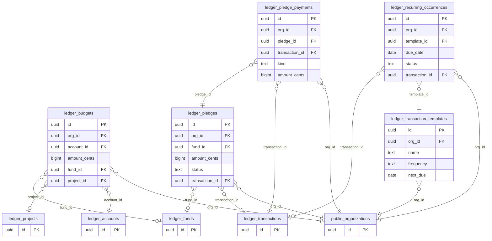

<details><summary><code>ledger.budgets</code> (10 columns)</summary>

| Column         | Type                     | Null | Default | Key / reference                              |
| -------------- | ------------------------ | ---- | ------- | -------------------------------------------- |
| `id`           | uuid                     |      |         | PK                                           |
| `org_id`       | uuid                     |      |         | → `public.organizations` (on delete cascade) |
| `account_id`   | uuid                     |      |         | → `ledger.accounts` (on delete cascade)      |
| `period_type`  | text                     |      |         |                                              |
| `period_start` | date                     |      |         |                                              |
| `amount_cents` | bigint                   |      |         |                                              |
| `created_at`   | timestamp with time zone |      | `now()` |                                              |
| `updated_at`   | timestamp with time zone |      | `now()` |                                              |
| `fund_id`      | uuid                     | yes  |         | → `ledger.funds` (on delete no action)       |
| `project_id`   | uuid                     | yes  |         | → `ledger.projects` (on delete no action)    |

Unique together: (org_id, account_id, period_type, period_start).

</details>

<details><summary><code>ledger.pledges</code> (12 columns)</summary>

| Column           | Type                     | Null | Default        | Key / reference                               |
| ---------------- | ------------------------ | ---- | -------------- | --------------------------------------------- |
| `id`             | uuid                     |      |                | PK                                            |
| `org_id`         | uuid                     |      |                | → `public.organizations` (on delete cascade)  |
| `donor_name`     | text                     |      |                |                                               |
| `fund_id`        | uuid                     | yes  |                | → `ledger.funds` (on delete no action)        |
| `amount_cents`   | bigint                   |      |                |                                               |
| `pledge_date`    | date                     |      |                |                                               |
| `expected_date`  | date                     | yes  |                |                                               |
| `note`           | text                     | yes  |                |                                               |
| `status`         | text                     |      | `'open'::text` |                                               |
| `transaction_id` | uuid                     | yes  |                | → `ledger.transactions` (on delete no action) |
| `created_by`     | uuid                     | yes  |                |                                               |
| `created_at`     | timestamp with time zone |      | `now()`        |                                               |

</details>

<details><summary><code>ledger.pledge_payments</code> (8 columns)</summary>

| Column           | Type                     | Null | Default           | Key / reference                               |
| ---------------- | ------------------------ | ---- | ----------------- | --------------------------------------------- |
| `id`             | uuid                     |      |                   | PK                                            |
| `org_id`         | uuid                     |      |                   | → `public.organizations` (on delete cascade)  |
| `pledge_id`      | uuid                     |      |                   | → `ledger.pledges` (on delete cascade)        |
| `transaction_id` | uuid                     |      |                   | → `ledger.transactions` (on delete no action) |
| `kind`           | text                     |      | `'payment'::text` |                                               |
| `amount_cents`   | bigint                   |      |                   |                                               |
| `paid_date`      | date                     |      |                   |                                               |
| `created_at`     | timestamp with time zone |      | `now()`           |                                               |

</details>

<details><summary><code>ledger.transaction_templates</code> (10 columns)</summary>

| Column        | Type                     | Null | Default       | Key / reference                              |
| ------------- | ------------------------ | ---- | ------------- | -------------------------------------------- |
| `id`          | uuid                     |      |               | PK                                           |
| `org_id`      | uuid                     |      |               | → `public.organizations` (on delete cascade) |
| `name`        | text                     |      |               |                                              |
| `description` | text                     |      |               |                                              |
| `lines`       | jsonb                    |      | `'[]'::jsonb` |                                              |
| `frequency`   | text                     | yes  |               |                                              |
| `next_due`    | date                     | yes  |               |                                              |
| `active`      | boolean                  |      | `true`        |                                              |
| `created_at`  | timestamp with time zone |      | `now()`       |                                              |
| `updated_at`  | timestamp with time zone |      | `now()`       |                                              |

</details>

<details><summary><code>ledger.recurring_occurrences</code> (7 columns)</summary>

| Column           | Type                     | Null | Default | Key / reference                                        |
| ---------------- | ------------------------ | ---- | ------- | ------------------------------------------------------ |
| `id`             | uuid                     |      |         | PK                                                     |
| `org_id`         | uuid                     |      |         | → `public.organizations` (on delete cascade)           |
| `template_id`    | uuid                     |      |         | → `ledger.transaction_templates` (on delete no action) |
| `due_date`       | date                     |      |         |                                                        |
| `status`         | text                     |      |         |                                                        |
| `transaction_id` | uuid                     | yes  |         | → `ledger.transactions` (on delete no action)          |
| `created_at`     | timestamp with time zone |      | `now()` |                                                        |

Unique together: (template_id, due_date).

</details>

### 9.3 Bank import, statement checks and OpenCharterApp dues

`import_batches` (a CSV/OFX/QFX file) create `bank_transactions` (deduplicated by FITID or hash), matched to transactions; `import_profiles` remember a bank's column mapping; `reconciliations` (statement checks) lock the entries they cover (`entries.reconciliation_id`).

**OpenCharterApp dues (S-18, Ledger `0011`).** `charter_import_settings` is each organization's choice (off by default; whose payments, the start date, the five accounts, the estimated card fee). `charter_drafts()` offers what `charter.api_payments` (Charter `0015`) has that isn't booked yet, one draft per day and channel. Posting goes through the usual transaction service. `charter_imports` keeps each posted or skipped draft and its transaction, and `charter_import_payments` its payments: a payment is covered once, refunds by amount.

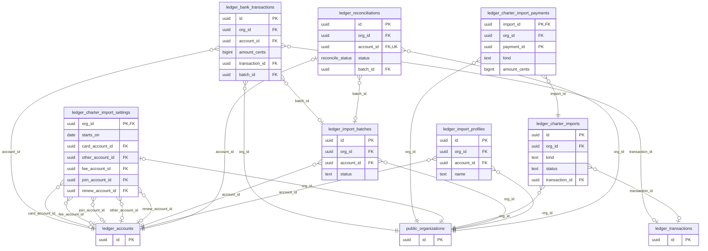

<details><summary><code>ledger.import_batches</code> (18 columns)</summary>

| Column                    | Type                     | Null | Default             | Key / reference                              |
| ------------------------- | ------------------------ | ---- | ------------------- | -------------------------------------------- |
| `id`                      | uuid                     |      | `gen_random_uuid()` | PK                                           |
| `org_id`                  | uuid                     |      |                     | → `public.organizations` (on delete cascade) |
| `account_id`              | uuid                     |      |                     | → `ledger.accounts` (on delete no action)    |
| `file_name`               | text                     |      |                     |                                              |
| `format`                  | import_format            |      |                     |                                              |
| `statement_start`         | date                     | yes  |                     |                                              |
| `statement_end`           | date                     | yes  |                     |                                              |
| `beginning_balance_cents` | bigint                   | yes  |                     |                                              |
| `ending_balance_cents`    | bigint                   | yes  |                     |                                              |
| `rows_total`              | integer                  |      | `0`                 |                                              |
| `rows_imported`           | integer                  |      | `0`                 |                                              |
| `rows_duplicate`          | integer                  |      | `0`                 |                                              |
| `rows_error`              | integer                  |      | `0`                 |                                              |
| `status`                  | text                     |      | `'active'::text`    |                                              |
| `created_by`              | uuid                     | yes  |                     |                                              |
| `created_at`              | timestamp with time zone |      | `now()`             |                                              |
| `updated_at`              | timestamp with time zone |      | `now()`             |                                              |
| `balance_mismatch_cents`  | bigint                   | yes  |                     |                                              |

</details>

<details><summary><code>ledger.import_profiles</code> (7 columns)</summary>

| Column       | Type                     | Null | Default             | Key / reference                              |
| ------------ | ------------------------ | ---- | ------------------- | -------------------------------------------- |
| `id`         | uuid                     |      | `gen_random_uuid()` | PK                                           |
| `org_id`     | uuid                     |      |                     | → `public.organizations` (on delete cascade) |
| `account_id` | uuid                     |      |                     | → `ledger.accounts` (on delete cascade)      |
| `name`       | text                     |      |                     |                                              |
| `mapping`    | jsonb                    |      | `'{}'::jsonb`       |                                              |
| `created_at` | timestamp with time zone |      | `now()`             |                                              |
| `updated_at` | timestamp with time zone |      | `now()`             |                                              |

Unique together: (account_id, name).

</details>

<details><summary><code>ledger.bank_transactions</code> (14 columns)</summary>

| Column           | Type                     | Null | Default             | Key / reference                                |
| ---------------- | ------------------------ | ---- | ------------------- | ---------------------------------------------- |
| `id`             | uuid                     |      | `gen_random_uuid()` | PK                                             |
| `org_id`         | uuid                     |      |                     | → `public.organizations` (on delete cascade)   |
| `account_id`     | uuid                     |      |                     | → `ledger.accounts` (on delete no action)      |
| `bank_date`      | date                     |      |                     |                                                |
| `description`    | text                     |      |                     |                                                |
| `amount_cents`   | bigint                   |      |                     |                                                |
| `external_id`    | text                     | yes  |                     |                                                |
| `fingerprint`    | text                     |      |                     |                                                |
| `transaction_id` | uuid                     | yes  |                     | → `ledger.transactions` (on delete set null)   |
| `raw`            | jsonb                    | yes  |                     |                                                |
| `created_at`     | timestamp with time zone |      | `now()`             |                                                |
| `batch_id`       | uuid                     | yes  |                     | → `ledger.import_batches` (on delete set null) |
| `needs_review`   | boolean                  |      | `false`             |                                                |
| `row_seq`        | integer                  | yes  |                     |                                                |

Unique together: (org_id, account_id, fingerprint).

</details>

<details><summary><code>ledger.reconciliations</code> (15 columns)</summary>

| Column                    | Type                     | Null | Default                                  | Key / reference                                  |
| ------------------------- | ------------------------ | ---- | ---------------------------------------- | ------------------------------------------------ |
| `id`                      | uuid                     |      | `gen_random_uuid()`                      | PK                                               |
| `org_id`                  | uuid                     |      |                                          | → `public.organizations` (on delete cascade)     |
| `account_id`              | uuid                     |      |                                          | unique → `ledger.accounts` (on delete no action) |
| `period_start`            | date                     |      |                                          |                                                  |
| `period_end`              | date                     |      |                                          |                                                  |
| `beginning_balance_cents` | bigint                   |      | `0`                                      |                                                  |
| `ending_balance_cents`    | bigint                   |      | `0`                                      |                                                  |
| `mode`                    | reconcile_mode           |      | `'full'::ledger.reconcile_mode`          |                                                  |
| `status`                  | reconcile_status         |      | `'in_progress'::ledger.reconcile_status` |                                                  |
| `batch_id`                | uuid                     | yes  |                                          | → `ledger.import_batches` (on delete set null)   |
| `created_by`              | uuid                     | yes  |                                          |                                                  |
| `completed_by`            | uuid                     | yes  |                                          |                                                  |
| `completed_at`            | timestamp with time zone | yes  |                                          |                                                  |
| `created_at`              | timestamp with time zone |      | `now()`                                  |                                                  |
| `updated_at`              | timestamp with time zone |      | `now()`                                  |                                                  |

</details>

<details><summary><code>ledger.charter_import_settings</code> — S-18: whether and how OpenCharterApp payments are offered for the books, per organization. (13 columns)</summary>

| Column             | Type                     | Null | Default            | Key / reference                                 |
| ------------------ | ------------------------ | ---- | ------------------ | ----------------------------------------------- |
| `org_id`           | uuid                     |      |                    | PK → `public.organizations` (on delete cascade) |
| `enabled`          | boolean                  |      | `false`            |                                                 |
| `scope`            | text                     |      | `'national'::text` |                                                 |
| `starts_on`        | date                     |      | `CURRENT_DATE`     |                                                 |
| `card_account_id`  | uuid                     | yes  |                    | → `ledger.accounts` (on delete set null)        |
| `other_account_id` | uuid                     | yes  |                    | → `ledger.accounts` (on delete set null)        |
| `fee_account_id`   | uuid                     | yes  |                    | → `ledger.accounts` (on delete set null)        |
| `join_account_id`  | uuid                     | yes  |                    | → `ledger.accounts` (on delete set null)        |
| `renew_account_id` | uuid                     | yes  |                    | → `ledger.accounts` (on delete set null)        |
| `fee_percent_bp`   | integer                  |      | `290`              |                                                 |
| `fee_fixed_cents`  | integer                  |      | `30`               |                                                 |
| `updated_by`       | uuid                     | yes  |                    |                                                 |
| `updated_at`       | timestamp with time zone |      | `now()`            |                                                 |

</details>

<details><summary><code>ledger.charter_imports</code> — S-18: each OpenCharterApp draft someone posted or skipped, with the transaction it became. (12 columns)</summary>

| Column           | Type                     | Null | Default             | Key / reference                              |
| ---------------- | ------------------------ | ---- | ------------------- | -------------------------------------------- |
| `id`             | uuid                     |      | `gen_random_uuid()` | PK                                           |
| `org_id`         | uuid                     |      |                     | → `public.organizations` (on delete cascade) |
| `day`            | date                     |      |                     |                                              |
| `channel`        | text                     |      |                     |                                              |
| `kind`           | text                     |      |                     |                                              |
| `status`         | text                     |      |                     |                                              |
| `transaction_id` | uuid                     | yes  |                     | → `ledger.transactions` (on delete set null) |
| `payment_count`  | integer                  |      |                     |                                              |
| `gross_cents`    | bigint                   |      |                     |                                              |
| `fee_cents`      | bigint                   |      | `0`                 |                                              |
| `decided_by`     | uuid                     | yes  |                     |                                              |
| `decided_at`     | timestamp with time zone |      | `now()`             |                                              |

</details>

<details><summary><code>ledger.charter_import_payments</code> — S-18: which OpenCharterApp payments (and refunded amounts) each import covered. (5 columns)</summary>

| Column         | Type   | Null | Default | Key / reference                                   |
| -------------- | ------ | ---- | ------- | ------------------------------------------------- |
| `import_id`    | uuid   |      |         | PK → `ledger.charter_imports` (on delete cascade) |
| `org_id`       | uuid   |      |         | → `public.organizations` (on delete cascade)      |
| `payment_id`   | uuid   |      |         | PK unique                                         |
| `kind`         | text   |      |         |                                                   |
| `amount_cents` | bigint |      |         |                                                   |

</details>

### 9.4 Administration

`org_settings` (type, currency, fiscal year, terminology, two-step sign-in requirement), `member_roles` (treasurer), `user_preferences`, `legal_acceptances` (self-hosted terms acceptance), `audit_log`, `deleted_organizations` (tombstones), `ai_usage` (the retired AI import's usage log).

```mermaid
erDiagram
    ledger_org_settings {
        uuid org_id PK,FK
    }
    ledger_member_roles {
        uuid org_id PK,FK
        uuid user_id PK,FK
        text role
    }
    ledger_user_preferences {
        uuid user_id PK,FK
    }
    ledger_legal_acceptances {
        uuid id PK
        uuid user_id FK
    }
    ledger_audit_log {
        uuid id PK
        uuid org_id FK
        text kind
    }
    ledger_deleted_organizations {
        uuid id PK
        text name
    }
    ledger_ai_usage {
        uuid id PK
        uuid org_id FK
        text kind
    }
    auth_users {
        uuid id PK
    }
    public_organizations {
        uuid id PK
    }
    ledger_ai_usage }o--|| public_organizations : "org_id"
    ledger_audit_log }o--|| public_organizations : "org_id"
    ledger_legal_acceptances }o--|| auth_users : "user_id"
    ledger_member_roles }o--|| auth_users : "user_id"
    ledger_member_roles }o--|| public_organizations : "org_id"
    ledger_org_settings |o--|| public_organizations : "org_id"
    ledger_user_preferences |o--|| auth_users : "user_id"
```

<details><summary><code>ledger.org_settings</code> (12 columns)</summary>

| Column                    | Type                     | Null | Default                       | Key / reference                                 |
| ------------------------- | ------------------------ | ---- | ----------------------------- | ----------------------------------------------- |
| `org_id`                  | uuid                     |      |                               | PK → `public.organizations` (on delete cascade) |
| `org_type`                | org_type                 |      | `'business'::ledger.org_type` |                                                 |
| `currency`                | text                     |      | `'USD'::text`                 |                                                 |
| `fiscal_year_start_month` | smallint                 |      | `1`                           |                                                 |
| `terminology`             | text                     |      | `'simplest'::text`            |                                                 |
| `term_overrides`          | jsonb                    |      | `'{}'::jsonb`                 |                                                 |
| `timezone`                | text                     |      | `'America/Chicago'::text`     |                                                 |
| `ai_pdf_enabled`          | boolean                  |      | `false`                       |                                                 |
| `books_locked_through`    | date                     | yes  |                               |                                                 |
| `require_mfa`             | boolean                  |      | `false`                       |                                                 |
| `recurring_mode`          | text                     |      | `'drafts'::text`              |                                                 |
| `updated_at`              | timestamp with time zone |      | `now()`                       |                                                 |

</details>

<details><summary><code>ledger.member_roles</code> (4 columns)</summary>

| Column       | Type                     | Null | Default | Key / reference                                 |
| ------------ | ------------------------ | ---- | ------- | ----------------------------------------------- |
| `org_id`     | uuid                     |      |         | PK → `public.organizations` (on delete cascade) |
| `user_id`    | uuid                     |      |         | PK → `auth.users` (on delete cascade)           |
| `role`       | text                     |      |         |                                                 |
| `created_at` | timestamp with time zone |      | `now()` |                                                 |

</details>

<details><summary><code>ledger.user_preferences</code> (4 columns)</summary>

| Column           | Type                     | Null | Default            | Key / reference                       |
| ---------------- | ------------------------ | ---- | ------------------ | ------------------------------------- |
| `user_id`        | uuid                     |      |                    | PK → `auth.users` (on delete cascade) |
| `terminology`    | text                     |      | `'simplest'::text` |                                       |
| `term_overrides` | jsonb                    |      | `'{}'::jsonb`      |                                       |
| `updated_at`     | timestamp with time zone |      | `now()`            |                                       |

</details>

<details><summary><code>ledger.legal_acceptances</code> (5 columns)</summary>

| Column          | Type                     | Null | Default             | Key / reference                    |
| --------------- | ------------------------ | ---- | ------------------- | ---------------------------------- |
| `id`            | uuid                     |      | `gen_random_uuid()` | PK                                 |
| `user_id`       | uuid                     |      |                     | → `auth.users` (on delete cascade) |
| `document_type` | text                     |      |                     |                                    |
| `version`       | text                     |      |                     |                                    |
| `accepted_at`   | timestamp with time zone |      | `now()`             |                                    |

Unique together: (user_id, document_type, version).

</details>

<details><summary><code>ledger.audit_log</code> (11 columns)</summary>

| Column            | Type                     | Null | Default             | Key / reference                              |
| ----------------- | ------------------------ | ---- | ------------------- | -------------------------------------------- |
| `id`              | uuid                     |      | `gen_random_uuid()` | PK                                           |
| `org_id`          | uuid                     |      |                     | → `public.organizations` (on delete cascade) |
| `user_id`         | uuid                     | yes  |                     |                                              |
| `action`          | text                     |      |                     |                                              |
| `entity`          | text                     |      |                     |                                              |
| `entity_id`       | uuid                     | yes  |                     |                                              |
| `before`          | jsonb                    | yes  |                     |                                              |
| `after`           | jsonb                    | yes  |                     |                                              |
| `created_at`      | timestamp with time zone |      | `now()`             |                                              |
| `kind`            | text                     |      | `'change'::text`    |                                              |
| `recorded_change` | jsonb                    | yes  |                     |                                              |

</details>

<details><summary><code>ledger.deleted_organizations</code> (5 columns)</summary>

| Column       | Type                     | Null | Default | Key / reference |
| ------------ | ------------------------ | ---- | ------- | --------------- |
| `id`         | uuid                     |      |         | PK              |
| `org_id`     | uuid                     |      |         |                 |
| `name`       | text                     |      |         |                 |
| `deleted_by` | uuid                     |      |         |                 |
| `deleted_at` | timestamp with time zone |      | `now()` |                 |

</details>

<details><summary><code>ledger.ai_usage</code> (7 columns)</summary>

| Column       | Type                     | Null | Default               | Key / reference                              |
| ------------ | ------------------------ | ---- | --------------------- | -------------------------------------------- |
| `id`         | uuid                     |      | `gen_random_uuid()`   | PK                                           |
| `org_id`     | uuid                     |      |                       | → `public.organizations` (on delete cascade) |
| `user_id`    | uuid                     |      |                       |                                              |
| `kind`       | text                     |      | `'pdf_extract'::text` |                                              |
| `page_count` | integer                  | yes  |                       |                                              |
| `ok`         | boolean                  |      | `false`               |                                              |
| `created_at` | timestamp with time zone |      | `now()`               |                                              |

</details>

---

## 10. Integration views (api_*)

Read-only, `security_invoker = true` (the reader's own row security applies). Columns are only ever added at the end. Documented in each app's `INTEGRATION.md`.

| View                          | Columns                                                                                                                                  | Read by                             |
| ----------------------------- | ---------------------------------------------------------------------------------------------------------------------------------------- | ----------------------------------- |
| `charter.api_units`           | id, org_id, parent_id, type, name, slug, status, created_at                                                                              | Hub (unit count), other apps        |
| `charter.api_board_seats`     | id, org_id, unit_id, unit_name, seat_id, title, seat_number, required, holder_name, starts_on, planned_end                               | Hub dashboard (officers)            |
| `charter.api_unit_count`      | org_id, units                                                                                                                            | Hub (pricing groundwork), dashboard |
| `charter.api_tasks`           | org_id, unit_id, kind (join_request, vacant_seat, renewals_due), title, unit_name, due_on, item_id, link                                 | Hub dashboard (Your tasks)          |
| `charter.api_member_summary`  | org_id, current_members, pending_requests, renewals_due                                                                                  | Hub dashboard (tiles)               |
| `board.api_meetings`          | id, org_id, title, meeting_date, start_time, location, status, minutes_status, motion_count, created_at                                  | Hub dashboard, `AddToBoardPackage`  |
| `board.api_decisions`         | id, org_id, meeting_id, meeting_title, meeting_date, motion_text, outcome, votes_yes, votes_no, votes_abstain, votes_recused, decided_at | Hub dashboard                       |
| `board.api_action_items`      | id, org_id, title, assignee_id, due_date, status, meeting_id, meeting_title, link, created_at                                            | Hub dashboard (Your tasks)          |
| `ledger.api_budgets`          | id, org_id, account_id, account_name, account_type, period_type, period_start, period_end, amount_cents, fund_id, project_id, updated_at | Other apps                          |
| `ledger.api_period_summaries` | org_id, month, currency, revenue_cents, expense_cents, net_cents, transaction_count                                                      | Hub dashboard (money)               |
| `ledger.api_tasks`            | org_id, kind (recurring_due), title, due_on, item_id, link                                                                               | Hub dashboard (Your tasks)          |

RPCs for other apps: `board.add_report_to_meeting` (S-13). Trigger-only sync: `charter.appointments_to_board`, `charter.appointment_from_board`, `charter.end_appointment_from_board`, `board.sync_term_from_charter`, `board.terms_charter_sync` (S-14, S-24).

---

## 11. Logical links (not foreign keys)

| From                                                              | To                               | Why not a foreign key                                                                               |
| ----------------------------------------------------------------- | -------------------------------- | --------------------------------------------------------------------------------------------------- |
| `board.terms.source_id` (when `source = 'charter'`)               | `charter.appointments.id`        | Cross-app: Board must work without Charter                                                          |
| `charter.chapter_board_requests.board_org_id`                     | `public.organizations.id`        | It is a foreign key (to the core); listed here because it's how a chapter finds its board           |
| `public.organizations.source_ref` (when `source_app = 'charter'`) | `charter.units.id`               | The core can't depend on an app schema                                                              |
| `charter.*.org_id`                                                | `public.organizations.id`        | Kept as a plain column on most Charter tables (they predate the suite); core row security guards it |
| `public.email_outbox.data->>'link'`                               | A path in the app named by `app` | Templates build the full address from the suite URLs                                                |
| `ledger` demo dues                                                | `charter.payments`               | The demo books Charter's payments; S-18 will add a real import with a link back                     |
| `api_*` views' `org_id`                                           | `public.organizations.id`        | Views have no keys; filter by it                                                                    |

---

## 12. Conventions

- Ids are `uuid` (`gen_random_uuid()` as a fallback; Ledger generates its own). Money is `bigint` cents (`amount_cents`) or integer minor units (`amount_minor`), never floats. Times are `timestamptz` in UTC; calendar days are `date`.
- Every table has row-level security; most writes go through policies that call `public.can_write(org, app)`; multi-step or privileged writes go through `security definer` functions with `search_path = ''`.
- Deleting an organization deletes its rows in every app (`on delete cascade`); audit logs that must outlive it don't reference it.
- New tables, columns and foreign keys are added by a new migration (never by editing an applied one), and this map is regenerated (`docs/tools/dbmap/`).
