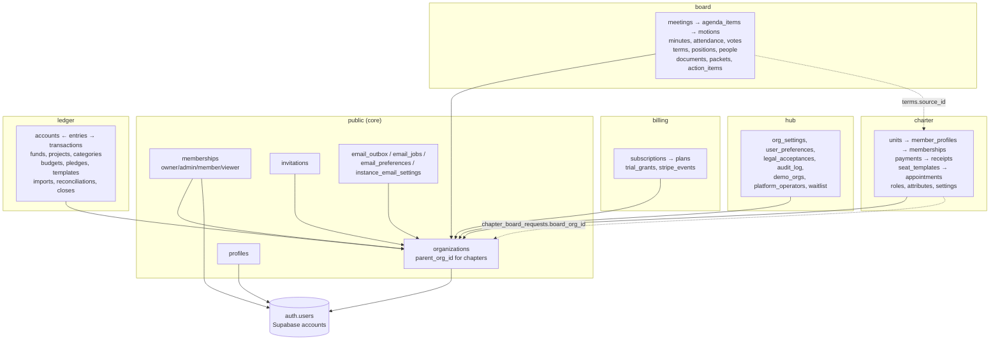
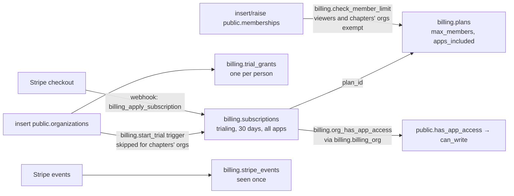
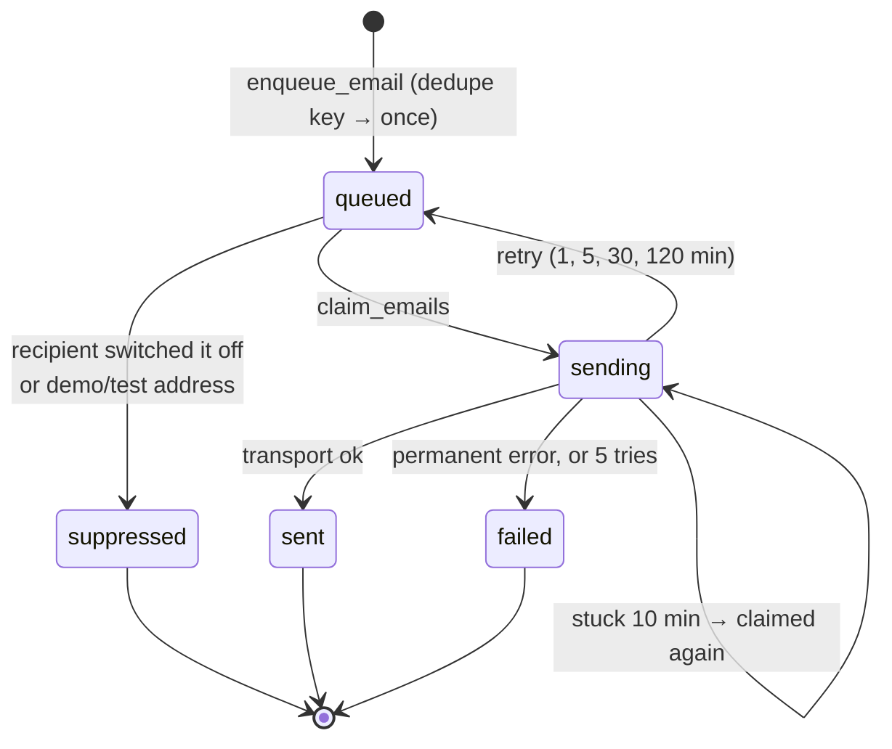

# Database map

Every table in the suite's database, grouped by what it's for, with how the tables connect. Use it to answer questions like "how do we track billing?" or "where does a dues payment end up?": find the domain below, read the diagram, then open the column list.

Generated from the schema built by every repo's migrations (core `0001`–`0006`, hub `0001`–`0004`, Charter `0001`–`0007`, Board `0001`–`0007`, Ledger `0001`–`0003`) on 2026-11-12: every relationship in a diagram is a real foreign key, and every column list is the real table. Architecture and the reasons behind it: [`architecture.md`](architecture.md). Charter's hand-written table map with write paths: [`charter/tables.md`](charter/tables.md).

**How to read the diagrams** (Mermaid entity-relationship diagrams):

- A box is a table, named `schema_table` (for example `billing_subscriptions` is `billing.subscriptions`). It lists the primary key (`PK`), foreign keys (`FK`), unique columns (`UK`) and the columns you most often need; the full list is in the collapsible section under each diagram.
- A box with only an `id` is a table from another domain that this one points to (for example `public_organizations`).
- A line is a foreign key, labelled with the column. `}o--||` means "many rows here point to exactly one row there"; `}o--o|` means the column can be empty; `|o--||` means at most one row here per row there (one-to-one).
- Links that aren't foreign keys (between apps, or by convention) are listed in [Logical links](#logical-links-not-foreign-keys).

**Contents**

1. [The whole database at a glance](#1-the-whole-database-at-a-glance)
2. [Follow a question](#2-follow-a-question)
3. [Core: organizations, people, invitations](#3-core-organizations-people-invitations) (`public`)
4. [Hub](#4-hub) (`hub`)
5. [Billing](#5-billing) (`billing`)
6. [Email](#6-email) (`public`)
7. [OpenCharterApp](#7-opencharterapp) (`charter`): organization tree and settings · roles and permissions · members and membership · money · governance
8. [OpenBoardApp](#8-openboardapp) (`board`): people and terms · meetings and votes · records
9. [OpenLedgerApp](#9-openledgerapp) (`ledger`): the books · planning · bank and statement checks · administration
10. [Integration views (api_*)](#10-integration-views-api_)
11. [Logical links (not foreign keys)](#11-logical-links-not-foreign-keys)
12. [Conventions](#12-conventions)

---

## 1. The whole database at a glance

> **Diagram description:** Supabase's `auth.users` holds the accounts. The core (`public`) holds organizations (with `parent_org_id` for chapters' organizations), memberships with their role, profiles, invitations and the email tables. The `hub`, `billing`, `charter`, `board` and `ledger` schemas all point to `public.organizations`. Two dotted lines are cross-app links that aren't foreign keys: Board's mirrored terms point to Charter appointments, and Charter's chapter requests point to the chapter's own organization.

Tables per schema: `public` 9, `hub` 8, `billing` 4, `charter` 34, `board` 21, `ledger` 25 (plus `ops.schema_migrations`).

---

## 2. Follow a question

| Question                                            | Start at                                                                                     | Then                                                                                                                                                                                                                                                                                           |
| --------------------------------------------------- | -------------------------------------------------------------------------------------------- | ---------------------------------------------------------------------------------------------------------------------------------------------------------------------------------------------------------------------------------------------------------------------------------------------- |
| **How do we track billing?**                        | `billing.subscriptions` (one per organization)                                               | `billing.plans` (limits), `billing.trial_grants` (one trial per person), `billing.stripe_events` (webhook idempotency), `public.organizations.parent_org_id` (a chapter uses its parent's subscription), `hub.org_settings` (billing contact), `public.instance_settings.billing_enabled` (§5) |
| **Who belongs to an organization, with what role?** | `public.memberships`                                                                         | `public.profiles` (name), `public.invitations` (pending), app overlays: `charter.role_assignments`, `board.officers`, `ledger.member_roles` (§3, §7, §8, §9)                                                                                                                                   |
| **Where does a dues payment end up?**               | `charter.payments`                                                                           | `charter.memberships` (what it paid for), `charter.receipts` (+ `receipt_counters`), `charter.gateway_connections` (whose Stripe), `charter.webhook_events`; in Ledger (demo, and S-18 later): `ledger.transactions` + `ledger.entries` on Membership Dues (§7.4)                              |
| **Who is on a board?**                              | `charter.appointments` (Charter's officers)                                                  | `charter.seat_templates`, `seat_terms`; mirrored to `board.terms` (`source = 'charter'`), `board.positions`, `board.officers` (app access) (§7.5, §8.1)                                                                                                                                        |
| **What happened at a meeting?**                     | `board.meetings`                                                                             | `agenda_items`, `attendance`, `motions` (+ `vote_electorate`, `member_votes` for live votes), `minutes`, `action_items`, `packets` (§8.2)                                                                                                                                                      |
| **What emails are waiting or were sent?**           | `public.email_outbox`                                                                        | `email_jobs` (what queues them), `email_preferences` (opt-outs), `hub.user_preferences` (billing/activity opt-outs), `instance_email_settings` (self-hosted SMTP) (§6)                                                                                                                         |
| **How is a ledger balanced?**                       | `ledger.transactions`                                                                        | `ledger.entries` (debits positive, credits negative, sum to zero per transaction), `accounts`, `categories`, `funds`, `projects` (§9.1)                                                                                                                                                        |
| **Is a month closed / reconciled?**                 | `ledger.period_closes`, `ledger.reconciliations`                                             | `ledger.entries.reconciliation_id`, `bank_transactions`, `import_batches` (§9.3)                                                                                                                                                                                                               |
| **Which chapters use OpenBoardApp?**                | `charter.chapter_board_requests`                                                             | `public.organizations` where `parent_org_id` is the national and `source_app = 'charter'` (§7.1)                                                                                                                                                                                               |
| **Who changed what?**                               | `hub.audit_log` (core tables), `charter.audit_events`, `board.audit_log`, `ledger.audit_log` | Each is append-only, written by triggers                                                                                                                                                                                                                                                       |
| **What does the hub dashboard read?**               | The `api_*` views                                                                            | §10                                                                                                                                                                                                                                                                                            |

---

## 3. Core: organizations, people, invitations

Schema `public`, from `db/core` (every repo vendors it). The organization is the one id every app uses; memberships give people a core role in it. A chapter's own organization (S-24) has `parent_org_id` (one level only, enforced by a trigger) and `source_app` / `source_ref` (the Charter unit it came from). `instance_settings` is one row: `billing_enabled` (true only on the hosted suite) and `hub_url`.

Key functions: `create_organization`, `rename_organization`, `delete_organization`, `transfer_ownership`, `create_invitation` / `get_invitation` / `accept_invitation` / `revoke_invitation`, `org_member_directory`, `is_member`, `has_role`, `can_write`, `has_app_access`, `set_organization_preferences`, `_create_child_organization` (apps' definer functions only), `is_member_of_child`.

<!--GEN:core-->

---

## 4. Hub

Schema `hub` (not exposed to the Data API; reached through definer functions). Hosted only. `instance` marks the environment (`staging` enables demo tools); `audit_log` records changes to core tables (who did what, old and new values) and survives the organization's deletion; `demo_orgs` gives demo organizations a long trial and lets the reset find them.

<!--GEN:hub-->

---

## 5. Billing

Schema `billing` (not exposed). One subscription per organization (`org_id` is the primary key). Written only by the Stripe webhook (service role) and the triggers below; read through `public.get_org_billing`.

> **Diagram description:** Creating an organization starts a 30-day trial subscription for all apps (skipped for a chapter's organization) and records the creator's one trial. A Stripe checkout's webhook writes the subscription. The subscription's plan sets the editor limit, which a trigger checks when memberships are added or raised (viewers and chapters' organizations are exempt). Access for every app is decided from the subscription of the billing organization (a chapter uses its parent's). Every Stripe event id is recorded once so a webhook is never applied twice.

Statuses: `trialing`, `active`, `past_due`, `canceled`, `unpaid`, `incomplete`, `expired`. Functions: `get_org_billing`, `billing_plans`, `billing_member_count`, `billing_parent_org`, `billing_customer_for_org`, `billing_set_customer`, `billing_record_event`, `billing_forget_event`, `billing_apply_subscription`, `billing_set_status`; internal: `org_has_app_access`, `billing_org`, `start_trial`, `check_member_limit`, `trial_days`, `trial_member_limit`.

<!--GEN:billing-->

---

## 6. Email

In the core (`0005_core_email.sql`), so it works hosted and self-hosted. Browsers can't read the outbox; people manage only their own preferences (`get_email_preferences` / `set_email_preferences`). The sender uses `run_email_jobs`, `claim_emails`, `finish_email`; apps' jobs use `enqueue_email`.

> **Diagram description:** An email starts queued (a de-duplication key makes sure the same reminder is only queued once). It may be suppressed (the recipient switched that kind of email off, or it's a demo or test address). The sender claims it (sending), and it ends sent, goes back to queued for a retry with back-off, or fails after a permanent error or five tries. A row stuck in sending for ten minutes is claimed again.

<!--GEN:email-->

---

## 7. OpenCharterApp

Schema `charter`. Every table has `org_id` (the customer, `public.organizations`) and, where it belongs to a national, region or chapter, `unit_id → charter.units` (the top unit has the same id as the organization). Charter's own permissions guard units inside the organization. Hand-written details (write paths, which RPC writes what): [`charter/tables.md`](charter/tables.md); domains: [`charter/data-domains.md`](charter/data-domains.md).

### 7.1 Organization tree, settings, setup, audit

`units` is the tree (`parent_id`, `ancestor_ids` kept by trigger, `type`: national, region, chapter, standalone). `org_settings` stores every setting per unit with a `mode` (inherit, override, locked) resolved by `charter.effective_setting`. `chapter_board_requests` tracks chapters asking to use OpenBoardApp (S-24), with `board_org_id` once approved. `audit_events` is Charter's append-only history.

<!--GEN:charter-org-->

### 7.2 Roles and permissions

Roles are bundles of permission keys; an assignment is (person, role, unit) and applies to that unit and everything below. Core owner/admin = Charter `org_admin` at the top unit. Checked by `charter.has_permission(user, permission, unit)` and `charter.permitted_units(permission)`.

<!--GEN:charter-access-->

### 7.3 Members and membership

`member_profiles` is a person's record in one unit (with or without an account; `home_of` points to the national membership in the home-chapter model). `memberships` holds a level (`membership_tiers`), a term (`tier_terms`: length and price), `status`, `paid_through` and, in the home-chapter model, `home_org_id`. `pricing_rules` change the price by member fields (for example rank); `attribute_*` are the organization's own member and chapter fields; `membership_events` and `affiliation_history` are histories.

<!--GEN:charter-members-->

### 7.4 Money: payments and receipts

`payments` (purpose join/renew, `amount_minor`, `status`, `method`, `received_on`, gateway reference) belong to a membership and a profile; each paid payment gets a `receipts` row numbered by `receipt_counters`. `gateway_connections` is the organization's own Stripe (or manual) connection; `gateway_secrets` holds its keys encrypted; `webhook_events` makes webhooks idempotent.

<!--GEN:charter-money-->

### 7.5 Governance: seats and appointments

`seat_templates` define seats (defined at a unit, `scope`: self, chapters, or both; required, count, term length, optional role). `appointments` put a member profile in a seat in a unit (start, planned end, end, reason) and may create a `role_assignment`. `seat_title_overrides` rename a seat for one unit; `seat_terms` set a unit's own term rules; `seat_contacts` give a seat a contact email. Appointments sync to OpenBoardApp's terms (S-14).

<!--GEN:charter-gov-->

---

## 8. OpenBoardApp

Schema `board`. Every table has `org_id → public.organizations` (a national's or a chapter's own). Same-organization triggers stop a row pointing to another organization's parent row; approved minutes, closed votes and distributed packets are locked.

### 8.1 People, positions, terms, committees

`terms` are board seats over time (`person_name`, an account `user_id` or a `people` record, `position`, start and end). `source = 'charter'` / `source_id` mark a term mirrored from a Charter appointment. `officers` (chair, secretary, treasurer) give app permissions; `positions` define titles and term lengths; `committees` and `committee_members` are committees.

<!--GEN:board-people-->

### 8.2 Meetings, agendas, votes, minutes, action items

A `meeting` has `agenda_items` (some are vote items with a proposed motion and an optional decision rule), `attendance`, `motions` (with counts and outcome; live votes freeze the electorate in `vote_electorate` and record ballots in `member_votes`), `minutes` (versions; approved ones are locked) and `action_items` (assignee, due date, status). `meeting_templates` hold a reusable agenda.

<!--GEN:board-meetings-->

### 8.3 Documents, packets, letterhead, audit

`documents` with `document_versions` (files in `board-files/<org>/…`; reports from Charter and Ledger arrive here through `add_report_to_meeting`), `packets` (generated board packets per meeting, versioned, distributed ones locked), `letterheads` (the organization's stationery), `audit_log` (append-only).

<!--GEN:board-records-->

---

## 9. OpenLedgerApp

Schema `ledger`. Every table has `org_id → public.organizations`. Posted transactions are immutable (void and re-post); every change and its history entry are written together (`audited_write`).

### 9.1 The books

A `transaction` has two or more `entries` (each on an `account`, `amount_cents` positive for debits and negative for credits; they sum to zero), optionally tagged with a `category`, `fund` (restricted or not) and `project`, plus `tags`. `period_closes` record month and year-end closes (the books lock).

<!--GEN:ledger-books-->

### 9.2 Planning: budgets, pledges, recurring transactions

`budgets` per account and period (optionally per fund or project); `pledges` and `pledge_payments`; `transaction_templates` (recurring when `frequency` and `next_due` are set; due ones are hub tasks) with `recurring_occurrences` (each due date posted or skipped once).

<!--GEN:ledger-planning-->

### 9.3 Bank import and statement checks

`import_batches` (a CSV/OFX/QFX file) create `bank_transactions` (deduplicated by FITID or hash), matched to transactions; `import_profiles` remember a bank's column mapping; `reconciliations` (statement checks) lock the entries they cover (`entries.reconciliation_id`).

<!--GEN:ledger-bank-->

### 9.4 Administration

`org_settings` (type, currency, fiscal year, terminology, two-step sign-in requirement), `member_roles` (treasurer), `user_preferences`, `legal_acceptances` (self-hosted terms acceptance), `audit_log`, `deleted_organizations` (tombstones), `ai_usage` (the retired AI import's usage log).

<!--GEN:ledger-admin-->

---

## 10. Integration views (api_*)

Read-only, `security_invoker = true` (the reader's own row security applies). Columns are only ever added at the end. Documented in each app's `INTEGRATION.md`.

| View                          | Columns                                                                                                                                  | Read by                             |
| ----------------------------- | ---------------------------------------------------------------------------------------------------------------------------------------- | ----------------------------------- |
| `charter.api_units`           | id, org_id, parent_id, type, name, slug, status, created_at                                                                              | Hub (unit count), other apps        |
| `charter.api_board_seats`     | id, org_id, unit_id, unit_name, seat_id, title, seat_number, required, holder_name, starts_on, planned_end                               | Hub dashboard (officers)            |
| `charter.api_unit_count`      | org_id, units                                                                                                                            | Hub (pricing groundwork), dashboard |
| `charter.api_tasks`           | org_id, unit_id, kind (join_request, vacant_seat, renewals_due), title, unit_name, due_on, item_id, link                                 | Hub dashboard (Your tasks)          |
| `charter.api_member_summary`  | org_id, current_members, pending_requests, renewals_due                                                                                  | Hub dashboard (tiles)               |
| `board.api_meetings`          | id, org_id, title, meeting_date, start_time, location, status, minutes_status, motion_count, created_at                                  | Hub dashboard, `AddToBoardPackage`  |
| `board.api_decisions`         | id, org_id, meeting_id, meeting_title, meeting_date, motion_text, outcome, votes_yes, votes_no, votes_abstain, votes_recused, decided_at | Hub dashboard                       |
| `board.api_action_items`      | id, org_id, title, assignee_id, due_date, status, meeting_id, meeting_title, link, created_at                                            | Hub dashboard (Your tasks)          |
| `ledger.api_budgets`          | id, org_id, account_id, account_name, account_type, period_type, period_start, period_end, amount_cents, fund_id, project_id, updated_at | Other apps                          |
| `ledger.api_period_summaries` | org_id, month, currency, revenue_cents, expense_cents, net_cents, transaction_count                                                      | Hub dashboard (money)               |
| `ledger.api_tasks`            | org_id, kind (recurring_due), title, due_on, item_id, link                                                                               | Hub dashboard (Your tasks)          |

RPCs for other apps: `board.add_report_to_meeting` (S-13). Trigger-only sync: `charter.appointments_to_board`, `charter.appointment_from_board`, `charter.end_appointment_from_board`, `board.sync_term_from_charter`, `board.terms_charter_sync` (S-14, S-24).

---

## 11. Logical links (not foreign keys)

| From                                                              | To                               | Why not a foreign key                                                                               |
| ----------------------------------------------------------------- | -------------------------------- | --------------------------------------------------------------------------------------------------- |
| `board.terms.source_id` (when `source = 'charter'`)               | `charter.appointments.id`        | Cross-app: Board must work without Charter                                                          |
| `charter.chapter_board_requests.board_org_id`                     | `public.organizations.id`        | It is a foreign key (to the core); listed here because it's how a chapter finds its board           |
| `public.organizations.source_ref` (when `source_app = 'charter'`) | `charter.units.id`               | The core can't depend on an app schema                                                              |
| `charter.*.org_id`                                                | `public.organizations.id`        | Kept as a plain column on most Charter tables (they predate the suite); core row security guards it |
| `public.email_outbox.data->>'link'`                               | A path in the app named by `app` | Templates build the full address from the suite URLs                                                |
| `ledger` demo dues                                                | `charter.payments`               | The demo books Charter's payments; S-18 will add a real import with a link back                     |
| `api_*` views' `org_id`                                           | `public.organizations.id`        | Views have no keys; filter by it                                                                    |

---

## 12. Conventions

- Ids are `uuid` (`gen_random_uuid()` as a fallback; Ledger generates its own). Money is `bigint` cents (`amount_cents`) or integer minor units (`amount_minor`), never floats. Times are `timestamptz` in UTC; calendar days are `date`.
- Every table has row-level security; most writes go through policies that call `public.can_write(org, app)`; multi-step or privileged writes go through `security definer` functions with `search_path = ''`.
- Deleting an organization deletes its rows in every app (`on delete cascade`); audit logs that must outlive it don't reference it.
- New tables, columns and foreign keys are added by a new migration (never by editing an applied one), and this map is regenerated (`docs/tools/dbmap/`).
